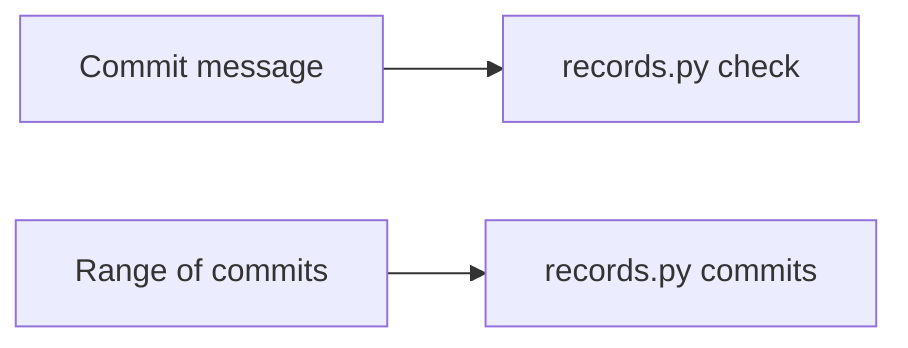
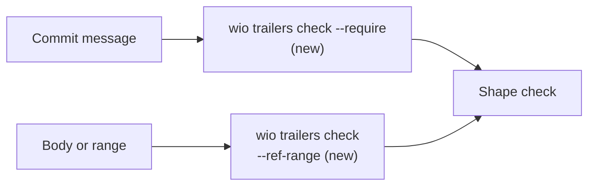

<!-- wio
id = "570wa9"
template = "feature.parent"
roots = ["@descendants"]
depends_on = []
-->

# wio trailers check

## Purpose

A record that no longer holds is found only when a reader trips over it, so
commits and pull requests need a check that refuses a wrong record when it is
written and tolerates an old one afterwards.

## Goals

- A commit message whose records do not hold against the live config, or that
  has no record when it needs one, is refused at commit time.
- A pull request body or a range of commits is checked afterwards without
  failing on a record that was valid when it was written.
- A record that the configured reader cannot see is reported, never ignored.

## Non-Goals

- Checking that a Work or an item id of a past commit still exists, because
  Works are deleted later and readers ignore unknown ids.

## Assumptions

### A-1

A project calls the commit-time check from a commit-msg hook and the later check
from CI, as
[concepts.md](../../../../../docs/concepts.md#records) describes, which is why
the two modes judge a name differently.

## Mechanisms

- **Shape check** — the checks of a record's own form that both modes share,
  with the report of a `Wio-` line the configured reader cannot see.
- **Commit-time mode** — the `--require` mode, which adds the checks against the
  live config and the Works.
- **Afterwards mode** — the mode without `--require`, for a body or a range.

## Visuals

The Before diagram is drawn from `9bfd62b` on `main`; the After diagram is the
design this Work delivers, and its `--ref-range` is provisional, as the parent's
A-3 says.

### Before

### After

## Acceptance criteria

### **AC-1** The same record is judged by the time of the check

#### A stage the config does not have

- **Given** a message whose well-formed record has `Wio-Stage: nosuch`.
- **When** `wio trailers check --require` reads it, and then
  `wio trailers check` reads it.
- **Then** the first exits 1 and names the stage, and the second exits 0 and
  warns about the same stage.

### **AC-2** A range tolerates what the config no longer has

#### A commit whose stage the config no longer lists

- **Given** a range with a commit whose well-formed record has
  `Wio-Stage: nosuch`.
- **When** `wio trailers check --ref-range` reads the range.
- **Then** the command exits 0 and warns about the stage.

### **AC-3** A record the reader cannot see is reported

#### A `Wio-` line in a paragraph that is not a record

- **Given** a message with a `Wio-Work` line in a paragraph that also holds a
  prose line, read by the `scan` reader.
- **When** `wio trailers check --require` reads it, and then when
  `wio trailers check` reads it.
- **Then** the first exits 1 and the second exits 0 with a warning, and both
  name that line.
