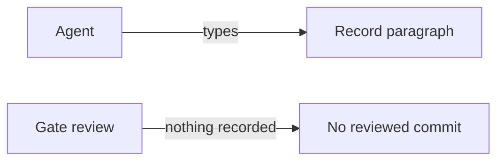
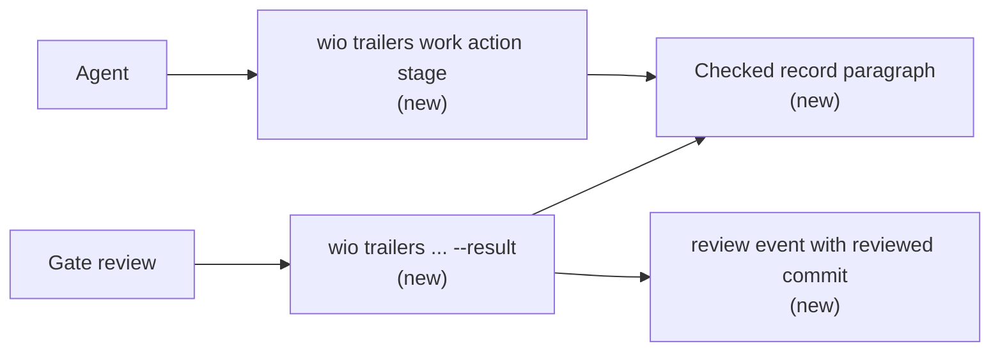

<!-- wio
id = "frspda"
template = "feature.parent"
roots = ["@descendants"]
depends_on = ["570wa9"]
-->

# wio trailers write

## Purpose

An agent that types a record by hand gets a name, an id or a result wrong, and
a gate's review leaves no trace of the commit it judged, so the engine needs to
produce the record and the review event itself.

## Goals

- A checked record is printed for a named Work, action and stage, and nothing is
  printed when a field is refused.
- A gate's result, judge and cited items are recorded with one command, and the
  commit the review judged is named in the `review` event; a history with no
  reviewed commit is refused.
- A gate that needs a human is never recorded as judged by an agent, and a
  refused human gate, result or reviewed commit prints no record and sends no
  event.

## Non-Goals

- Writing one record for a list of Works and `wio trailers none`.
- Writing the review event to the event log; see C-4 of `3jbrzz`.

## Assumptions

### A-1

The record paragraph is read by the agent from the command's output and added
to its commit message; the command does not edit a message.

## Mechanisms

- **Record renderer** — the shared renderer of `Wio-*` records, built by
  `eh62g6`.
- **`History` port** — gives the commits from `HEAD` for the reviewed-commit
  walk.
- **`EventSink` port** — receives the `review` event.
- **Stage-rules port** — provisional, gives the rules a stage selects, declared
  and consumed by `jyhy64`.

## Visuals

The Before diagram is drawn from `9bfd62b` on `main`; the After diagram is the
design this Work delivers. The nodes marked (new) have no counterpart in the
Before diagram.

### Before

### After

## Acceptance criteria

### **AC-1** A human gate refuses an agent and a missing reviewed commit

#### An agent judge for a gate that needs a human

- **Given** a gate stage with `judge = "human"`, a Work, commits on `HEAD` where
  the latest is a pure gate commit of this gate and the one before is the work
  commit, and a recording `EventSink`.
- **When** `wio trailers <work> <action> <stage> --result pass` runs, and then
  `wio trailers <work> <action> <stage> --result pass --judge human` runs.
- **Then** the first exits 1, prints no record and the sink receives no event;
  the second exits 0, prints a record with `Wio-Judge: human` and the sink
  receives one `review` event.

#### A history with no reviewed commit

- **Given** a gate stage and a history whose every commit is a pure gate commit
  of this gate, and a recording `EventSink`.
- **When** `wio trailers <work> <action> <stage> --result pass --judge human`
  runs.
- **Then** the command exits 1, prints no record and the sink receives no
  event.

### **AC-2** A refused gate result prints no record and sends no event

#### A result outside the vocabulary

- **Given** a gate stage, a config whose results do not include `maybe`, and a
  recording `EventSink`.
- **When** `wio trailers <work> <action> <stage> --result maybe` runs.
- **Then** the command exits 1, prints no record, and the sink receives no
  `review` event.

### **AC-3** A gate's result is recorded with the commit it judged

#### The record and the event carry what was passed

- **Given** a gate stage with `judge = "human"`, a Work with an item `AC-1`,
  commits on `HEAD` where the latest is a pure gate commit of this gate and the
  one before is the work commit, and a recording `EventSink`.
- **When** `wio trailers <work> <action> <stage> --result pass --judge human
  --items AC-1 --cite AC-1=pass` runs.
- **Then** the command exits 0, the printed record holds `Wio-Result: pass`,
  `Wio-Judge: human` and `Wio-Items: AC-1`, and the sink receives one `review`
  event whose reviewed commit is the work commit's sha and which cites `AC-1`
  with the result `pass`.
