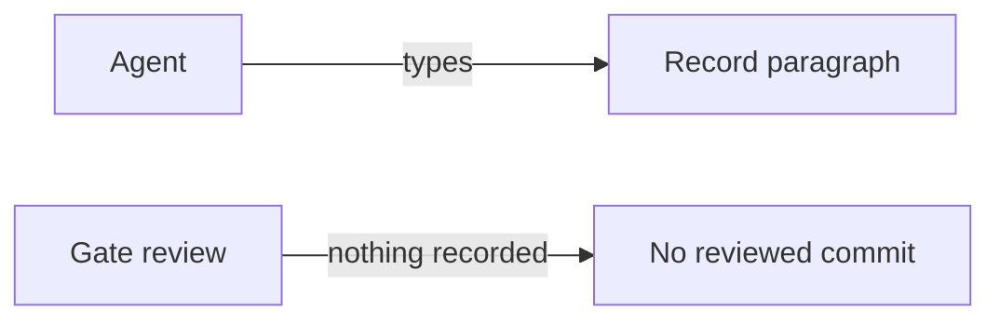
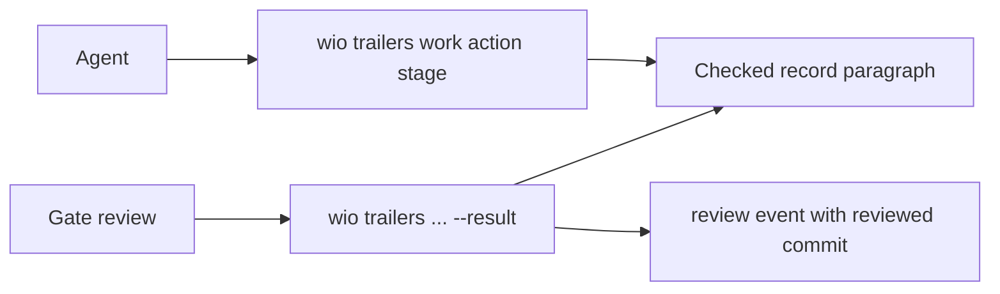

<!-- wio
id = "frspda"
template = "feature.parent"
roots = ["@descendants"]
depends_on = []
-->

# wio trailers write

## Purpose

An agent that types a record by hand gets a name, an id or a result wrong, and
a gate's review leaves no trace of the commit it judged, so the engine needs to
produce the record and the review event itself.

## Goals

- A checked record is printed for a named Work, action and stage, and nothing is
  printed when a field is refused.
- A gate's result, judge and cited items are recorded with one command, and the
  commit the review judged is named.

## Non-Goals

- Writing one record for a list of Works and `wio trailers none`.
- Writing the review event to the event log; that arrives with `wio log`.

## Assumptions

### A-1

The record paragraph is read by the agent from the command's output and added
to its commit message; the command does not edit a message.

## Mechanisms

- **Record renderer** — the shared renderer of `Wio-*` records.
- **`History` port** — gives the commits from `HEAD` for the reviewed-commit
  walk.
- **`EventSink` port** — receives the `review` event.

## Visuals

The Before diagram is drawn from `9bfd62b` on `main`; the After diagram is the
design this Work delivers.

### Before

### After

## Acceptance criteria

### **AC-1** A printed record is accepted by the commit-time check

#### Round trip for a Work and stage

- **Given** a Work in the working tree and one of its stages.
- **When** the record that `wio trailers <work> <action> <stage>` prints is the
  paragraph of a commit message that `wio trailers check --require` reads.
- **Then** both commands exit 0.

### **AC-2** A refused field prints no record

#### A Work that exists nowhere

- **Given** a Work id that is in neither the working tree nor `HEAD`.
- **When** `wio trailers <work> <action> <stage>` runs.
- **Then** the command exits 1 and prints no record.

### **AC-3** A gate's result is recorded with the commit it judged

#### The record and the event carry what was passed

- **Given** a gate stage, a Work with an item `AC-1`, commits on `HEAD` where
  the latest is a pure gate commit of this gate and the one before is the work
  commit, and a recording `EventSink`.
- **When** `wio trailers <work> <action> <stage> --result pass --judge human
  --items AC-1` runs.
- **Then** the printed record holds `Wio-Result: pass`, `Wio-Judge: human` and
  `Wio-Items: AC-1`, and the sink receives one `review` event whose reviewed
  commit is the work commit's sha.
