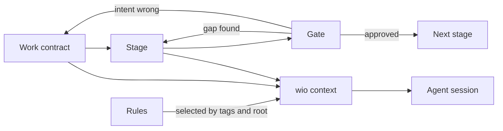

# wio: an intent-based, stage-gated workflow engine for coding agents

**Work It Out** (`wio`) is a small, fully configurable engine for coding
agents. You state the outcome you want in a **Work contract**. The work then
runs in **stages** separated by **gates**, and at each stage the agent sees only
the **rules** that apply to it.

wio does not prescribe a process. The engine provides the building blocks, and
a project (or a shared preset) decides which stages exist and what each one
produces.

## Status

Pre-alpha. The v0.1 design is settled and the engine is being built. Nothing
here is usable yet and nothing is released. The commands below are planned, not
working.

## Why

A coding agent does better work when three things are true:

1. It knows the intended outcome, and a human confirmed that understanding
   before expensive work started.
2. At each step it sees only the guidance that applies to that step, not every
   rule the project has.
3. A human or a fresh reviewer can stop the work at a chosen point and look at a
   small artifact, not at a finished 800-line diff.

## Core concepts

| Need | Concept |
| --- | --- |
| Know the intended outcome | **Work contract** |
| Break big outcomes into small ones | **Nesting** (parent and leaf Works) |
| Do the work in separate steps | **Stage** |
| Stop and decide between steps | **Gate** |
| Give each step only its own guidance | **Rules**, selected by tags |



- **Work contract.** A markdown file that states one outcome, the assumptions
  behind it and the behaviors that show it was achieved. It records intent, not
  progress. Each work type has a template, so projects add their own types.
- **Nesting.** A Work is either a leaf (one coherent outcome, one root) or a
  parent delivered by its children. Children, scope and inherited sections are
  computed, never stored.
- **Stage.** One named step with a goal (or a skill), tags that select its
  rules, and optional approval and session policy. A project defines its own
  stages, and a single stage is valid.
- **Gate.** A point where work stops for a decision: continue, go back, or
  change the contract. A gate is a stage that needs approval or reviews the
  previous stage's artifact, usually in a fresh session.
- **Rules.** Atomic do/don't instructions with a one-line reason, tagged and
  grouped into **rulesets**. A repo binds rulesets to **roots**, which are
  directories with their own toolchain. A rule applies to a stage only when
  every one of the rule's tags is among the stage's tags.
- **Context compiler.** `wio context` joins the contract, the stage and the
  matching rules into one deterministic bundle that the agent reads first in
  each session.

Terms are defined in [GLOSSARY.md](GLOSSARY.md).

On top of the engine, a **preset** is a named, ordered list of stages. A typed
flow (contract, typed boundaries, wired skeleton, implementation, with a review
after each step) is one example. A single `implement` stage is another.

## Principles

- **The repo stores intent; the outside world stores progress.** Contracts have
  no status fields, because a commit cannot record a fact that only becomes true
  after it lands.
- **Compute, don't store.** Children, scope, inherited constraints and the Work
  tree are derived.
- **Deterministic context.** A script picks the rules for a stage; nothing
  depends on a model guessing which guidance applies.
- **The driver decides.** Which stage is current is a decision by the human (or
  a later orchestrator), not a recorded fact.
- **Skills are procedures, rules are atoms, tools are checks.** Only text that
  nearly every task needs is always loaded.

## Planned for v0.1

The first release is the engine only: no shipped stages, presets or rulesets.

| Piece | Purpose |
| --- | --- |
| `wio config` | Read, show and validate `.agents/wio/config.toml` |
| `wio contract` | Create, list, check and show Work contracts |
| `wio rule` | Validate and list rule files |
| `wio context` | Compile the contract and rules for a stage |
| `wio log` | Record context and review events |
| `wio-define` skill | Interview, then write and check a contract |

## Development

You need [uv](https://docs.astral.sh/uv/).

```sh
make install   # sync the environment and install the git hooks
make check     # run every check and the fast tests
```

`make help` lists the other targets.

`AGENTS.md` lists the commands and the code conventions for people and agents
working in this repo, and `tests/README.md` describes the test strategy. Commit
messages follow Conventional Commits and are checked by a hook.

## License

Apache License 2.0. See [LICENSE](LICENSE).
