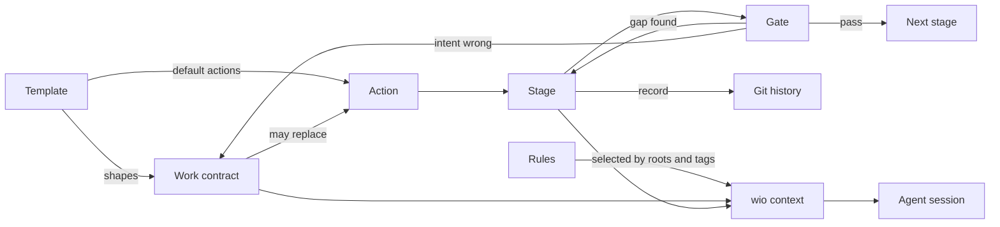

# wio: an intent-based, stage-gated workflow engine for coding agents

**Work It Out** (`wio`) is a small, fully configurable engine for coding
agents. You state the outcome you want in a **Work contract**, written from a
**template**. wio runs **actions** on it, such as defining the outcome and
delivering it. An action is a list of **stages** separated by **gates**, and at
each stage the agent sees only the **rules** that apply to it.

wio does not prescribe a process. The engine provides the building blocks, and
a project (or a shared preset) decides which stages exist, how they are ordered
and what each one produces.

## Status

Pre-alpha. The v0.1 design is settled and the engine is being built. Nothing
here is usable yet and nothing is released. The commands below are planned, not
working.

## Why

A coding agent does better work when three things are true:

1. It knows the intended outcome, and a human confirmed that understanding
   before expensive work started.
2. At each step it sees only the guidance that applies to that step, not every
   rule the project has.
3. A human or a fresh reviewer can stop the work at a chosen point and look at a
   small artifact, not at a finished 800-line diff.

## Core concepts

| Need | Concept |
| --- | --- |
| Know the intended outcome | **Work contract**, written from a **template** |
| Break big outcomes into small ones | **Nesting** (parent and leaf Works) |
| Name the kinds of work done on an outcome | **Action**, declared by the project |
| Do an action in separate steps | **Stage** |
| Stop and decide between steps | **Gate** |
| Give each step only its own guidance | **Rules**, selected by roots and tags |

In one sentence: wio runs **actions** on an **outcome**. An action is a
**preset**, an ordered list of stages, some of them gates. A **template** gives
a contract its shape and its default actions, rules are selected for every
stage, and every commit of a stage carries a **record** in the git history.



- **Work contract.** A markdown file that states one outcome, the assumptions
  behind it and the behaviors that show it was achieved. It records intent, not
  progress. A contract follows a template, and each template belongs to a type,
  so projects add their own types. New Works start from their type's entry
  template. The template carries the default actions, and a contract can
  replace them with its own.
- **Nesting.** A Work is either a leaf or a parent delivered by its children.
  Children, a parent's roots and inherited sections are computed, never stored.
- **Action.** A named kind of work done on a Work, such as `define` or
  `deliver`. The project declares its actions, each with a description that
  helps an agent choose one; none are built in. An action's pipeline is a
  preset or a list of stages. Splitting, promoting and demoting are procedures
  that stages and skills own; wio checks the invariants afterwards.
- **Stage.** One named step with a goal (or a skill), tags that select its
  rules, optional roots and a session policy. A project defines its own stages,
  and a single stage is valid.
- **Gate.** A point where work stops for a decision: continue, go back, or
  change the contract. A gate is a stage that judges the previous stage's
  artifact and records a result, done by an agent in a fresh session or by a
  human.
- **Rules.** Atomic do/don't instructions with a one-line reason, tagged and
  grouped into **rulesets**. A repo binds rulesets to **roots**, which are
  directories with their own toolchain. A stage selects the rules of the Work's
  roots, or of the roots it names itself, and a rule applies only when every
  one of its tags is among the stage's tags.
- **Context compiler.** `wio context` joins the contract, the stage and the
  matching rules into one deterministic bundle that the agent reads first in
  each session.
- **Records.** Every commit of a stage carries a record: a paragraph of `Wio-*`
  git trailers in its message. wio reads progress from the records reachable
  from `HEAD`, whatever workflow put them there.

Terms are defined in [GLOSSARY.md](GLOSSARY.md), and the design is described
in [docs/](docs/README.md).

On top of the engine, a **preset** is a named, ordered list of stages, and it
can be the pipeline of an action. A typed flow (contract, typed boundaries,
wired skeleton, implementation, with a review after each step) is one example.
A single `implement` stage is another.

## Principles

- **The working tree stores intent; the history stores progress.** Contracts
  have no status fields, because a commit cannot record a fact that only
  becomes true after it lands. Each commit records which stage it works on
  instead.
- **Compute, don't store.** Children, roots of parents, inherited constraints
  and the Work tree are derived.
- **Deterministic context.** A script picks the rules for a stage; nothing
  depends on a model guessing which guidance applies.
- **The driver decides.** Which action and stage is current is a decision by the
  human (or a later orchestrator), not a recorded fact. wio can propose the next
  step from the records, but it never blocks one.
- **Skills are procedures, rules are atoms, tools are checks.** A stage loads
  only the rules for its roots and tags, so guidance reaches the sessions that
  need it and no others.

## Planned for v0.1

The first release is the engine only: no shipped stages, presets or rulesets.

| Piece | Purpose |
| --- | --- |
| `wio config` | Read, show and validate `.agents/wio/config.toml` |
| `wio contract` | Create, list, check and show Work contracts |
| `wio rule` | Create, check and list rule files, also for a given path |
| `wio context` | Compile the contract and rules for a stage |
| `wio trailers` | Write and check the records that tie commits to stages |
| `wio log` | Record context and review events |
| `wio-define` skill | Interview, then write and check a contract |

## Development

You need [uv](https://docs.astral.sh/uv/).

```sh
make install   # sync the environment and install the git hooks
make check     # run every check and the fast tests
```

`make help` lists the other targets.

`AGENTS.md` lists the commands and the code conventions for people and agents
working in this repo, and `tests/README.md` describes the test strategy. Commit
messages follow Conventional Commits and are checked by a hook.

## License

Apache License 2.0. See [LICENSE](LICENSE).
