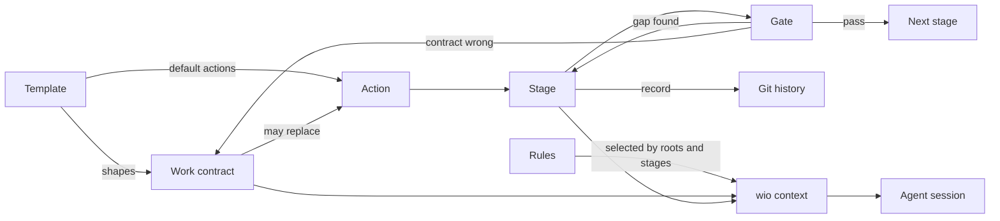

# wio: a configurable, stage-gated workflow engine for AI agents

**Every agent session starts with exactly the context its step needs. Nothing
more.**

Before a session starts, **Work It Out** (`wio`) compiles one bundle for it:

- **What is wanted:** the Work's **contract**.
- **What this step produces:** the **stage**'s goal, or the skill that holds
  its procedure.
- **How to do it well:** only the project's **rules** for this step and these
  files.

Same inputs, same bytes. Two sessions with the same bundle id saw the same
context, so a run can be repeated, compared and trusted.

**Small steps, real stops.** Between stages, a **gate** hands the artifact to a
fresh agent or to a human. A wrong design is caught while it is a few lines,
before anything expensive is built on it.

**Plain files, no server.** Contracts, templates, rules and one config, all in
your repository. Their metadata decides which stages run, which rules each one
sees, and what a contract inherits from its parents.

**Progress in your git history.** Every commit carries `Wio-*` trailers that
name its Work and stage. wio reads where each Work stands from the commit
messages, so no file holds a status field that goes stale.

**Know what it cost.** A personal event log records which agent session ran
each stage and which rules it got. Joined with your harness's transcripts, it
shows the tokens each contract and each stage took, the review rounds a stage
needed before it passed, and whether a rule earns its place.

**Your process, not ours.** wio ships no stages, stage presets or rulesets. Your
project decides what its contracts say, which **actions** and stages exist and
what each one produces. [wio's own workflow](docs/workflow.md) is one example.

**Not only for code.** Documentation, research, an investigation, a data
analysis: any agentic work that git tracks fits the same shape.

**Status: pre-alpha.** The design is settled and the engine is being built.
Nothing is usable or released yet.

## Why

When an agent's work goes wrong, it is usually for one of three reasons, and
none of them is a lack of skill:

- **It builds the wrong thing.** The request lived in a chat, and nobody
  confirmed what "done" means. *With wio,* what is wanted is written into a
  contract, and a gate lets a human confirm it before the expensive work
  starts.
- **It drowns in guidance.** Every rule the project has sits in one file, for
  every step, and the rule that matters now is lost among the forty that do
  not. *With wio,* each stage sees only the rules for that step and those
  files.
- **It hands you everything at once.** Your first chance to look is a finished
  800-line diff or a finished report, when changing course costs the most.
  *With wio,* the work runs in stages, and a gate stops it after each one, so
  you review a small artifact while it is still cheap to change.

## How it works

One Work in [wio's own workflow](docs/workflow.md), from its contract to a
reviewed stage. The commands are planned, and the output below is
illustrative: the bundle's exact format is not fixed yet.

**1. Write down what is wanted.** `wio contracts new feature --title "Read
config.toml"` creates a Work: a contract in a directory of its own, started
from the kind's template. A define stage fills it in, and a gate lets
a human confirm it.

**2. Compile the context for a stage.** The agent's first command in a session
names the Work, the action and the stage:

```text
$ wio context k3m9xq deliver implementation
Work k3m9xq "Read config.toml" · action deliver · stage implementation
Session: may continue the previous stage's session
Rules: 2 · 4,812 bytes, 96 lines · bundle 7f3a9c2e

Goal: Implement the stubbed leaves until the tests and checks pass.

# Read config.toml
...the contract, with the sections it inherits from its parents...

Rules for root wio (src, tests, scripts):

UPK001 false-assumption-amends-the-contract
When an assumption proves false, stop and ask the driver to amend the contract
through the amend action, instead of working around it in the code.

Why: A workaround hides the changed intent from every reader of the contract,
and the next stage builds on the wrong premise.

UPK002 correct-diagrams-to-the-implementation
...

If this session's context was compacted, run the command in the header again.
```

**3. Commit with a record.** Every commit of the stage says what it is:

```text
feat(config): read config.toml

Wio-Work: k3m9xq
Wio-Action: deliver
Wio-Stage: implementation
Wio-Items: AC-1, AC-2
```

**4. Stop at the gate.** `implementation-review` runs in a fresh session with
its own rules, judges the commit against the contract, and records
`Wio-Result: pass` or `fail`. The driver decides what comes next.

The pieces, and how they connect:



| Term | In one line |
| --- | --- |
| **Work** | A Markdown file whose first line opens a `wio` metadata block: its contract. |
| **Template** | What contracts of one kind share: sections, checks, inherited sections and default actions. |
| **Nesting** | A Work is a leaf or a parent; children and inherited sections are computed, never stored. |
| **Action** | A named kind of work on a Work, such as `define` or `deliver`. None are built in. |
| **Stage** | One step: a goal or a skill, the rules it adds to its roots' rules, and a session policy. |
| **Gate** | A stage that judges the previous stage's artifact and records a result. |
| **Stage preset** | A named, ordered list of stages that an action can run. |
| **Rule preset** | A named selection of rules that a root or a stage can name. |
| **Rules** | Atomic do/don't instructions with a reason, grouped into rulesets and selected by roots and stages. |
| **Record** | The `Wio-*` trailers in a commit message that tie it to a Work and a stage. |

An action's pipeline can be as long as a typed flow (typed boundaries, a wired
skeleton, the implementation, with a review after each) or as short as a
single `implement` stage. Terms are defined in [GLOSSARY.md](GLOSSARY.md), the
engine is described in [docs/concepts.md](docs/concepts.md), and the process
this repository runs on it in [docs/workflow.md](docs/workflow.md).

## Principles

- **The working tree stores contracts; the history stores progress.**
  Contracts have no status fields, because a commit cannot record a fact that
  only becomes true after it lands. Each commit records which stage it works on
  instead.
- **Compute, don't store.** Children, roots of parents, inherited sections
  and the Work tree are derived.
- **Deterministic context.** A script picks the rules for a stage; nothing
  depends on a model guessing which guidance applies.
- **The driver decides.** Which action and stage is current is a decision by the
  human (or a later orchestrator), not a recorded fact. wio can propose the next
  step from the records, but it never blocks one.
- **Skills are procedures, rules are atoms, tools are checks.** Guidance with
  steps, references or scripts is a skill. One instruction with a reason is a
  rule, and a stage loads only the rules its roots and its own selection name.
  Anything a linter or a type checker can catch belongs in that tool's config,
  not in a bundle.

## Status and v0.1

Pre-alpha. The v0.1 design is settled and the engine is being built. Nothing
here is usable yet and nothing is released, so the commands in this README are
planned, not working. The first release is the engine only: no shipped
stages, stage presets or rulesets.

| Piece | Purpose |
| --- | --- |
| `wio config` | Read, show and validate `.agents/wio/config.toml` |
| `wio contracts` | Create, list, check and show Work contracts |
| `wio rules` | Create, check and list rule files, also for a given path |
| `wio context` | Compile the contract, the stage's goal or skill, and the rules for a stage |
| `wio trailers` | Write and check the records that tie commits to stages |
| `wio log` | Record context and review events |

## Development

You need [uv](https://docs.astral.sh/uv/).

```sh
make install   # sync the environment and install the git hooks
make check     # run every check and the fast tests
```

`make help` lists the other targets.

`AGENTS.md` lists the commands and the code conventions for people and agents
working in this repo, and `tests/README.md` describes the test strategy. Commit
messages follow Conventional Commits and are checked by a hook.

## License

Apache License 2.0. See [LICENSE](LICENSE).
