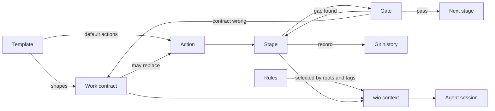

# wio: a configurable, stage-gated workflow engine for AI agents

**Every agent session starts with exactly the context its step needs. Nothing
more.**

Before a session starts, **Work It Out** (`wio`) compiles one bundle for it:

- **What is wanted:** the Work's **contract**.
- **What this step produces:** the **stage**'s goal, or the skill that holds
  its procedure.
- **How to do it well:** only the project's **rules** for this step and these
  files.

Same inputs, same bytes. Two sessions with the same bundle id saw the same
context, so a run can be repeated, compared and trusted.

**Small steps, real stops.** Between stages, a **gate** hands the artifact to a
fresh agent or to a human. A wrong design is caught while it is a few lines,
before anything expensive is built on it.

**Plain files, no server.** Contracts, templates, rules and one config, all in
your repository. Their metadata decides which stages run, which rules each one
sees, and what a contract inherits from its parents.

**Progress in your git history.** Every commit carries `Wio-*` trailers that
name its Work and stage. wio reads where each Work stands from the commit
messages, so no file holds a status field that goes stale.

**Know what it cost.** A personal event log records which agent session ran
each stage and which rules it got. Joined with your harness's transcripts, it
shows the tokens each contract and each stage took, the review rounds a stage
needed before it passed, and whether a rule earns its place.

**Your process, not ours.** wio ships no stages, presets or rulesets. Your
project decides what its contracts say, which **actions** and stages exist and
what each one produces. [wio's own workflow](docs/workflow.md) is one example.

**Not only for code.** Documentation, research, an investigation, a data
analysis: any agentic work that git tracks fits the same shape.

## Status

Pre-alpha. The v0.1 design is settled and the engine is being built. Nothing
here is usable yet and nothing is released. The commands below are planned, not
working.

## Why

When an agent's work goes wrong, it is usually for one of three reasons, and
none of them is a lack of skill:

- **It builds the wrong thing.** The request lived in a chat, and nobody
  confirmed what "done" means. *With wio,* what is wanted is written into a
  contract, and a gate lets a human confirm it before the expensive work
  starts.
- **It drowns in guidance.** Every rule the project has sits in one file, for
  every step, and the rule that matters now is lost among the forty that do
  not. *With wio,* each stage sees only the rules for that step and those
  files.
- **It hands you everything at once.** Your first chance to look is a finished
  800-line diff or a finished report, when changing course costs the most.
  *With wio,* the work runs in stages, and a gate stops it after each one, so
  you review a small artifact while it is still cheap to change.

## Core concepts

| Need | Concept |
| --- | --- |
| Know what is wanted | **Work contract** |
| Give contracts of one kind the same shape, checks and defaults | **Template** |
| Break big work into small pieces | **Nesting** (parent and leaf Works) |
| Name the kinds of work done on a Work | **Action**, declared by the project |
| Do an action in separate steps | **Stage** |
| Stop and decide between steps | **Gate** |
| Give each step only its own guidance | **Rules**, selected by roots and tags |

In one sentence: wio runs **actions** on a **Work**. An action's pipeline is a
**preset** or a list of stages, some of them gates. A **template** gives a
contract its shape and its default actions, rules are selected for every
stage, and every commit of a stage carries a **record** in the git history.



- **Work contract.** A Work's `README.md`: a metadata block that wio reads,
  with the Work's id, template, roots, dependencies and actions, and a Markdown
  body that agents and people read. wio checks the body's headings and passes
  the rest into bundles as written; what the body states is the workflow's. A
  contract holds no progress.
- **Template.** A Markdown file that contracts of one kind follow. It gives
  them their starting metadata and sections, the checks those sections must
  pass, the sections children inherit and the default actions. Each template
  belongs to a type, so projects add their own, and new Works start from their
  type's entry template.
- **Nesting.** A Work is either a leaf or a parent with child Works in its
  directory. Children and inherited sections are computed, never stored, and a
  parent can compute its roots from its descendants with `@descendants`.
- **Action.** A named kind of work done on a Work, such as `define` or
  `deliver`. The project declares its actions, each with a description that
  helps an agent choose one; none are built in. Splitting, promoting and
  demoting Works are procedures that stages and skills own; wio checks the
  invariants afterwards.
- **Stage.** One named step with a goal (or a skill), tags that select its
  rules, optional roots and a session policy. A project defines its own stages,
  and a single stage is valid.
- **Gate.** A stage that judges the previous stage's artifact and records a
  result, done by an agent in a fresh session or by a human. What follows a
  result is the driver's decision.
- **Rules.** Atomic do/don't instructions with a one-line reason, tagged and
  grouped into **rulesets**. A repo binds rulesets to **roots**, which are
  directories with their own toolchain. A stage selects the rules of the Work's
  roots, or of the roots it names itself, and a rule applies only when every
  one of its tags is among the stage's tags.
- **Context compiler.** `wio context` joins the contract, the stage and the
  matching rules into one deterministic bundle that the agent reads first in
  each session.
- **Records.** Every commit of a stage carries a record: a paragraph of `Wio-*`
  git trailers in its message, for one Work or a list of Works. wio reads
  progress from the records reachable from `HEAD`, whatever workflow put them
  there.

Terms are defined in [GLOSSARY.md](GLOSSARY.md), and the design is described
in [docs/](docs/README.md): the engine in
[docs/concepts.md](docs/concepts.md), and the process this repository runs on
it in [docs/workflow.md](docs/workflow.md).

On top of the engine, a **preset** is a named, ordered list of stages, and it
can be the pipeline of an action. A typed flow (typed boundaries, wired
skeleton, implementation, with a review after each step) is one example. A
single `implement` stage is another.

## Principles

- **The working tree stores contracts; the history stores progress.**
  Contracts have no status fields, because a commit cannot record a fact that
  only becomes true after it lands. Each commit records which stage it works on
  instead.
- **Compute, don't store.** Children, roots of parents, inherited sections
  and the Work tree are derived.
- **Deterministic context.** A script picks the rules for a stage; nothing
  depends on a model guessing which guidance applies.
- **The driver decides.** Which action and stage is current is a decision by the
  human (or a later orchestrator), not a recorded fact. wio can propose the next
  step from the records, but it never blocks one.
- **Skills are procedures, rules are atoms, tools are checks.** A stage loads
  only the rules for its roots and tags, so guidance reaches the sessions that
  need it and no others.

## Planned for v0.1

The first release is the engine only: no shipped stages, presets or rulesets.

| Piece | Purpose |
| --- | --- |
| `wio config` | Read, show and validate `.agents/wio/config.toml` |
| `wio contracts` | Create, list, check and show Work contracts |
| `wio rules` | Create, check and list rule files, also for a given path |
| `wio context` | Compile the contract, the stage's goal or skill, and the rules for a stage |
| `wio trailers` | Write and check the records that tie commits to stages |
| `wio log` | Record context and review events |

## Development

You need [uv](https://docs.astral.sh/uv/).

```sh
make install   # sync the environment and install the git hooks
make check     # run every check and the fast tests
```

`make help` lists the other targets.

`AGENTS.md` lists the commands and the code conventions for people and agents
working in this repo, and `tests/README.md` describes the test strategy. Commit
messages follow Conventional Commits and are checked by a hook.

## License

Apache License 2.0. See [LICENSE](LICENSE).
