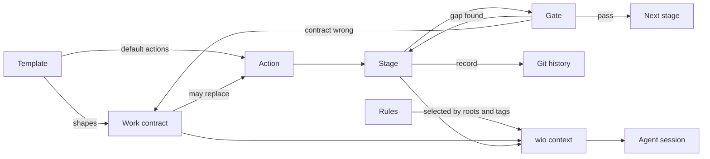

# wio core concepts

This document explains the engine of wio: the few concepts everything else is
built from. It does not describe a particular process: the process this
repository runs on the engine, with its actions, presets and gates, is
[wio's own workflow](workflow.md), and names from it appear here only as
examples. Terms are defined in the [glossary](../GLOSSARY.md). Open points are
listed under [Open points](#15-open-points).

## 1. What the engine does

wio reads Markdown files that carry a small metadata block, and compiles each
of them, for one step of work, into the context an agent session reads first.
That is the whole engine:

1. **Read.** A **Work** is a directory whose `README.md`, its **contract**,
   has a `wio` metadata block. The block names the Work's **template**, its
   roots, its dependencies and its own actions. wio reads the rest of the file
   only by its headings.
2. **Check.** wio checks each contract against the template it names: the
   metadata, and the sections the template's directives require.
3. **Compile.** Given a Work, an **action** and a **stage**, `wio context`
   prints a bundle: the stage's goal or a pointer to its skill, the contract
   with the inheritable sections of its ancestors, and the **rules** selected
   for the stage.
4. **Record.** Every commit of a stage carries a **record** in its message,
   and wio reads progress from those records, never from the files.

What a contract says, which stages exist and what they produce are the
workflow's: its templates, its config and its rulesets. In
[wio's own workflow](workflow.md#2-what-a-contract-states), a contract states
one outcome and the behaviors that show it was achieved, but the engine never
relies on that.

The engine exists because an AI agent produces better work when three things
are true, and each concept serves one of them:

1. It knows what is wanted, and a human has confirmed that before expensive
   work starts.
2. At each step it sees only the guidance that applies to that step, not every
   rule the project has.
3. A human or a fresh reviewer can stop the work at a chosen point and look at a
   small artifact, not at a finished 800-line diff.

| Need | Concept |
| --- | --- |
| Know what is wanted | **Work contract** |
| Give contracts of one kind the same shape, checks and defaults | **Template** |
| Break big work into small pieces | **Nesting** (parent and leaf Works) |
| Name the kinds of work done on a Work | **Action**, declared by the project |
| Do an action in separate steps | **Stage** |
| Stop and decide between steps | **Gate** |
| Give each step only its own guidance | **Rules**, selected by roots and tags and compiled into context |

In one sentence: wio runs **actions** on a **Work**. An action's pipeline is a
**preset** or a list of stages, some of them gates. A **template** gives a
contract its shape and its default actions, rules are selected for every
stage, and every commit of a stage carries a **record** in the git history.
Everything else (skills, presets, rulesets, the event log) plugs into these.

The engine prepares and describes the work; it does not move it forward. That is
the job of a **driver**: whoever advances a Work through its stages. Today the
driver is a human, later it can be an orchestrator. The driver names the action
and the stage, honors the gates and decides what happens after a back-edge. The
engine never decides these things itself. It can propose the next step, and it
warns about inconsistencies, but it never blocks a choice.



## 2. What wio reads

wio reads a small set of names and markers in a project's files, and nothing
else in them. This section lists them by the file they appear in, each with its
presence, its purpose and the section that defines it. Presence is *required*,
*optional* or *reserved* where the design says so, and *open* where it does
not say yet; elsewhere, too, *open* marks a form that is not settled
([Open points](#15-open-points)). A dash means presence does not apply.

### A Work's `README.md`

| Symbol | Presence | Purpose | See |
| --- | --- | --- | --- |
| `<!-- wio ... -->` or `+++` | *required* | The metadata block that makes a directory's `README.md` a Work. | [Anatomy](#anatomy), [Metadata forms](#metadata-forms) |
| `id` | *required* | The Work's short random id, which dependencies, records and the event log key on. | [Identity and location](#identity-and-location) |
| `template` | *required* | The template the contract follows, which gives its sections, checks and default actions. | [Anatomy](#anatomy) |
| `roots` | *optional* | The roots the Work touches, which select its rules. | [Roots of a Work](#roots-of-a-work) |
| `depends_on` | *optional* | The Works this one waits for. | [Dependencies](#dependencies) |
| `[actions]` | *optional* | The actions whose pipelines the Work replaces. | [Where the pipeline comes from](#where-the-pipeline-comes-from) |
| `[x]` | *optional* | The one table for the project's own data: wio skips its contents, while any other unknown key gets a warning. | [Anatomy](#anatomy) |
| `tracks` | *reserved* | Planned: which items of other Works an item contributes to. | [Tracking items](#tracking-items-planned) |
| First heading | *open* | The Work's title. | [Anatomy](#anatomy) |
| `##` headings | — | The sections checked against the template, and the ones a descendant inherits. | [Checking a contract](#checking-a-contract-against-its-template) |
| Directory layout | — | A subdirectory that is a Work is a child, so the tree is the hierarchy. | [Parent and leaf](#parent-and-leaf) |

### A template

| Symbol | Presence | Purpose | See |
| --- | --- | --- | --- |
| `name` | *required* | The template's unique name, which contracts and `[types]` refer to. | [What a template is](#what-a-template-is) |
| `type` | *required* | The declared type the template serves. | [Types and entry templates](#types-and-entry-templates) |
| `description` | *open* | What tools show when they list templates. | [What a template is](#what-a-template-is) |
| `shape` | *optional* | `"leaf"` or `"parent"`, the shape of Work the author expected. | [What a template is](#what-a-template-is) |
| `[actions]` | *open* | The default pipeline of each action. | [Where the pipeline comes from](#where-the-pipeline-comes-from) |
| `[contract]` | *open* | The metadata of the contracts the template produces. | [From template to contract](#from-template-to-contract) |
| `<!-- wio: required -->` | *optional* | The section must be present in the contract. | [Directives](#directives) |
| `<!-- wio: items>=N -->` | *optional* | The section must hold at least `N` items; what counts is *open*. | [Directives](#directives) |
| `<!-- wio: pattern=... -->` | *optional* | The section's items must match a regular expression, and the matches are their item ids; its quoting is *open*. | [Directives](#directives), [Item ids](#item-ids) |
| `<!-- wio: inherit -->` | *optional* | The section is included in every descendant's resolved view. | [Inheritance, computed](#inheritance-computed) |

### A rule file

| Symbol | Presence | Purpose | See |
| --- | --- | --- | --- |
| `code` | *required* | The rule's identifier, whose letters are its family. | [Codes and families](#codes-and-families) |
| `name` | *required* | The rule's readable name, shown with its code. | [Codes and families](#codes-and-families) |
| `tags` | *optional* | Which stages see the rule: every tag must be among the stage's. | [Tags](#tags) |
| `types` | *optional* | The types of Work the rule is restricted to. | [What else filters a rule](#what-else-filters-a-rule) |
| Body | — | The text a bundle shows as written: instruction, `Why:` and `Example:`. | [What a rule is](#what-a-rule-is) |

### A ruleset's `ruleset.toml`

| Symbol | Presence | Purpose | See |
| --- | --- | --- | --- |
| `name` | *required* | The ruleset's name, equal to its directory's. | [Rulesets on disk](#rulesets-on-disk) |
| `description` | *open* | What the ruleset is for. | [Rulesets on disk](#rulesets-on-disk) |
| `[families]` | *open* | The code prefixes the ruleset owns, with their topics. | [Codes and families](#codes-and-families) |

### The config

| Symbol | Presence | Purpose | See |
| --- | --- | --- | --- |
| `tags` | *open* | The tag vocabulary, so a misspelled tag is an error. | [Tags](#tags) |
| `results` | *open* | The results a gate can record. | [The event log](#the-event-log) |
| `[types]` | *open* | The valid types, each with its entry template. | [Types and entry templates](#types-and-entry-templates) |
| `[actions.<name>]` | *open* | An action, with its `description`, `after`, `invalidated_by` and `on_demand`. | [What an action is](#what-an-action-is), [What `wio next` proposes](#what-wio-next-proposes) |
| `[[roots]]` | *open* | A root: its `name`, its `paths` and the `rulesets` bound to it. | [Roots and rulesets](#9-roots-and-rulesets) |
| `[stages.<name>]` | *open* | A stage: a `goal` or a `skill` is required, `tags` is *open*, and `roots`, `gate`, `judge` and `session` are optional. | [Stage](#7-stage) |
| `[presets]` | *open* | Named, ordered lists of stages. | [Presets](#13-presets-process-built-on-the-engine) |
| `[rulesets.<name>]` | *optional* | Which rules of a ruleset are chosen, with `include`, `exclude`, `tags` and `types`. | [Choosing rules from a ruleset](#choosing-rules-from-a-ruleset) |
| `[skills] paths` | *open* | Where wio looks for skills first. | [Stage](#7-stage) |
| `[trailers] reader` | *optional* | How records are read from messages: `scan` or `git`. | [Reading records](#reading-records) |
| Bundle settings | *optional* | A size threshold and the separator between rules; their keys are *open*. | [The context compiler](#11-the-context-compiler) |

### Tokens

| Symbol | Presence | Purpose | See |
| --- | --- | --- | --- |
| `@descendants` | — | In `roots`, the union of the descendants' roots. | [Roots of a Work](#roots-of-a-work) |
| `@work` | — | In a stage's `roots`, the Work's roots. | [Which roots a stage selects](#which-roots-a-stage-selects) |
| `@descendants:<action>` | — | In `invalidated_by`, that action on any descendant. | [What `wio next` proposes](#what-wio-next-proposes) |
| `@dependencies:<action>` | — | In `invalidated_by`, that action on the Works in `depends_on`. | [What `wio next` proposes](#what-wio-next-proposes) |

### Commit messages

| Symbol | Presence | Purpose | See |
| --- | --- | --- | --- |
| `Wio-Work` | *required* | The Works a commit is work on, or `none`. | [Records](#records) |
| `Wio-Action`, `Wio-Stage` | *required* unless `Wio-Work: none` | The action and stage the commit is work on. | [Records](#records) |
| `Wio-Criteria` | *optional* | The item ids the commit addresses, such as acceptance criteria. | [Records](#records) |
| `Wio-Result` | *required* on a gate, absent elsewhere | The gate's result. | [Records](#records) |
| `Wio-Judge` | *optional*, on a gate | Who judged the gate; without it, a human did. | [Records](#records) |
| `Merge`, `Revert`, `Reapply`, `fixup!`, `squash!` | — | Subjects of commits that need no record. | [Records](#records) |
| `This reverts commit <sha>.` | — | Takes the records of the reverted commit back. | [Records](#records) |

### Environment and paths

| Symbol | Presence | Purpose | See |
| --- | --- | --- | --- |
| `$WIO_HOME` | *optional* | The Wio home, where the event log lives; `~/.agents/wio` by default. | [The Wio home](#the-wio-home) |
| `$TMPDIR` | — | Where a bundle is written when no path is given. | [The context compiler](#11-the-context-compiler) |
| `.agents/wio/config.toml` | — | The config. | [Glossary](../GLOSSARY.md) |
| `.agents/wio/works/` | — | The Works directory. | [Identity and location](#identity-and-location) |
| Templates directory | — | The templates; a file without a `wio` block is ignored. | [Types and entry templates](#types-and-entry-templates) |
| `.agents/wio/rules/` | — | The repository's rulesets, one directory each. | [Rulesets on disk](#rulesets-on-disk) |
| `<dir>/<skill>/SKILL.md` | — | A skill a stage names, in the skill paths or a harness's skill directories. | [Stage](#7-stage) |

## 3. Work contract

### What it is

A Work contract is the `README.md` of a Work: a metadata block that wio reads,
and a Markdown body that agents and people read. wio uses the metadata to find
the Work's roots, dependencies and actions, and puts the body into bundles as
written.

A Work is a directory, and its contract is that directory's `README.md`, for
two reasons:

- Forges such as GitHub render a directory's `README.md` when it is opened, so
  browsing the Works directory shows each contract without a tool.
- The directory keeps everything about one Work in one place. A workflow can
  store the artifacts of its own process next to the contract: notes, an
  investigation's findings, an evaluation's results. These are not source code.
  They stay with the Work, and reach the code only if a stage carries them
  there. wio ignores them (see
  [Identity and location](#identity-and-location)) and does not put them into
  bundles, so a stage that needs one reads it itself. Deleting the Work's
  directory removes them with the contract, and git keeps both.

Every contract also names a **template**
([Templates and types](#4-templates-and-types)). Contracts of one kind share a
template, which gives them their sections, the checks those sections must pass
and their default actions. This section describes the contract on its own, and
[Templates and types](#4-templates-and-types) adds what the template supplies.

A contract holds no progress: wio writes none into it and reads none from it.
The reason is mechanical. Progress changes with every stage. If it lived in the
file, every stage would edit the same lines and the file would turn into a
conflict magnet. Progress lives in the history instead ([Records](#records)).
The contract changes only when someone decides to change what it says.

### Anatomy

A contract has a small block of metadata for wio and Markdown sections for
people and agents.

The metadata is TOML. It sits inside an HTML comment at the top of the file, so
it is hidden when the contract is rendered and readable in the source:

```markdown
<!-- wio
id = "k3m9xq"
template = "feature.leaf"
roots = ["api"]
depends_on = ["a7b2c4"]

[actions]
deliver = ["implementation"]
-->

# Short title
```

- `id`: a short random id.
- `template`: the name of the template this contract follows
  ([What a template is](#what-a-template-is)). Required.
- `roots`: the names of the roots the Work touches (see
  [Roots of a Work](#roots-of-a-work)). It may be empty, for example while a
  Work is still being defined.
- `depends_on`: an optional array of Work ids that this Work waits for (see
  [Dependencies](#dependencies)).
- `[actions]`: optional. The pipelines of the Work's actions, where it differs
  from its template's defaults (see
  [Where the pipeline comes from](#where-the-pipeline-comes-from)).

Contract metadata carries no comments. Explanations belong to the template.

wio knows these keys, and an unknown key is a **warning**, in contracts,
templates and rules alike, naming the key and the known key it is close to, if
any ("unknown key `depend_on`; did you mean `depends_on`?"). A typo is visible
and nothing is blocked. A known key with a wrong type, such as a string where a
list belongs, is an error. Keys planned for later, such as `tracks` for tracking
items, are reserved and do not warn. Data of a project's own goes in a table
named exactly `[x]`. wio skips whatever it holds and never warns about it, while
a table of any other unknown name warns like any unknown key:

```toml
[x]
ticket = "PAY-142"
```

The title is the first heading and is stored nowhere else. There is no `parent`
field, because the directory layout gives the hierarchy (see
[Parent and leaf](#parent-and-leaf)).

The body is prose. wio reads its first heading as the title and its `##`
headings, which are
[checked against the template](#checking-a-contract-against-its-template); the
rest it passes into bundles as written.

Why prose and not a strict schema? Because the reader is mostly an agent, and an
agent reads prose well. wio only needs the metadata and a few headings, so only
those are machine-checked.

### Metadata forms

wio also reads the same TOML as front matter between `+++` lines. A template
picks the form, and contracts made from it use the same form. The templates in
this repository use the comment form because GitHub shows `+++` front matter as
plain text, while other forges, GitLab for example, render it. A setting for the
form, and a command that rewrites it, may come later.

TOML was chosen over YAML, for now, for simplicity: it needs only the standard
library for reading, and strings are always quoted, so an id such as `234567` is
never read as a number. The choice is cheap to change: add a YAML reader and
writer (using a safe load) and change the templates.

### Identity and location

- The `id` is random and short: 6 to 8 characters of lowercase Crockford base32.
  It is generated, not written by a model, because models invent or duplicate
  ids. It is not a UUID (too long, untypeable) and not a ticket key (that would
  tie wio to one tracker).
- Two contracts with the same id are an error, and `wio contracts check` names
  both paths. Copying a Work's directory is the usual cause. Ids are what
  dependencies, records and the event log key on, so a duplicate would merge the
  progress of two Works.
- A **Work** is a directory whose `README.md` contains a `wio` metadata block:
  `.agents/wio/works/<slug>/README.md`. The path is the default and will be
  configurable. Humans navigate by slug and scripts key on the id.
- Anything else in a Work's directory (notes, diagrams, stage artifacts) is
  ignored. Only a subdirectory that is itself a Work makes a child.
- `wio contracts new` creates a Work in the Works directory, or inside a parent
  given by id with `--parent`. Its directory is named by `--slug`, or by a slug
  derived from `--title`, and an existing directory of that name is an error,
  so a Work is never overwritten.

### Changing a contract

wio has no notion of a kind of change. A contract is a file: it is edited, or
its Work's directory is deleted, in a commit like any other, and the commit
carries a record of whichever action the driver ran. The rest follows from
mechanisms described where they belong: which actions become stale is their
`invalidated_by` ([What `wio next` proposes](#what-wio-next-proposes)), a
dependency on a deleted Work is reported by `wio contracts check`
([Dependencies](#dependencies)), and the deleting commit's record is checked
against `HEAD` ([Records](#records)).

Which changes a workflow tells apart, and through which actions, is the
workflow's business. [wio's own workflow](workflow.md#5-changing-a-contract)
tells amending, ratifying and abandoning apart, and
[retires](workflow.md#retiring-a-contract) a contract once it is spent.

## 4. Templates and types

### What a template is

A template is a markdown file that contracts of one kind follow. A contract
names it in `template`, and the template supplies the rest of what the
contract means to wio. Only the starting metadata is copied; everything else
is read from the template whenever wio reads the contract, so a change to the
template reaches every contract that follows it:

| The template supplies | How |
| --- | --- |
| The starting metadata, such as `roots`, `depends_on` and `[x]` | Copied once, when `wio contracts new` creates the contract |
| The starting body: headings and authoring comments | Copied once, the same way |
| The default actions | Read live; a contract's own `[actions]` replace them per action |
| The type, which rules can be restricted to | Read live |
| The directives: the checks on its sections, item ids and inheritance | Read live; contracts carry no directives |
| The expected `shape`, leaf or parent | Read live |

On disk, a template holds instructional comments, directives and a metadata
block. Its metadata describes the template itself and what the contracts made
from it look like:

```markdown
<!-- wio
name = "feature.leaf"
type = "feature"
description = "A capability delivered directly as one coherent outcome."

[actions]
deliver = "typed-boundary"

[contract]
roots = []
depends_on = []
-->
```

- `name` is the template's unique name. Two templates cannot share a name, and
  the file name does not matter.
- `type` is the template's type, one of the types the config declares.
- `description` is what tools show when they list templates.
- `shape` is optional: `"leaf"` or `"parent"`, the shape of Work the template
  is for. `wio contracts check` warns when a Work's children do not match it:
  a Work with children whose template says `leaf`, or a Work without children
  whose template says `parent`. It is only a warning, because the two disagree
  for a moment during every split. wio still has no levels: the tree decides
  what a Work is, and `shape` only states what the template's author expected.
- `[actions]` holds the default actions of every contract that follows the
  template (see
  [Where the pipeline comes from](#where-the-pipeline-comes-from)).
- `[contract]` is the metadata of the contracts the template produces.

### From template to contract

When wio creates a contract from a template, it prepares the template as a
contract skeleton. The `[contract]` table is promoted to the top level
(`[contract.foo]` becomes `[foo]`), and the template's own keys (`name`, `type`,
`shape`, `description` and `[actions]`) are dropped. wio always sets `id` and
`template` itself, even if the template specifies them, and it removes comments
from the metadata, because they belong to the template author. So a template
can, for example, give every contract a ticket key to fill in:

```toml
[contract.x]
ticket = ""      # in the template; the contract gets [x] ticket = ""
```

A contract created from a template therefore has exactly the shape the template
describes, and the agent that fills it in sees that shape. `wio contracts
template <name>` prints that prepared skeleton without creating a Work, so a
skill can name a template and show it to the agent without knowing which file
holds it. That skeleton carries no `id`: pasted as it is, it fails
`wio contracts check`, and the output is the same on every run. With
`--work <id>`, it is the skeleton for that existing Work: `template` is the
requested template, and the Work's `id` and `depends_on` are carried over,
because they are its identity and its ordering in any template. Everything else
comes from the new template's defaults. `--keep <key>`, which can be repeated,
carries more on request: `--keep roots` and `--keep actions` keep the Work's
roots and its action overrides. wio knows no procedure for moving between
templates, so it never decides what else to keep: the skill that knows its
templates does. On standard error, wio lists the Work's metadata the skeleton
does not carry, so nothing is dropped silently; standard output stays the
skeleton. A stage that moves a Work to another template uses `--work`, so the
Work keeps its id and its records.

### Types and entry templates

The config declares the valid types, and for each type its **entry template**:
the template that new Works of that type start from.

```toml
[types]
feature = "feature.draft"
bugfix = "bugfix"
```

A type groups templates that serve one kind of Work. A type can have any
number of templates (a draft, a leaf, a parent, or seven others), each with its
own actions. wio gives them no level or shape: which template a contract follows
is the contract's `template` field, and that decides its sections and its
actions. `wio contracts new feature` creates a Work from `feature.draft`, and a
template can also be chosen by name.

How a Work moves from its entry template to another one, for example from a
draft to a leaf or a parent, is a procedure of the stages that define it. wio
does not know about it. It only checks the result. So a type's templates and
the skills of its define stages are written together, as one package: the
skills know which templates the type has, name them, and print them with
`wio contracts template <name> --work <id>`, and the agent rewrites the contract
in the chosen shape. wio does not rewrite contracts itself.

`wio config check` fails when a type's entry template does not exist or has
another type, and when a template or a rule names a type that is not declared.

Anyone can add a template, and with it a type, and that is the main extension
point for projects. Files in the templates directory without a `wio` metadata
block are ignored.

### Directives

Directives tell wio what a template's sections mean: which are mandatory, what
their content must look like, and which ones children inherit. A directive
list is an HTML comment that starts with `wio:` at the end of a `##` heading of
a template, with the directives separated by commas:

```markdown
## Purpose <!-- wio: required -->
## Glossary <!-- wio: inherit -->
## Acceptance criteria <!-- wio: required, items>=1, pattern=AC-\d+ -->
```

They are invisible when the template is rendered, readable in the source, and
parseable by a markdown parser. The grammar is small:

| Directive | Meaning |
| --- | --- |
| `required` | The heading is present in the contract. It says nothing about what is under it. |
| `items>=N` | The section holds at least `N` items. |
| `pattern=<regex>` | The section's items match the regular expression, and the matches are their **item ids**. |
| `inherit` | The section is inheritable: a descendant's resolved view includes it ([Inheritance, computed](#inheritance-computed)). |

Sections are **optional until marked required**, so the agent can choose
sections based on what the Work needs. Authoring comments do not count as
content, so a Work fresh from its template passes a check that only requires
headings, and a template that wants content says so with `items`. What counts
as an item, and how a `pattern` that holds a comma or `-->` is written, are
open ([Open points](#15-open-points)).

### Item ids

Item ids are the only content of a section that wio keeps track of: the ids
that a `pattern` directive gives the items of a section, such as `AC-1`.
They let records and reviews say which parts of a contract a commit addresses
or a gate judged, without wio knowing what the parts mean. A template decides
which sections carry ids and what they look like; a workflow decides what they
stand for. In [wio's own workflow](workflow.md#2-what-a-contract-states) they
are acceptance criteria, so the trailer that carries them is `Wio-Criteria`
and the flag is `--criteria`, named after that common use. Ids belong to their
Work: `AC-1` of one Work and `AC-1` of another are different items.

This is the direction for v0.1, not a settled grammar: how wio finds the items
of a section, and so their ids, is open ([Open points](#15-open-points)).

A contract created from a template keeps the template's authoring comments in
its body, because they are the guidance the agent follows while it fills each
section in. Directives are removed at creation, because `wio contracts check`
reads them from the template. The agent deletes each authoring comment once its
section is written, and deletes the sections it leaves empty, unless they are
required. The `wio` metadata block stays.

### Checking a contract against its template

A contract is checked against the template it names, and only against it:

- Because directives are removed from contracts, wio matches a contract's
  level-2 headings (`##`) to the template's headings by their text, ignoring
  case, surrounding whitespace and a trailing directive comment. Nothing else is
  normalized, so the match stays predictable.
- A `##` heading that the template does not have is a warning. A misspelled
  `## Constraint` would otherwise lose its inheritance without any error.
  Deeper headings are free.
- A fresh Work must pass the check too, so what an entry template requires
  decides what a Work needs from its first commit. How strict each template is
  belongs to the workflow; [wio's own](workflow.md#from-draft-to-leaf-or-parent)
  is one example.
- Changing a template changes the checks for every contract that follows it. A
  template change is a reviewed change, and `wio contracts check` lists the
  contracts it breaks, so they are fixed in the same change or moved to a new
  template.

## 5. Nesting

### Parent and leaf

A Work either is a **leaf** (it has no child Works) or a **parent** (it has
child Works). A child's directory sits inside its parent's directory, so the
hierarchy is the directory tree. There is no `parent` field and no `children`
list, because both are **computed** from the layout. Stored lists drift;
computed ones cannot.

Between the Works directory and any Work, every directory must itself be a Work.
A directory without a contract between two Works is an error, so the tree means
exactly the hierarchy and nothing has to skip a level. The Works directory
itself is the only exception, and it may hold a `README.md` without a `wio`
block, for example an index for people.

### Splitting

The Work tree divides the work as its contracts do. It does not have to mirror
the module tree or the directory tree of the code.

When to split a Work, how the split is carried out, and whether the pieces
become nested children or flat siblings, is a procedure that a stage and its
skill own. wio only reads the result: the directory layout and the metadata.
[wio's own workflow](workflow.md#when-to-split) shows one such procedure.

### Roots of a Work

A **root** is a set of directories bound to one toolchain and its rulesets
([Roots and rulesets](#9-roots-and-rulesets)). A Work names the roots it touches
in `roots`, using the names the config gives them.

- A Work's roots are exactly the ones it lists, for a leaf and a parent alike.
  Nothing is added implicitly, so a parent's stages get the rules of the roots
  its author chose, however large its subtree is.
- A parent can list `@descendants` to include the union of its descendants'
  roots, computed recursively: a child that is a parent contributes whatever
  its own `roots` resolve to, so a parent in the middle of the tree decides what
  it passes upward. `@descendants` combines with explicit roots:

  ```toml
  roots = ["api", "web"]              # exactly these
  roots = ["@descendants"]            # the union of the descendants' roots
  roots = ["e2e", "@descendants"]     # the union, plus e2e
  ```

  A template sets the default, so a parent template can use
  `roots = ["@descendants"]`. A parent whose roots leave out a root that one of
  its descendants uses gets a note from `wio contracts check`, not a warning,
  because a narrower list may be intended. A Work without children that lists
  `@descendants` gets a warning, because the token resolves to nothing there,
  for example after a parent is demoted to a leaf.
- An empty `roots` list and a missing one mean the same: no roots. Templates can
  therefore keep `roots = []` as a placeholder.
- `roots` may be empty. That is not an error in `wio contracts check`. It fails
  only when a stage selects rules by the Work's roots
  ([Which roots a stage selects](#which-roots-a-stage-selects)), and then
  loudly.

How many roots a leaf may have is a choice of the workflow. A preset can ask
for exactly one root per leaf, so that a Work spanning a FastAPI backend
and a Next.js frontend becomes a parent with one leaf per root. wio does not
enforce it.

### Inheritance, computed

A child often needs constraints that its parent states. Instead of copying them
into each child, a parent's template marks sections as **inheritable** with the
`inherit` directive on their headings:

```markdown
## Glossary <!-- wio: inherit -->
## Constraints <!-- wio: inherit -->
```

To resolve a Work, wio walks up the directory tree to the Works directory. For
each ancestor it reads the template that the ancestor's `template` field names,
takes the `##` headings marked `inherit` there, and finds the ancestor
contract's sections with the same heading text, matched as in
[Checking a contract against its template](#checking-a-contract-against-its-template).
The directive is read from the template and never from the contract, because
contracts carry no directives. `wio contracts show` prints the Work together
with those sections, and so does the resolved contract in a bundle
([The context compiler](#11-the-context-compiler)). The agent reads one resolved
view and never needs to open whole parent contracts. How the inherited sections
are rendered is open ([Open points](#15-open-points)).

A leaf's own Constraints section holds only the constraints the leaf adds. The
inherited ones are not restated, so they cannot drift.

Marking individual items, by their ids, as inheritable is possible later.

### Dependencies

A Work can depend on other Works. Its metadata has an optional `depends_on`, an
array of Work ids:

```toml
depends_on = ["a7b2c4", "k3m9xq"]
```

- Dependencies are ids, never paths, so moving or renaming a Work's directory
  breaks nothing. The tree gives the hierarchy, and `depends_on` adds an
  ordering graph on top of it. Nesting only decides what is inherited;
  `depends_on` works the same for nested and flat Works.
- `wio contracts check` verifies that every id exists and that there are no
  cycles. Each parent also depends implicitly on its children, and that edge
  counts too.
- A `depends_on` id that is not in the tree is looked up in the history: wio
  reads the latest record of that Work reachable from `HEAD`, with the
  configured reader. With no record at all it is an **error**, because the id is
  mistyped or the Work never got anywhere. With a record it is a **note** that
  shows that record ("depends on removed Work `y4k2mq`, last record:
  `deliver`/`system-review`, pass"), and the dependency counts as satisfied for
  ordering and for the cycle check. wio does not interpret action names, so it
  cannot tell why the Work was deleted; the driver reads the note and decides
  whether the dependents still hold, and `wio contracts show` lists them.
- A dependency means the other Work comes first. Which of its actions must have
  run is open ([Open points](#15-open-points)). It applies to the Work that
  lists it and to no other: a parent's dependency holds back only that parent,
  and a child that needs the same Work lists it itself. So the graph is exactly
  the listed edges plus each parent's implicit dependency on its children, and
  that is the graph the cycle check walks. A sibling may build on one child of a
  parent while the parent's integration waits for the sibling. Whether a
  dependency also holds back the dependent's definition is an open point.

### Tracking items (planned)

This is planned for v0.2 or v0.3 and is not part of v0.1.

A parent's items, such as its acceptance criteria, are usually established by
its descendants together, and the parent is written before they exist. So the
link runs from the child upward: an item of a Work can track an item of
another Work, such as a parent, a grandparent or a sibling. The links live in
the contract's metadata block, in a `[tracks]` table keyed by the Work's own
item ids:

```toml
[tracks]
AC-1 = ["31as8f AC-3"]
AC-2 = ["31as8f AC-3", "871df7 AC-4"]
```

- To track means to contribute to, not to be enough for. Several children
  together establish one parent item.
- `wio contracts check` verifies that every referenced Work and item exists,
  so a change that removes an item shows up as a dangling link.
- The parent never lists its children. The items that track a parent item are
  computed from the descendants.
- A parent item that nothing tracks is a warning, not an error. Some items are
  established only by a stage of the parent itself.
- Records carry no extra trailer for this. Their `Wio-Criteria` together with
  the contract's links gives the same information.
- Inherited sections, such as a parent's constraints, are not covered. They
  are inherited, not traced.

The exact shape of the table is open. A flat table with one string per target,
as above, is the simplest. Nested tables per target Work, such as
`[tracks.31as8f]` with `AC-1 = ["AC-3"]`, keep the Work id and the item id as
separate pieces of data.

## 6. Actions

### What an action is

An action is a named kind of work done on a Work. wio has no built-in actions.
The config declares them, each with a description:

```toml
[actions.define]
description = "Turn an intent into a contract, and split it when needed."

[actions.deliver]
description = "Build what the contract says."
```

The description is written for agents, like a skill's description: an agent
reads it to choose the action that fits what the user asked for. `wio contracts
show` lists a Work's actions with their descriptions and pipelines.

An action can be **on demand**:

```toml
[actions.ratify]
on_demand = true
description = "Update a contract to match what was built, without reworking anything."
```

`wio next` never proposes an on-demand action; the driver runs it on purpose.
That is all `on_demand` means. Its records count like any other's, so an action
that lists it in `invalidated_by` becomes stale after it, and listing it in
`after` is an error, because an order with an action that is never proposed
could not happen. `wio contracts show` marks it. The default is `false`.

`define`, `deliver`, `amend` and `ratify` are the actions
[this repository uses](workflow.md), and they are only examples. Nothing in the
engine sets one action apart from another, so a project can add as many as it
needs.

An action's **pipeline** is either a **preset** (an ordered list of stages, by
preset id) or a list of **stage names**. In both, some stages may be gates.

### Where the pipeline comes from

A contract follows a template, and the template's `[actions]` give the default
pipeline of each action. A contract may carry its own `[actions]`, and **each
action it names replaces that action of the template**. The actions it does not
name are inherited:

```toml
[actions]
deliver = ["implementation"]
```

This is how a small leaf skips the stages a large parent needs: its delivery is
shorter, and its `define` and `amend` actions are still the template's. An
empty list removes an action from the Work, such as `define = []`, and a
contract can add an action the template does not have, as long as the config
declares it. A contract's `[actions]` customizes its pipelines and has no other
meaning.

A string value is a preset id and an array is a list of stage names, so a
one-stage pipeline is a one-element array. Action names, stage names and preset
ids must exist in the config. A contract that names stages is free to skip any
of them, including gates. Hygiene is the project's business, and guidance and
presets can encourage good practice.

Inherited actions follow the template when it changes. The actions a contract
overrides stay as the contract states them, and wio does not update them when
the template or the config changes. `wio contracts check` reports names that no
longer exist.

### Procedures belong to stages

Splitting a Work, promoting a leaf to a parent, demoting a parent, moving a
Work from its entry template to its final one: these are procedures. Each is a
stage with a skill, and wio does not know how they work. wio has no concept of a
stub, a draft or a level, and it does not know whether a Work is "defined".
Which actions a Work has done is progress, and progress is read from history
([Records](#records)).

What wio does is provide context to each stage, select its rules, log what
happens and check invariants afterwards.

### What `wio next` proposes

This comes in v0.2 and is not part of v0.1, and this section is a sketch. It
records the direction chosen (currency from records, `after` for order,
`invalidated_by` for staleness, on-demand actions, gates with results). The Work
that builds `wio next` settles the details against the records v0.1 produces.
The record format is fixed in v0.1. Config keys may be added in v0.2, and the
keys v0.1 defines keep their meaning: `results` stays the vocabulary, and which
results let the next stage start becomes a key of its own, such as
`[gates] continue = ["pass"]`. The cases it must settle are listed in the
[open points](#15-open-points).

`wio next` proposes the next action and stage for a Work. It is a heuristic over
the records in the git history ([Records](#records)), and the driver may do
something else. Every proposal says so in one fixed line.

- Actions are considered in the order that `after` gives: an action comes after
  the actions it lists, and actions with no relation between them are ordered by
  name, so the order never depends on how the config file is laid out. `after`
  means order and nothing else. A cycle in `after` is an error in
  `wio config check`. An entry that starts with `@` is reserved for v0.2 (for
  example `@descendants:deliver`, to order a Work after its descendants'
  delivery): v0.1 accepts it with a note and does not read it, and the same goes
  for any `@` prefix in `invalidated_by` other than the ones defined. On-demand
  actions are never proposed. The proposal is the first stage, in the first
  action, that is not current.
- A stage is **current** when it has a record, and its latest record is newer
  than the latest record of every earlier stage in the same pipeline. When an
  earlier stage is done again after a back-edge, the stages after it stop being
  current, and `wio next` proposes them again.
- A record says that a commit is work on a stage, not that the stage is finished
  ([Records](#records)). So after the first commit of a stage, `wio next`
  proposes the stage after it. Whether the work is really done is the driver's
  call, and the next gate's result is the only judgement the history holds.
- An action can declare what **invalidates** its work:

  ```toml
  [actions.deliver]
  after = ["define"]
  invalidated_by = ["define", "amend", "@descendants:deliver"]
  ```

  A stage of such an action is current only if its latest record is also newer
  than the latest record of everything in `invalidated_by`:
  - a plain name is that action of the same Work, on demand or not;
  - `@descendants:<action>` is that action on any descendant of the Work, at
    any depth, so a parent's delivery becomes stale when one of its descendants
    is delivered again;
  - `@dependencies:<action>` is that action on the Works in `depends_on`.

  An amendment therefore makes every `deliver` stage stale, and `wio next`
  proposes delivery again from its first stage. This is coarse: it cannot tell
  which stages a change really affects, and the driver can skip ahead. Tracking
  items could make it finer later. `invalidated_by` implies no order and `after`
  implies no staleness, so `deliver` lists `define` in both, because it is
  ordered after definition and also redone after it. Without `invalidated_by`,
  nothing invalidates an action. Names that start with `@` are reserved, as in
  `@work`, so they cannot clash with an action's name.
- Only stages in the Work's current pipeline count. Records of a stage that the
  pipeline no longer contains are ignored, for example after a leaf is promoted
  to a parent with a different pipeline.
- A gate's latest record carries its result, and which results let the next
  stage start is declared with the results, when `wio next` is built.

In a workflow like [wio's own](workflow.md), defining runs top-down and
delivering runs bottom-up over a tree. A parent is defined before the Works its
split creates, and a parent is delivered after its children. The leaves to
deliver, with `depends_on`, form a graph that can be sorted into batches, and
the Works in one batch can run in parallel, for example
`(("32sa4k", "97fqmz"), "213asx", ("8asd2w", "732sfa"))`.

Stages of different Works do not interleave. A boundary that several leaves
share is extracted as a leaf of its own and delivered first, and the other
leaves depend on it. The [split exercises](split-exercises.md) walk through
this.

### Invariants wio checks

`wio contracts check` and `wio config check` verify mechanically what wio relies
on, and they do not judge how a workflow is built:

- Every contract names an existing template, and the template's type is a
  declared type. Every type's entry template exists and has that type.
- No two contracts share an id, and every directory between the Works directory
  and a Work is itself a Work.
- The actions a contract resolves to are not empty, and each pipeline has at
  least one stage. An empty list in a contract's `[actions]` removes that
  action; it is not an empty pipeline. Work with no stage to run belongs in a
  ticketing system, not in the repository.
- Every action name, preset id and stage name in a template or a contract
  exists, `after` has no cycle and names no on-demand action, the names in
  `invalidated_by` are declared actions with a known prefix, and every stage's
  skill can be found.
- Every root a contract or a stage names is a root in the config.
- Every `depends_on` id exists, and there are no cycles in the graph of listed
  dependencies plus each parent's implicit dependency on its children.
- No stage appears twice in one pipeline. Records key on the Work, the action
  and the stage, so two positions of one stage could not be told apart.
- Required sections are present, as the template's directives say. A `##`
  heading the template does not have is a warning, and so is a Work whose
  children do not match its template's `shape`.

## 7. Stage

### What it is

A stage is one named step of working on a Work. It answers: *what is being
produced right now, and with which guidance?*

A stage definition has these parts:

| Part | Meaning |
| --- | --- |
| `name` | Identifier used in config, rules, records and logs. |
| `goal` | A short text that says what to produce. Used when the instructions fit in a few lines. |
| `skill` | A skill name, used instead of a goal when the procedure needs references, templates or scripts. |
| `tags` | Which rules apply ([Tags](#tags)). |
| `roots` | Optional. Which roots the stage selects rules from ([Which roots a stage selects](#which-roots-a-stage-selects)). Without it, the stage uses the Work's roots. |
| `gate` | Optional. `true` when the stage judges an artifact, so each of its records carries a result ([Gate](#8-gate)). |
| `judge` | Optional, for a gate. `"human"` when a person must judge it ([Gate](#8-gate)). |
| `session` | Optional. `"fresh"` when the stage needs a new session (see "Sessions" below). |

```toml
[stages.define]
skill = "wio-define"
tags = ["contract"]
roots = ["contract"]

[stages.architecture-review]
goal = "Review the typed boundaries against the contract."
tags = ["architecture", "review"]
gate = true
session = "fresh"
```

The key that marks a stage as not continuable is open
([Open points](#15-open-points)).

A stage with only a goal and tags is valid. A stage with a skill hands its
procedure to that skill. The engine does not care which; it prints the goal or
names the skill, and compiles the rules.

wio does not load or run skills, but it finds them, so it can check that a
stage's skill exists and tell when it changed. A skill is a directory named
after it that holds a `SKILL.md`, which is the shape harnesses use. wio looks
for it in this order, and the first match wins:

1. the directories in the config's `[skills] paths`, such as
   `paths = [".agents/wio/skills"]`, for skills meant only for wio, which no
   harness loads by default and whose descriptions therefore never take up an
   agent's context;
2. the project directories harnesses read, such as `.agents/skills` and
   `.claude/skills`;
3. the same directories in the user's home.

`wio config check` fails when a stage names a skill that none of them holds,
and adds a note when a skill is found only in the user's home, because another
machine may not have it.

Stage names are global in the config, so the same stage can appear in the
pipelines of several actions. That is why every command, record and event
names the action as well as the stage.

### Why stages exist

Staging lets a cheap artifact be reviewed before an expensive one is built. A
typed signature costs a few lines to produce and a few seconds to review. The
implementation behind it costs far more. If the signature is wrong, only the
signature is redone.

The engine does not decide which stages exist. Projects define stages in the
config file. A project may have one stage or twelve. A single-stage contract is
valid, and its session still gets the contract and the rules.

### Stages are not a pipeline

Real work goes back and forth. Implementation may show that the architecture
needs redoing. A review may send the work back one step. The engine therefore
treats stages as a **set of named steps**, and the order is a preset
([Presets](#13-presets-process-built-on-the-engine)) that a driver follows, not
a rule the engine enforces.

### Who knows which stage is current

Nobody stores it. "Which stage is the Work at" is a decision, not a fact that
the repository can answer. A stage may have produced a valid artifact that did
not pass its review, and with back-and-forth the answer is not even monotonic.
So the **driver** names the stage: the human in v0.1, an orchestrator later. The
command that starts a session (`wio context`, given the Work, the action and the
stage) is the declaration. What the history can say is which stages left a
record, and `wio next` proposes from that
([What `wio next` proposes](#what-wio-next-proposes)).

### Sessions

A stage may require a **fresh session**. Reviews need one, because a reviewer
who shares the author's context shares the author's blind spots. A stage may
also mark itself as **not continuable**, so a later stage will not reuse it.
Otherwise a session may be continued from the previous stage, which saves tokens
because the contract and rules are already loaded. In v0.1 `wio context` only
prints this advice. The driver follows it.

## 8. Gate

### What it is

A gate is a point where work stops until the driver decides what comes next.
The engine records how the artifact fared, and nothing about the decision.

In the engine a gate is not a separate object. It is a stage marked
`gate = true`, whose job is to judge the previous stage's artifact, and every
record of it carries a **result** from the `results` vocabulary in the config
([Records](#records)). It is a normal stage with its own rules (tagged for
review) and usually a fresh session. The mark lets wio require the result:
`wio trailers` refuses a gate's record without one, and a stage that is not a
gate cannot record one. The bundle's header says when a stage is a gate.

Who judges is the workflow's business. A review can be done by an agent in a
fresh session with a different ruleset, or by a human. A human approval is a
review stage too, for example `architecture-approval`, whose goal says that a
person approves the artifact. A review that changes no files records its result
in an empty commit.

A gate's record says who judged it, in `Wio-Judge`. A commit's author cannot,
because agents commit under the person's git identity and a squash merge gives
a pull request one author. A record without `Wio-Judge` was judged by a human,
so a person who records a result by hand adds nothing. `wio trailers --result`
always writes the trailer: `agent` by default, because agents run the tool, and
`human` with `--judge human` when a person judged, whether they ran the command
or told the agent to record their decision. A gate with `judge = "human"`
requires a human judge: `wio trailers` refuses `agent` for it, and the bundle's
header says that a person must judge. This is a stated claim, not a proof: an
agent could type `--judge human`. But the claim is explicit and reviewable,
and the tool's default cannot produce it by accident.

There is no gate object to learn and no approval flag, only stages marked
`gate = true` that record a result.

A gate is also where wio's first need is met: a human can confirm what is
wanted before expensive work starts.

### What a gate decides

The gate records one of the results the config declares, and the result only
says how the artifact fared. What follows a result, whether the work goes on,
goes back to an earlier stage (a **back-edge**) or the contract changes, is the
driver's decision, which no record states. What each result means, and what a
good gate looks like, are the [workflow's](workflow.md#6-gates).

### What the engine enforces

In v0.1, the engine describes gates and the driver honors them. `wio context`
prints the stage's session advice, and `wio trailers` records the result. It
does not block anything. Enforcement (for example refusing to start a stage
whose gate did not pass) belongs to a later orchestrator, which keeps the state
in its own run record and not in the repository.

## 9. Roots and rulesets

A **root** is the directories that a set of rules applies to. In a
single-language repo the code is one root. In a monorepo with a backend, a
frontend and Terraform, there are three roots with three different toolchains
and three different sets of guidance.

A **ruleset** is a reusable collection of rule files, for example "python" or
"fastapi". The repo's config **binds** rulesets to roots:

```toml
[[roots]]
name     = "api"
paths    = ["services/api"]
rulesets = ["python", "fastapi"]

[[roots]]
name     = "infra"
paths    = ["infra"]
rulesets = ["terraform"]

[[roots]]
name     = "contract"
paths    = [".agents/wio/works"]
rulesets = ["contracts"]
```

A root has a `name`, which contracts and stages use, and `paths`, a list of
directories. Why bind at the repo level and not inside the ruleset? Because a
ruleset must work in any repo. It does not know where the FastAPI service lives.
The repo does.

A root is a **toolchain boundary**, not a kind of directory. Tests and sources
written in the same language under the same tools share a root. They differ by
rule tags, not by root.

### The contract root

The contracts are a directory with their own tooling too, and the rules for
writing them (how to state a criterion, what an assumption is) are a ruleset
like any other. A project binds it to a root whose paths are the Works
directory, named `contract` in the example. A stage that writes or reviews a
contract selects that root with `roots = ["contract"]`, so a Work that has no
roots yet still gets the rules for writing contracts.
[wio's own workflow](workflow.md#the-contract-root) shows which of its stages
select it.

### Which roots a stage selects

Rules are selected by the root the stage edits:

- A stage without `roots` uses the Work's roots, with `@descendants` expanded
  ([Roots of a Work](#roots-of-a-work)).
- A stage with `roots` uses exactly those. The entry `@work` stands for the
  Work's roots, so a contract review that checks criteria against real modules
  can use `roots = ["contract", "@work"]`. Root and action names cannot
  contain `@`, so the `@` tokens never clash with them.
- If the stage selects the Work's roots, without `roots` or through `@work`, and
  the Work has none, `wio context` fails loudly, whatever other roots the list
  names. A Work whose roots were never set fails at the first stage that needs
  them. A stage that runs while roots are still being decided, such as a review
  of a parent whose children have no roots yet, should not select `@work`, or it
  fails too. An empty `@work` that adds nothing would hide exactly that mistake
  behind the other roots' rules. A form for "the Work's roots, if any" can come
  later if a stage needs one.

### Paths

In v0.1 `paths` are descriptive. Rules are selected by root name, never by
path, so paths are used for three things:

- the header of each group of rules in a bundle, so the agent knows which files
  the rules are for ([The context compiler](#11-the-context-compiler));
- the scope that `wio contracts tree` shows;
- `wio rules list --path <file>`, which answers "which rules apply to this
  file?": every root whose paths contain the file, then the rules of their
  rulesets, optionally narrowed by a stage's tags. No Work is given, so rules
  restricted by `types` are listed with their types marked rather than
  filtered. An agent can ask it about a file it is about to change, and a
  driver can ask it when auditing the rules of a large repo.

Paths are plain directories, without globs, relative to the repo root.
`wio config check` verifies that they are normalized and stay inside the repo,
and that a root lists no path twice. A path that does not exist yet is a
warning, not an error, because a new root's directory is often created by the
Work that needs it. Roots may overlap: `repo = ["."]` and
`api = ["services/api"]` can coexist, and a file in both gets the rules of both
from `wio rules list --path`. Files outside every specific root, such as CI
configuration, belong to a root the project defines for them.

## 10. Rules

### What a rule is

A rule is one atomic instruction with a one-line reason: do X, or don't do Y. It
is a small markdown file.

```markdown
<!-- wio
code = "ARC001"
name = "adapters-return-typed-results"
tags = ["architecture", "review"]
types = ["feature"]            # optional
-->

Adapters return typed results, not raw dicts.

Why: a dict hides the contract from the type checker, so drift appears at runtime.

Example: `fetch_user(id) -> User | NotFound`, not `fetch_user(id) -> dict`.
```

Everything after the metadata block is the rule's **body**, and the bundle shows
it exactly as written ([The context compiler](#11-the-context-compiler)). wio
does not parse it, so the author controls its formatting. A convention keeps
rules alike:

- The first paragraph is the instruction. `wio rules list` shows it as the
  rule's summary.
- A paragraph that starts with `Why:` gives the reason. An agent that knows why
  a rule exists applies it sensibly at its edges instead of literally.
- An optional paragraph that starts with `Example:`, which may be followed by a
  short code block, shows the rule applied. An example that needs steps or
  several files is a sign that the guidance is a skill.
- The body has no Markdown headings, because they would break the structure of
  the bundle it is injected into.

`wio rules check` checks the metadata, not the body, with one exception: a
Markdown heading in a body is a warning, because it is the one convention
whose violation breaks something other than the rule, the structure of the
bundle it is injected into. The rule is still selected and injected as written.

Rules are atomic so they can be combined freely. A long guidance document cannot
be filtered, but forty small rules can be filtered down to the seven that matter
right now.

What is **not** a rule:

- A procedure with steps, references or scripts is a **skill**.
- A mechanical check that a tool can enforce (formatting, a type error, an
  import cycle) belongs in the **tool's config**. If a linter already catches
  it, it should not cost tokens in the bundle.

What a project puts in its `AGENTS.md` is its own business. A rule that applies
to every stage can still be a rule (see "Tags" below): it then reaches only wio
sessions for its roots, not everyone who opens the repository with an agent.

### Codes and families

Rules are identified the way linter rules are. A rule has a **code**, such as
`ARC001`, a **name**, such as `adapters-return-typed-results`, and a summary
(the first paragraph of its body). The letters of the code are its
**family**, which groups rules by topic.

- A ruleset declares its families and owns their prefixes. `wio rules new`
  assigns the number after the highest existing code in a family, and never
  fills a gap, so codes cannot clash inside a ruleset. `wio config check` fails
  when two rulesets bound in the same repo claim the same prefix.
- The code identifies a rule within a ruleset as it currently is, and renaming
  the rule does not change it. It is not a permanent registry entry: rules are
  cheap to try and drop, and a deleted code may come back. So the events that
  cite rules record each rule's code together with a hash of its file, and
  evidence never confuses two rules that shared a code, nor a rule with an
  edited version of itself.
- A rule file is named `<code>-<name>.md`, so listings sort by family.
- Wherever a rule is shown to a person or an agent, the code and the name appear
  together, so the code is never opaque.

Family and tags are independent: a family groups rules by topic, and tags select
rules for a stage.

### Rulesets on disk

A ruleset is a directory of rule files with a `ruleset.toml` manifest, which
names the ruleset and declares its families. The config binds a ruleset by its
directory name, and the manifest's `name` must equal it, which `wio config
check` verifies. The rulesets of a repository live
in `.agents/wio/rules/`, one directory each:

```text
.agents/wio/rules/
  contracts/
    ruleset.toml
    CON001-purpose-says-why.md
    ACC003-state-the-boundaries.md
```

```toml
name = "contracts"
description = "How to write and review Work contracts."

[families]
CON = "Contract sections"
ACC = "Acceptance criteria"
```

A ruleset is data: it can be copied from another repository, and copied again
when it is updated. So nothing that a repository decides about a ruleset lives
in the ruleset's own files.

### Choosing rules from a ruleset

A repository rarely wants all of a ruleset written by someone else, and that
ruleset's tags rarely match the repository's vocabulary. The config chooses
the rules and maps their tags, in a table per ruleset:

```toml
[rulesets.mattpocock]
include = ["TSX", "ERR003", "ERR007"]   # families or codes; omitted = everything
exclude = ["TSX012"]                    # taken out of an included family

[rulesets.mattpocock.tags]              # override the ruleset author's tags
TSX = ["implementation"]                # for a whole family
ERR003 = ["implementation", "review"]   # for one rule; wins over its family

[rulesets.mattpocock.types]             # override the ruleset author's types
ERR = ["fix"]                           # the author's `bugfix` is our `fix`
```

- A ruleset without a table is used whole, with the tags its rules declare.
- A rule's **effective tags** are its code's override if there is one, else its
  family's, else the tags in its own file. Everything that matches tags works
  on the effective tags: selection for a stage, the vocabulary check, the note
  about always-on rules and the warning about rules that reach no stage.
- A rule's **effective types** work the same way, through the `types` table:
  a code's override, else its family's, else the `types` in its own file. Type
  names are a repository's own, like tags, so a copied rule needs the same way
  to map them.
- A rule the config chooses (included, or in a ruleset without a table) whose
  effective tags or types are not all declared in the config is an error that
  names the rule, so a copied rule never goes missing silently. It is mapped or
  excluded. Rules the config excludes are not checked against it at all.
  "Chosen" here is about the config, not about whether any stage selects the
  rule.
- Including a family includes the rules added to it later, when the ruleset is
  copied again. Rules included by code stay as they are. Codes are stable, so
  the lists survive renames.

### Tags

Tags connect rules to stages. A tag is a label from a vocabulary declared in the
config (a rule's tags here are its effective tags, see above), similar to the
categories in a linter (style, complexity, security). The vocabulary is declared
so a misspelled tag is an error, not a rule that silently never loads:

```toml
tags = ["contract", "architecture", "implementation", "testing", "review"]
```

A stage lists tags, and a rule lists tags. In v0.1 the matching rule is
**all-of**: a rule applies to a stage only when **every** tag of the rule is
among the stage's tags.

An example shows why. Suppose the architecture stage has tags `[architecture,
testing]`, and the review stage has `[architecture, review]`.

| Rule tags | Architecture stage | Review stage |
| --- | --- | --- |
| `[architecture]` | applies | applies |
| `[architecture, review]` | does not apply | applies |
| `[testing]` | applies | does not apply |
| `[]` | applies | applies |

The second rule is reviewer-only: a check that the reviewer applies but the
author is not told in advance. Reviewer-only rules cost tokens only when a
reviewer runs, and a rule that keeps being violated can be promoted by adding
the author's tag.

The last rule has no tags, so it applies to every stage that selects its root.
That is valid, and it is how a project states a rule that is always on within
its roots. `wio rules list` marks such rules, and `wio rules check` reports them
as a note that does not change its exit code, so the driver can review them.

A rule whose tags no single stage has all of, so that it can never be selected,
is a warning
in `wio rules check`.

### What else filters a rule

- **Roots**: only rulesets bound to the roots the stage selects are considered
  ([Roots and rulesets](#9-roots-and-rulesets)).
- **Template type**: an optional `types` list restricts a rule to certain types
  of Work. The names must be declared types.
- **Stage**, through its tags. A stage lists the tags of the rules it should
  see, so an authoring stage and its review stage get different rules without
  any rule naming a stage. Stage names are chosen by each project and a ruleset
  has to work in any repo, so rules refer to tags and never to stage names. To
  scope a rule to exactly one stage, add a tag named after that stage to the
  vocabulary and list it in that stage's tags.

So selection is: roots, then template type, then the stage's tags. Three
dimensions are enough. More would make rules hard to write and reason about.

## 11. The context compiler

`wio context` is the piece that joins everything. It answers: *what should this
agent session read before it starts?*

Inputs: a Work id, an action and a stage. The Work always exists first: new work
starts with `wio contracts new <type>`, which creates the Work from the type's
entry template, and writing its contract then runs as stages of an action like
any other. `wio context` reads the contract and its ancestors, the stage
definition, the rulesets bound to the roots the stage selects, and the rule
files.

Output, printed to the session:

1. A header: the Work, the action, the stage, whether the stage is a gate, the
   session advice, the number of rules, the size of the bundle in bytes and
   lines, a short bundle id, and the exact command that produced the bundle.
   For a stage with a skill, it also names the directory the skill was found in
   and a hash of the skill's files. The bundle id is a hash of the parts below
   the header (the goal, the resolved contract and the rules) and of the skill's
   files, so it does not depend on the header that contains it, on how wio was
   invoked or on `--output`, and it changes when the skill does. A skill's
   references and scripts are part of its procedure, so all its files count.
2. The stage's goal, or, for a stage with a skill, one fixed instruction to read
   it: "This stage's procedure is the skill `wio-define`. Read
   `.agents/skills/wio-define/SKILL.md` and follow it; its other files are in
   the same directory." The path is relative to the repository. The bundle does
   not include the skill's text, so it stays small and works with any harness
   that can read files, and a harness that loads the skill itself can use it as
   usual.
3. The resolved contract: the Work plus inheritable sections from its
   ancestors.
4. The selected rules. They are grouped by the set of roots they apply to, each
   group under one line that names the roots and their paths, such as
   `Rules for root api (services/api):`, and then by the set of their tags, in
   a stable order. Each rule is a line with its code and name, followed by its
   body exactly as written, and rules are separated by two newlines, or by the
   separator the config sets. A ruleset bound to two roots of the Work gives
   each rule once, in the group for both roots.
5. One fixed closing line: if the session's context was compacted, run the
   command from the header again.

Properties that matter:

- **Deterministic**: the same inputs produce the same bytes. This makes it
  testable with golden files and lets two evaluation runs be compared by bundle
  id ("these saw identical context").
- **Pull, not push**: the agent runs `wio context` itself as the first step of a
  stage. For new work the Work must exist first, so the first step is
  `wio contracts new`, run by the driver or by a stage's skill, and
  `wio context` follows. That works with any harness that can run a command, it
  makes the command the session's own declaration of its stage, and it lets the
  `context` event be written from inside the session, with the session's id. A
  wrong stage is caught by reading the header, which shows the Work, action,
  stage and goal first.
- **Loud failures**: an unknown Work, action, stage or root is an error, and so
  is a stage that selects the Work's roots when the Work has none. An empty
  bundle looks like success, so it is never produced by mistake. Zero matching
  rules is valid, and the header says so. A stage that is not in the pipeline
  of the given action for this Work is only a warning, because the driver
  decides. wio checks the pair: `deliver` with the stage `define` warns even
  though `define` is one of the Work's stages.
- **Explainable**: `wio context` can list why each rule was included or
  excluded.
- **Sized**: harnesses truncate long command output, and a truncated bundle
  looks complete. The header states the size, an optional threshold in the
  config turns an oversized bundle into a warning, and `--output` writes the
  bundle to a file that the agent reads with its file tools. Without a path it
  writes `wio/<repo>/<bundle-id>.md` in the temporary directory and prints that
  path. The temporary directory is `$TMPDIR` when that is set to a non-empty
  value, used as it is without a test: harnesses set it to a directory their
  sandbox lets the session write, which a configured path might not be. When
  `$TMPDIR` is unset or empty it is `/tmp` on Linux or `/private/tmp` on macOS,
  if a small test file can be written there; otherwise the command fails and
  says to set `$TMPDIR` or to pass a path. `--output <path>` writes where it is
  told, and a path inside the worktree gets a warning, because an uncommitted
  bundle can be committed by mistake and marks the tree as changed.
- **Once per session, and again when needed**: the bundle is injected at session
  start. If the harness compacts the context, the session runs the command
  again and gets the same bundle id. If the contract is amended afterwards, the
  session runs it again too, and gets a new bundle id, because the context
  changed. Hooks that do this automatically are harness integration, not part of
  the engine.

## 12. Contracts in the repo, progress in the history

The engine keeps a strict line:

| Lives in the working tree | Lives outside the contracts |
| --- | --- |
| Contracts | Which action and stage is current (the driver's decision) |
| Templates, rules, config | Whether a Work is done (a ticket, or the human) |
| Artifacts produced by stages | Which stages were done, with their results: records in the git history |
| | Event log: which sessions ran, which rules they received, review results |

The reason is a fixed-point problem. A commit cannot record a fact that only
becomes true after the commit lands (merged, approved, done). Recording such
facts in the files needs follow-up commits, and the follow-up commits need
recording too.

So there is no status field in a contract, no per-item state, and no stored
current stage. The working tree can still be queried for what is
**derivable**: the Work tree, each Work's roots, and what a contract inherits.
Which Works exist is whatever is in the working tree, committed or not.

A change to a contract is different from progress. An edit of a contract,
including its own `[actions]`, is made and reviewed in the repository like an
edit of any other file. Which stage the Work is in, and whether it is
truly done, stay outside.

Progress comes from two places: records in the git history, which are shared,
and the event log, which is personal.

### Records

A **record** says that a commit is work on a stage of one or more Works. It is
a paragraph of git trailers in the commit's message:

```text
Wio-Work: k3m9xq
Wio-Action: deliver
Wio-Stage: architecture-review
Wio-Criteria: AC-1, AC-3
Wio-Result: pass
```

| Trailer | Meaning |
| --- | --- |
| `Wio-Work` | The Work's id; several ids separated by a comma and one space, for Works that share the rest of the record; or `none` for a commit that belongs to no Work. Required. |
| `Wio-Action` | The action the stage belongs to. Required unless the Work is `none`. |
| `Wio-Stage` | The stage the commit works on. Required unless the Work is `none`. |
| `Wio-Criteria` | The item ids this commit addresses, such as acceptance criteria, separated by commas. Optional. |
| `Wio-Result` | The gate's result, one of the `results` in the config. Only for stages that judge an artifact. |
| `Wio-Judge` | Who judged a gate: `human` or `agent`. Optional; a gate's record without it was judged by a human. |

- **One record is one paragraph.** A commit message can hold several records,
  each in its own paragraph. Repeating keys inside one paragraph would lose
  which ids belong to which stage, so a record never does.
- **A record names one Work or a list of Works.** `Wio-Work: a7b2c4, k3m9xq` is
  shorthand for two records that are identical except for the id, in the order
  written, and the Work listed later counts as recorded later. A commit that
  serves several Works, such as the `review-contract` gate that approves a
  parent and its children together, writes one list when every other trailer is
  the same, and one paragraph per Work when anything else differs. The ids are
  separated by a comma and one space, as in `Wio-Criteria`. Nothing is listed
  twice, and `none` is never listed. A record of a parent says nothing about its
  children, because progress is read for each Work, action and stage on its own.
  Two cautions follow from that. The order of the ids matters when one Work's
  staleness depends on another's record
  ([What `wio next` proposes](#what-wio-next-proposes)), so list dependencies
  and children before the Works that depend on them. And item ids belong to
  their Work, so `Wio-Criteria: AC-1` on a list means each Work's own `AC-1`:
  list Works together only when that is what the record means.
- **Every commit of a stage carries the stage's record.** A stage that takes
  four commits has four records, and only the latest counts. No record says
  that a stage is finished: that is a judgement, and the next gate's result
  records it. A stage that changes no files, such as a review, records itself
  in an empty commit.
- **wio reads every record reachable from `HEAD`.** It does not assume a
  workflow: a squash-merged `main`, the commits of the current branch, and a
  repository without branches are read the same way. A branch that was
  abandoned is not reachable and does not count. Uncommitted work leaves no
  record. Records are a signal, not proof: an item addressed at an
  early stage may be specified, not yet satisfied.
- **The latest record of a stage counts** for whether the stage is current.
  Order is the order of the history, and within one commit the order of the
  paragraphs, and within a list the order of the ids (see
  [What `wio next` proposes](#what-wio-next-proposes)).
- **A stage's item ids are the union of its current run.** Each record names the
  ids its own commit addresses, so an agent writes only what it knows. The ids a
  stage addressed are the union over its records that are newer than the latest
  record of every earlier stage in its pipeline, the same window that decides
  currency. When an earlier stage is redone, the run starts over, and so do its
  ids. A record without `Wio-Criteria` adds none.
- **Unknown ids are ignored.** A record of a Work that was deleted refers to
  nothing and does no harm.
- **A revert takes its commit's records back.** `git revert` writes
  `This reverts commit <sha>.` into the revert's message. A reader that finds
  that line drops the records of the commit it names, and a revert of a revert
  restores them. A revert carries no record of its own: it undoes work rather
  than doing any. When reverted work is rolled back by hand instead, nothing
  can tell, and the driver decides.
- **A pull request body shows the records folded.** The commits keep every
  record, and a squash merge keeps only the body, so the body carries what a
  reader needs and no repetition. The fold takes two steps, in this order.
  - For each Work, consecutive records of the same action and stage become one
    record at the later position, with the ids united in order of appearance and
    the latest result and judge. This loses nothing a reader uses, because only
    the latest record of a stage counts, and the ids of a stage are read from
    the window of its earlier stages alone, not from `invalidated_by`.
  - Then consecutive records that differ only in the Work become one list, in
    the order of the history; records with any other difference stay apart. Only
    neighbors merge, because a record between two others can matter: a child
    delivered again after its parent integrated makes the parent stale
    ([What `wio next` proposes](#what-wio-next-proposes)), and merging the two
    deliveries would move one past that record.

  Records that are not consecutive, such as a stage done again after another,
  stay as they are. The fold is a function of the commits, so running it again
  gives the same body. After a squash merge the folded body is the only record
  of the pull request, so a reader may rely on nothing more than the latest
  record of each Work, action and stage, its ids and the order of those
  records. How many times a stage was recorded is lost; a back-edge is not,
  because it needs a record of another stage between the two.

```text
wio trailers <work>[,<work>...] <action> <stage> [--criteria ...]
             [--result ...] [--judge ...] [--cite ...]
```

It prints a checked record: each Work exists in the working tree or in `HEAD`,
the item ids exist in the contract of every Work listed, the result is in the
vocabulary and present exactly when the stage is a gate, and the stage is in
each Work's actions (a warning, as in `wio context`). On the command line the
ids are separated by commas alone, and the record separates them with a comma
and a space, in the order given. A list names no Work twice. A Work found only
in `HEAD` is one that the change being committed deletes, so the commit that
retires or abandons a Work still carries its record, and its ids are checked
against `HEAD`'s contract.

With `--result` it also writes the `review` event to the event log, with the
items `--cite` names (such as `--cite ARC001=fail --cite AC-2=pass`), so a
reviewer records everything with one command. For a list of Works, each cited
item id must exist in every Work's contract, the event is written once per Work,
and the comparison with the `context` event below runs for each Work. Each item
is checked: one whose form is a rule code must name a rule the config chooses,
and any other must be an item id of the Work's contract, and its result must be
in the vocabulary. The **reviewed commit** is worked out from the history:
starting at `HEAD` and following first parents, wio skips the
**pure gate commits** of this gate, those with at least one record, all of which
belong to its action and stage once the lists are expanded (for this Work or for
others, as when one gate approves a parent and its children), and the first
other commit is the artifact. A commit with no record, or only `Wio-Work: none`,
is never pure. A commit that carries this gate's record together with a record
of another action or stage, for example a squash merge that holds a whole pull
request's records, is not skipped: it holds the artifact. So every call of a
gate that takes several commits finds the same commit, and a gate records its
result on each of its commits, because only the latest record counts. The walk
reads records with the configured reader; it is the one place v0.1 reads records
from the history. `--reviewed <sha>` overrides the rule, for example for a
review of an older commit. `wio trailers --result` warns when the commit it
works out differs from the one recorded by the gate's `context` event, because
then the artifact changed while it was under review, and when the review started
on a tree with uncommitted changes, because then no commit holds all of what was
judged. The event it compares with is this session's first `context` event for
the gate, where the review started. When wio cannot see the session id, it is
the earliest `context` event for the same Work, action and stage from the same
working directory since the latest `review` event for them, so a bundle injected
again after the artifact changed does not move the start of the review.

`wio trailers check` reads a commit message or a pull request body. It has two
modes, because a message is checked either when it is written or long after.

- **At commit time, `--require`.** It checks every record as `wio trailers` does
  when it writes one: the Work exists in the index or in `HEAD`, its item ids
  exist, the names are in the config, and a result is present exactly on gates.
  Failures are errors, because the message is checked against the config it was
  written for. It also fails a message without a record, except a message whose
  subject starts with `Merge`, `Revert`, `Reapply`, `fixup!` or `squash!`, each
  followed by a space: git's own forms for commits that are merged, reverted
  (git writes `Reapply` for a revert of a revert) or squashed into another. An
  `amend!` commit is not exempt, because when it is squashed its message
  replaces the target's message, so it must carry the record the target will end
  up with. A project calls it from a commit-msg hook.
- **Afterwards, without `--require`,** for a pull request body or a range of
  commits in CI. It checks the shape of every record (the keys, the id's form, a
  result's value, the ids of a list), and reports names that the current config
  does not know as **warnings**: a record that was valid when it was written
  never fails later because the config changed. It does not check that Works and
  item ids exist, because Works are deleted later and the readers ignore unknown
  ids. A message without a record passes: a pull request whose commits all
  belong to no Work has none in its body.

In both modes, a `Wio-` line that the configured reader cannot see is reported,
as an error at commit time and as a warning afterwards: for `scan`, a `Wio-`
line in a paragraph that is not a record, for example one with a prose line or
a wrapped value inside; for `git`, a record that is not in the message's last
paragraph.

Writing and checking records is part of v0.1, and so is the short walk back
from `HEAD` that finds a gate's reviewed commit. Reading progress from the
history comes with `wio next` in v0.2.

### Reading records

How a workflow moves commit messages around decides where records end up. A
squash merge on GitHub, for example, with the repository's default squash
message set to "pull request title and description", replaces the branch's
commit messages with the pull request's body, and when the branch's commits have
co-authors it appends a separate `Co-authored-by` paragraph after it. Git itself
only parses the last paragraph of a message as trailers, so records in the body
are no longer trailers to git.

The reader is therefore a setting:

```toml
[trailers]
reader = "scan"
```

- `scan` (the default) reads every paragraph in which every line is a
  `Key: value` trailer and some key starts with `Wio-`, anywhere in the message,
  outside fenced code blocks and leaving out lines that start with `#`. The code
  blocks are skipped because a message often quotes example records, like this
  document does, and the `#` lines are git's comments, which a commit-msg hook
  still sees before git removes them.
- `git` uses git's own trailer parsing (`git log --format=%(trailers)`), for
  workflows that keep records in the last paragraph: rebase merges, merge
  commits, or squash merges with an explicit message. Git parses only the last
  paragraph, so a message can hold one record under this reader, and
  `wio trailers check` fails a message with more than one when the reader is
  `git`, because all but the last would be invisible. A list of Works is how a
  message under this reader serves several Works, when their records are the
  same. A folded body usually holds several paragraphs, so it belongs to the
  `scan` reader. Lists have a cost for any reader: each must expand them, and
  `git log --grep` or a trailer filter on the key finds only the first id of
  a list.

The two can disagree on edge cases. Git accepts a last paragraph that is only
partly trailers when it contains a trailer git generated itself, and `scan`
requires every line to be one. Reading records from git notes is a possible
third reader, later.

### The Wio home

The directory where wio keeps its private state for one user. It is the one
`$WIO_HOME` names when that is set to a non-empty absolute path, and
`~/.agents/wio` otherwise. A path under the user's own home directory is the
same on Linux and macOS, unlike the XDG directories, which map to other places
on other platforms. An empty `$WIO_HOME` counts as unset and a relative one is
an error, because it would put the state in a different place for each working
directory. Wio creates the directory on the first write and never writes
elsewhere in the user's directories. Only the adapter of the default reads the
user's home directory, and only when `$WIO_HOME` is unset, so a test sets
`$WIO_HOME` and no component needs to know about `HOME`. In v0.1 it holds the
event log, and the personal workflows beyond v0.2 would live there too.

A harness may forbid the session to write there. Wio then warns, names the path
and says to add an exception to the harness's configuration so that sessions can
always write to `~/.agents/wio`; setting `$WIO_HOME` to a directory the harness
allows is the other way out.

### The event log

An append-only JSONL file stored in the Wio home, one file per
repository. A repository is identified by its git common directory, so the
worktrees of one clone share a log, and each event is written as one line in a
single append, so sessions that run at the same time do not interleave. It holds
ids, hashes, codes, times and the working directory, and no prompts, no code and
no free text. It is personal to one machine, so the history answers "what was
done" for everyone, and the log answers "what I started". Writing it never
blocks a command, a failure is only a warning, and it can be turned off. In v0.1
it records two events:

- `context`: a session started a stage, with the Work, action, stage, bundle id,
  size, the code and file hash of each rule it received, the harness and the
  session id. For a gate, it also records
  the commit the review starts from, found with the same rule as the reviewed
  commit (skipping the gate's own commits), and whether the working tree had
  uncommitted changes. A second review of the same artifact, after an `unknown`
  or for a second opinion, therefore records the same commit. A second event
  with the same session, Work, action and stage is the bundle being injected
  again, after a compaction or an amendment, not a new stage. Its bundle id says
  whether the context changed.
- `review`: a gate finished, with the Work, action, stage, the reviewed commit,
  the judge, the overall result, and a result for each cited item, a rule code
  (with its file's hash) or an item id (`ARC001=fail`, `AC-2=pass`). What is
  not cited was not judged.
  `wio trailers --result` writes it, and `wio log review`, with the same
  arguments, writes it for workflows that do not use records. A gate that takes
  several commits, or a record printed again after a hook rejected the commit,
  writes several `review` events; the latest one for the same Work, action,
  stage and reviewed commit replaces the earlier ones, as the latest record
  does. An event shows what a session recorded, not that a commit exists.

Results come from a vocabulary that the config declares, as tags do, so a
misspelled result is an error:

```toml
results = ["pass", "fail", "unknown"]
```

The record in the history carries only the overall result. The log keeps the
detail, including the reviewed commit, which a squash merge would remove from
the history.

Because events carry the harness session id, they can be joined to the harness's
own transcripts. That gives token and cost totals per Work and per stage, which
is how a project learns what each stage costs and whether a rule earns its
place.

## 13. Presets: process built on the engine

A **preset** is a named ordered list of stages. The engine ships none in v0.1. A
preset becomes the pipeline of an action wherever a template or a contract names
it, so most contracts never list stages themselves.

The engine does not care what the stages are. A preset is declared in the
config, and a template binds it to an action:

```toml
[presets]
reviewed = ["implement", "implement-review"]
```

```toml
[actions]
deliver = "reviewed"
```

Any preset is equally valid: a single `implement` stage, a flow that starts with
high-level acceptance tests in a readable DSL, the typed-boundary flow of
[wio's own workflow](workflow.md#typed-boundaries-for-a-leaf), or an
organization-specific procedure with extra approval stages. Presets and rulesets
can live in their own repositories and be used or forked by anyone. Joining
presets, so that one is built from others, may come later.

A preset only names stages and orders them. What a stage produces comes from its
goal or skill. How well it produces it comes from the rules its tags select.

## 14. What the engine deliberately does not do

- It does not decide when a stage is done, or which action comes next. The
  driver does. `wio next` only proposes.
- It does not store progress or status in contracts.
- It does not run agents. It prepares context for them.
- It does not prescribe a workflow. Splitting, promoting and demoting Works,
  how many roots a leaf has, and who approves a gate are choices of the
  workflow; wio checks the invariants afterwards.
- It does not manage branches, worktrees, merges, publishing or cleanup. Those
  are project conventions. It reads the records that reach `HEAD`, however they
  got there.
- It does not lint Markdown. wio checks its own parts of a file (the metadata
  block, the directives and the sections they require), and the project's own
  tools check the rest.
- It does not assume a language. The typed-boundary preset of
  [wio's own workflow](workflow.md) needs a checker that
  can reject a skeleton cheaply (a type checker, architecture tests), but the
  engine itself only needs files, tags and text.

## 15. Open points

- Whether the harness session id is visible to the `wio context` process, or
  only to hooks. If not, events join to transcripts by time window and working
  directory.
- The config schema: the exact field names for stage session policy, and the
  names of the config tables (`[types]`, `[actions]`, `[stages]`, `[presets]`,
  `[trailers]`).
- Whether rule files accept `+++` front matter as well. The rule example above
  uses the `<!-- wio -->` block, as contracts do.
- Mapping tag names when a ruleset's vocabulary is close to the repository's,
  such as `style = "implementation"`. Family overrides cover most cases.
- Two rulesets that claim the same family prefix cannot both be bound. Renaming
  a prefix when binding could solve it later.
- Stage-level ordering across the tree. A parent waits for its children,
  and a shared boundary is a leaf of its own, so interleaved stages
  are not needed. Records and the log key on the Work, the action and the stage,
  so they can be added later.
- Whether defining a Work holds back on its dependencies, so the dependent's
  contract can cite the dependency's contract, while independent Works are
  defined in parallel. The first split exercise leans towards yes.
- Which results let a gate's next stage start, for `wio next`, for example
  `pass` continues and `fail` goes back.
- Path hints for rules inside a root, so a ruleset can say which files of the
  root it is for, for example tests colocated with sources. The preferred shape
  is paths on a binding, such as
  `rulesets = ["python", { name = "pytest", paths = ["**/*_test.py"] }]`. It
  changes only how bundles and `wio rules list --path` show rules, not which
  rules a stage selects.
- A scope check that warns when a change touches files outside the roots of the
  Work its records name. It needs the record reader, so it belongs with v0.2.
- Whether `wio contracts new` also avoids ids that appear in the history, so a
  deleted Work's id is never reused with its old records.
- The form of the metadata block (comment or `+++`) as a config setting, with a
  command that rewrites contracts and templates. Templates must keep their
  comments, so the rewrite either swaps only the delimiters or reads with a
  style-preserving parser.
- Flat splits and the joining of presets, which come after v0.1. A flat split
  has no channel for shared constraints; passing inheritable sections along
  `depends_on` could close that.
- Tracing a parent's items to the child items that establish them (v0.2 or
  v0.3). The proposed design is under [Tracking items](#tracking-items-planned),
  and the shape of its `[tracks]` table is open. Tracing a parent's constraints
  is not covered.
- Giving a Work that designs a shared boundary the contracts of its sibling
  Works as context. For now a stage goal or a skill asks the agent to read them.
- The order of records in a history with merge commits, where "the order of
  the history" is not a total order. Topological order, oldest first, is the
  likely answer, for `wio next` to settle.
- How wio finds the items of a section, and so their ids
  ([Item ids](#item-ids)), and what `items` and `pattern` count. This
  repository's criteria are `### **AC-1** ...` subheadings, not list items, so
  the directive grammar must be able to apply to subheadings. How a `pattern`
  that contains a comma or `-->` is written is open too. The directive-grammar
  Work settles both.
- How the resolved view renders inherited sections: their heading levels,
  their order relative to the Work's own sections, and how each names the
  ancestor it comes from. The contract Work settles it before golden tests fix
  it.
- Whether all-of tag matching is enough. It is the simplest rule that works, and
  it can be replaced later without changing the file formats.
- Recipes for harness hooks that inject the bundle again after compaction.
- A lock file for the whole workflow, like `uv.lock`, for v0.3 or later.
  `.agents/wio/wio.lock` records everything `wio context` compiles bundles from:
  the config, each template, each rule the config chooses (its ruleset, code,
  name and file hash), and each skill a stage names (where it was found and a
  hash of its files), and later where a copied ruleset came from.
  - `wio lock` rewrites it on purpose, so a change to the workflow shows up in
    the pull request's diff: a code that now names a different rule, an edited
    skill, a new template.
  - `wio context` warns, before compiling a bundle, when the repository is out
    of sync with the lock and names what changed. `wio lock check` fails on the
    same differences, for a project that wants unreviewed workflow changes to
    stop CI. wio itself still never blocks a session.
  - A **lock id**, a hash of the lock, is recorded in every `context` event. Two
    sessions with the same lock id ran under the same workflow, as two with the
    same bundle id saw the same context. A skill found in a user's directory is
    part of the lock too, so a machine that runs a different version of it shows
    up as a mismatch.
  - It is the natural unit of evaluation: two commits, each with its
    `wio.lock`, run the same Work, and the results are compared by a skill, a
    human gate, or both. An evaluation is then a Work of its own type, with its
    own template and actions, so the evaluation harness uses the engine rather
    than sitting beside it.
- Personal workflows, beyond v0.2: a user's own `~/.agents/wio` providing a
  workflow for a repository, in two cases with different problems.
  - **Inside a repository that uses wio.** A team member layers their own
    rulesets, stages, presets or templates over the project's config. Personal
    rulesets bound to the project's roots are the easy start, because rulesets
    are already data and leave no trace in shared history. Personal stages are
    harder: their records name stages teammates' configs do not know, and a
    personal pipeline can skip the team's gates. Open questions: precedence and
    name clashes between the user's and the project's config; whether a project
    can forbid overlays, or allow personal rules but not personal stages; and
    making an overlay visible in the bundle header and in the lock id, so that
    the same lock id still means the same workflow.
  - **In a repository that does not use wio.** Contracts cannot live in its tree
    and `Wio-*` trailers cannot go into a history the team did not agree to, so
    contracts live in the user's directory, such as
    `~/.agents/wio/projects/<repo>/works/`, keyed by the repository's identity
    as the event log is, and progress lives somewhere personal, such as the
    event log or git notes in a local ref. "The working tree stores contracts,
    the history stores progress" becomes "the user's directory stores contracts,
    local notes store progress": coherent for one person, not shared. Open
    questions: where personal Works and progress live, how the repository is
    identified, and how personal Works move into the project, as its first
    contracts, when the team adopts wio.
- Making an unknown metadata key an error when it is a near miss of a known key,
  within a small edit distance, while other unknown keys stay warnings.
- The environment variables that harnesses set for their temp directory, to
  check before `$TMPDIR`: verify them in the documentation of Claude Code,
  Codex, pi, opencode and Hermes.
- Cases the `wio next` Work must settle, found on paper:
  - a gate's record under `define` or `amend` makes delivery stale even when
    the contract did not change, for example a second opinion on a defined
    contract;
  - the gate of an on-demand action is never proposed once its first stage has
    run, because the action is never proposed;
  - "delivered", which `depends_on` and a parent's implicit dependency on its
    children rely on, names no action in an engine without built-in actions;
    `after` could take `@descendants:` and `@dependencies:` to say which;
  - retiring finished leaves before their parent is delivered leaves the parent
    with nothing for `@descendants` to resolve;
  - dropping an edge to a retired Work changes the dependent's contract, and no
    action clearly matches that change;
  - staleness flows up the tree through `@descendants:` but not down, although
    inherited constraints flow down when a parent is amended.
- How users get the skills wio offers. In v0.1, `wio-define` lives in this
  repository at `.agents/skills/wio-define/` and is copied, like a ruleset. A
  command that installs it from the package may come later.
- The exact list of harness skill directories wio searches, checked against
  each harness's documentation when it is built.
