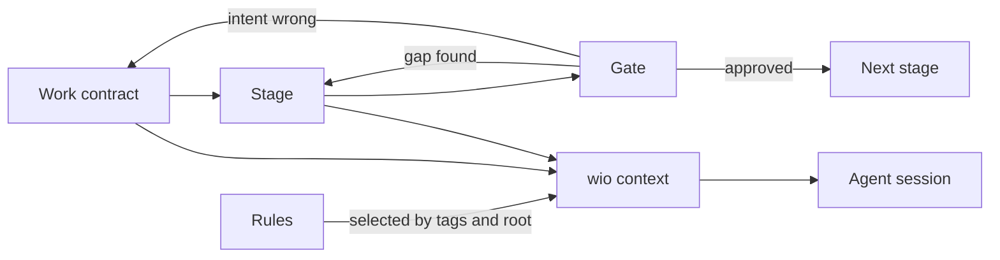

# wio core concepts

This document explains the engine of wio: the few concepts everything else is
built from. It does not describe a particular process. The contract-to-
implementation flow (typed architecture, wired skeleton, implementation) is one
preset that can run on this engine, and it appears only as an example at the
end. Terms are defined in the [glossary](../GLOSSARY.md). Open points are
listed in section 12.

## 1. What the engine is for

A coding agent produces better work when three things are true:

1. It knows what outcome is wanted, and the human has confirmed that
   understanding before expensive work starts.
2. At each step it sees only the guidance that applies to that step, not every
   rule the project has.
3. A human or a fresh reviewer can stop the work at a chosen point and look at a
   small artifact, not at a finished 800-line diff.

wio's engine provides exactly these three things, through five concepts:

| Need | Concept |
| --- | --- |
| Know the intended outcome | **Work contract** |
| Break big outcomes into small ones | **Nesting** (parent and leaf Works) |
| Do the work in separate steps | **Stage** |
| Stop and decide between steps | **Gate** |
| Give each step only its own guidance | **Rules**, selected by tags and compiled into context |

Everything else (skills, presets, rulesets, the event log) plugs into these.

The engine prepares and describes the work; it does not move it forward. That is
the job of a **driver**: whoever advances a Work through its stages. Today the
driver is a human, later it can be an orchestrator. The driver names the stage,
honors the gates and decides what happens after a back-edge. The engine never
decides these things itself.



## 2. Work contract

### What it is

A Work contract is a markdown file that states one outcome and the behaviors
that show it has been achieved. It records **intent**: what should become true,
and why.

It is deliberately not a plan, a task list or a progress report. The reason is
mechanical. Intent changes rarely and by deliberate decision. Progress changes
constantly. If both live in one file, every stage edits the same lines and the
file turns into a conflict magnet. So the contract holds intent, and progress
lives elsewhere (see section 9).

### Anatomy

A contract has a small block of metadata for scripts and markdown sections for
people and agents.

The metadata is TOML. In the templates it sits inside an HTML comment at the top
of the file, so it is hidden when the contract is rendered and readable in the
source:

```markdown
<!-- wio
id = "k3m9xq"     # short random id, generated by `wio contract new`
type = "feature"  # selects the template and the default preset
root = "api"      # the name of the root this leaf touches; a parent has none
-->

# Short outcome title
```

wio also reads the same TOML as front matter between `+++` lines, so a project
can pick either form in its templates. This repository's templates use the
comment form because GitHub shows `+++` front matter as plain text, while other
forges, GitLab for example, render it.

TOML was chosen over YAML, for now, for simplicity: it needs only the standard
library, and strings are always quoted, so an id such as `234567` is never read
as a number. The choice is cheap to change: add a YAML reader and writer (using
a safe load) and change the templates.

The title is the first heading and is stored nowhere else. There is no `parent`
field, because the directory layout gives the hierarchy (see section 3).

The body is prose. A typical contract has a purpose, goals and non-goals, an
explicit list of assumptions, and acceptance criteria (the behaviors).
Assumptions and criteria carry ids (`A-1`, `AC-1`) so that a later amendment can
say precisely what changed.

Why prose and not a strict schema? Because the reader is mostly an agent, and an
agent reads prose well. Scripts only need the metadata and a few required
sections, so only those are machine-checked.

### Identity and location

- The `id` is random and short (6 to 8 base32 characters). It is generated by
  the script, because models invent or duplicate ids. It is not a UUID (too
  long, untypeable) and not a ticket key (that would tie wio to one tracker).
- Each Work is a directory named for its slug, with the contract inside:
  `.agents/wio/works/<slug>/README.md`. The path is the default and will be
  configurable. Humans navigate by slug and scripts key on the id.

### Work types and templates

Each `type` has a template for each level, a leaf and a parent, for example
`feature.leaf.md` and `feature.parent.md` in `.agents/wio/templates/`. A
template is a markdown file with instructional comments, a `[template]` table in
its metadata block (name, level, description), and directives that tell
`wio contract check` what is mandatory.

- Anyone can add a type by adding a template. That is the main extension point
  for projects.
- A parent and a leaf of the same type differ. For example a parent requires
  visuals and owns constraints that its children inherit.
- Sections are **optional until marked required**, so the agent can choose
  sections based on the intent it gathered.
- Directives live in HTML comments on the heading they govern, for example
  `## Goals <!-- wio: required, items>=1 -->`. They are invisible when the
  contract is rendered, readable in the source, and parseable by a markdown
  parser. The grammar is small: `required`, `items` and `pattern`, and
  `inherit`.
- Authoring comments and directives are removed when a contract is written. The
  `wio` metadata block stays, and `wio contract new` removes the `[template]`
  table from it.

### Changing a contract

Later stages can reveal that the contract was wrong or incomplete. That is
normal, not a failure. The rule is that a downstream stage **proposes** a change
and the human decides. The decision has three outcomes:

- **Abandon**: stop this Work.
- **Amend**: change the acceptance criteria or assumptions, then rework whatever
  depended on them.
- **Ratify**: update the contract to match what was built, without reworking
  anything.

Ratify is the cheap option and the one to watch. Used too often, it turns the
contract from a statement of intent into a log of what happened.

## 3. Nesting

### Parent and leaf

A Work either is a **leaf** (one coherent outcome, executed directly) or a
**parent** (an outcome that is delivered by its children). A child's directory
sits inside its parent's directory, so the hierarchy is the directory tree.
There is no `parent` field and no `children` list, because both are
**computed** from the layout. Stored lists drift; computed ones cannot.

### When to split

For any outcome, ask one question: does it need decomposition?

- **Yes**: it contains independently useful, independently deliverable
  outcomes. Split them into child Works.
- **No**: it is one coherent outcome. Keep it as a leaf.
- **Unknown**: you cannot tell yet. Resolve the uncertainty with the smallest
  exploration that answers it, within the authorized outcome. Exploration can
  inform a split. It never authorizes building the feature.

The Work tree describes outcomes. It does not have to mirror the module tree or
the directory tree of the code.

### One root per leaf

A **root** is a set of directories bound to one toolchain and one set of
rulesets (section 6). A leaf has exactly one root, written as `root` in its
metadata, using the name the config gives that root. If
an outcome spans two roots, for example a FastAPI backend and a Next.js
frontend, it becomes a parent with one leaf per root. This keeps the guidance
for each leaf deterministic: a leaf has exactly one rule stack. A parent has no
root field: its scope is derived as the union of its children.

If a leaf discovers it needs to change a root outside its declared scope, that
is a signal to split, not to widen the scope.

### Inheritance, computed

A child often needs constraints that its parent states. Instead of copying them
into each child, a parent template marks sections as **inheritable** with the
`inherit` directive: its Glossary and its Constraints. `wio contract show` can
then print the leaf together with the inheritable sections of its ancestors. The
agent reads one resolved view and never needs to open whole parent contracts.

A leaf's own Constraints section holds only the constraints the leaf adds. The
inherited ones are not restated, so they cannot drift.

Marking individual acceptance criteria as inheritable is possible later.

### Ordering

Ordering between sibling Works is not stored for now. Dependencies are implied
by the Work tree, and the v0.1 scope is bounded and known. A `depends_on`
mechanism may return when an orchestrator needs it for scheduling.

## 4. Stage

### What it is

A stage is one named step of working on a Work. It answers: *what is being
produced right now, and with which guidance?*

A stage definition has these parts:

| Part | Meaning |
| --- | --- |
| `name` | Identifier used in config, rules and logs. |
| `goal` | A short text that says what to produce. Used when the instructions fit in a few lines. |
| `skill` | A skill name, used instead of a goal when the procedure needs references, templates or scripts. |
| `tags` | Which rules apply (section 7). |
| `approval` | Optional. Marks that a human must approve before the next stage starts. |
| session policy | Whether the stage needs a fresh session, and whether later stages may continue its session. |

A stage with only a goal and tags is valid. A stage with a skill hands its
procedure to that skill. The engine does not care which; it prints the goal or
names the skill, and compiles the rules.

### Why stages exist

Staging lets a cheap artifact be reviewed before an expensive one is built. A
typed signature costs a few lines to produce and a few seconds to review. The
implementation behind it costs far more. If the signature is wrong, only the
signature is redone.

The engine does not decide which stages exist. Projects define stages in the
config file. A project may have one stage or twelve. A single-stage contract is
valid, and still benefits from the intent captured in the contract.

### Stages are not a pipeline

Real work goes back and forth. Implementation may show that the architecture
needs redoing. A review may send the work back one step. The engine therefore
treats stages as a **set of named steps**, and the order is a preset (section
10) that a driver follows, not a rule the engine enforces.

### Who knows which stage is current

Nobody records it. "Which stage is the Work at" is a decision, not a fact that
the repository can answer. A stage may have produced a valid artifact that is
nevertheless not approved, and with back-and-forth the answer is not even
monotonic. So the **driver** names the stage: the human in v0.1, an
orchestrator later. The command that starts a session (`wio context`, given the
Work and the stage) is the declaration.

### Sessions

A stage may require a **fresh session**. Reviews need one, because a reviewer
who shares the author's context shares the author's blind spots. A stage may
also mark itself as **not continuable**, so a later stage will not reuse it.
Otherwise a session may be continued from the previous stage, which saves tokens
because the contract and rules are already loaded. In v0.1 `wio context` only
prints this advice. The driver follows it.

## 5. Gate

### What it is

A gate is a point where work stops until a decision is made. The decision is one
of: continue to the next stage, go back to an earlier stage, or change the
contract.

In the engine a gate is not a separate object. It appears in two forms:

1. **Approval gate**: a stage marked `approval = "human"`. Work does not proceed
   until a person approves the stage's artifact.
2. **Review gate**: a stage whose job is to judge the previous stage's
   artifact. It is a normal stage with its own rules (tagged for review) and
   usually a fresh session. A review stage can itself carry an approval.

Both forms are built from stage properties. This keeps the engine small: there
is no gate type to learn, only stages that stop for a decision.

### What a good gate looks like

- It looks at the **exact revision** that was produced. A reviewer pinned to a
  commit cannot be fooled by later edits.
- It is done by someone other than the author, or by the human.
- It judges the artifact against the contract. The contract is the standard, the
  code is the subject.
- A passing automated check is evidence, not a verdict. A type check proves the
  types agree. It does not prove the design is right.

### What a gate decides

Three outcomes, all of which are normal:

- **Pass**: the next stage starts.
- **Back-edge**: the artifact exposes a gap in an earlier stage's work. Work
  returns to that stage. Repeated back-edges to the same stage are a signal that
  something unknown was treated as known, and the right response is to amend the
  contract or split the Work.
- **Contract change**: the intent was wrong. See section 2.

### What the engine enforces

In v0.1, the engine describes gates and the driver honors them. `wio context`
prints the stage's approval and session advice. It does not block anything.
Enforcement (for example refusing to start a stage whose predecessor lacks an
approval) belongs to a later orchestrator, which keeps the state in its own run
record and not in the repository.

## 6. Roots and rulesets

A **root** is the directories that a set of rules applies to. In a
single-language repo the root is the repo itself. In a monorepo with a backend,
a frontend and Terraform, there are three roots with three different toolchains
and three different sets of guidance.

A **ruleset** is a reusable bundle of rule files, for example "python" or
"fastapi". The repo's config **binds** rulesets to roots:

```toml
[[roots]]
name     = "api"
paths    = ["services/api"]
rulesets = ["python", "fastapi"]

[[roots]]
name     = "infra"
paths    = ["infra"]
rulesets = ["terraform"]
```

A root has a `name`, which contracts use in their `root` field, and `paths`, a
list of directories. The paths are plain directories for now, without globs.
It is a list from the start because adding `paths` later, next to a single
`path`, would mean supporting two forms.

Why bind at the repo level and not inside the ruleset? Because a ruleset must
work in any repo. It does not know where the FastAPI service lives. The repo
does.

A root is a **toolchain boundary**, not a kind of directory. Tests and sources
written in the same language under the same tools share a root. They differ by
rule tags, not by root.

## 7. Rules

### What a rule is

A rule is one atomic instruction with a one-line reason: do X, or don't do Y. It
is a small markdown file.

```markdown
<!-- wio
code = "ARC001"
name = "adapters-return-typed-results"
tags = ["architecture", "review"]
types = ["feature"]            # optional
-->

Adapters return typed results, not raw dicts.

Why: a dict hides the contract from the type checker, so drift appears at runtime.
```

The first line of the body is the rule's summary, and the rest is its reason.

Rules are atomic so they can be combined freely. A long guidance document cannot
be filtered, but forty small rules can be filtered down to the seven that matter
right now.

What is **not** a rule:

- A procedure with steps, references or scripts is a **skill**.
- A mechanical check that a tool can enforce (formatting, a type error, an
  import cycle) belongs in the **tool's config**. If a linter already catches
  it, it should not cost tokens in the bundle.
- Always-needed text (a short list of commands, a few style rules) belongs in
  `AGENTS.md`.

### Codes and families

Rules are identified the way linter rules are. A rule has a **code**, such as
`ARC001`, a **name**, such as `adapters-return-typed-results`, and a one-line
summary (the first line of its body). The letters of the code are its
**family**, which groups rules by topic.

- A ruleset declares its families and owns their prefixes. `wio rule new`
  assigns the next free number in a family, so codes cannot clash inside a
  ruleset, and `wio config check` fails when two rulesets bound in the same repo
  claim the same prefix.
- The code is the stable identifier. Verdicts in the event log and review
  comments cite it, and renaming a rule does not change it.
- A rule file is named `<code>-<name>.md`, so listings sort by family.
- Wherever a rule is shown to a person or an agent, the code and the name appear
  together, so the code is never opaque.

Family and tags are independent: a family groups rules by topic, and tags select
rules for a stage.

### Tags

Tags connect rules to stages. A tag is a label from a vocabulary declared in the
config, similar to the categories in a linter (style, complexity, security). The
vocabulary is declared so a misspelled tag is an error, not a rule that silently
never loads.

A stage lists tags, and a rule lists tags. In v0.1 the matching rule is
**all-of**: a rule applies to a stage only when **every** tag of the rule is
among the stage's tags.

An example shows why. Suppose the architecture stage has tags `[architecture,
testing]`, and the review stage has `[architecture, review]`.

| Rule tags | Architecture stage | Review stage |
| --- | --- | --- |
| `[architecture]` | applies | applies |
| `[architecture, review]` | does not apply | applies |
| `[testing]` | applies | does not apply |

The second rule is reviewer-only: a check that the reviewer applies but the
author is not told in advance. Reviewer-only rules cost tokens only when a
reviewer runs, and a rule that keeps being violated can be promoted by adding
the author's tag.

### What else filters a rule

- **Root**: only rulesets bound to the Work's root are considered.
- **Work type**: an optional `types` list restricts a rule to certain kinds of
  Work.
- **Stage**, through its tags. A stage lists the tags of the rules it should
  see, so an authoring stage and its review stage get different rules without
  any rule naming a stage. Stage names are chosen by each project and a ruleset
  has to work in any repo, so rules refer to tags and never to stage names. To
  scope a rule to exactly one stage, add a tag named after that stage to the
  vocabulary and list it in that stage's tags.

So selection is: root, then Work type, then the stage's tags. Three dimensions
are enough. More would make rules hard to write and reason about.

## 8. The context compiler

`wio context` is the piece that joins everything. It answers: *what should this
agent session read before it starts?*

Inputs: a Work id (or only a root, before a contract exists) and a stage name.
It reads the contract and its ancestors, the stage definition, the rulesets
bound to the root, and the rule files.

Output, printed to the session:

1. A header: Work, stage, number of rules, session advice, and a short bundle id
   (a hash of the text).
2. The stage's goal, or the name of its skill.
3. The resolved contract: the Work plus inheritable sections from its
   ancestors.
4. The selected rules, grouped by tag, in a stable order, each shown with its
   code and name.

Properties that matter:

- **Deterministic**: the same inputs produce the same bytes. This makes it
  testable with golden files and lets two evaluation runs be compared by bundle
  id ("these saw identical context").
- **Pull, not push**: the agent runs it itself as the first step of a stage, so
  a session always gets the bundle for its own stage. A dispatcher that pushed
  the wrong bundle could hand a reviewer the author's rules.
- **Loud failures**: an unknown Work, stage or root is an error. An empty bundle
  looks like success, so it is never produced by mistake. Zero matching rules is
  valid, and the header says so.
- **Explainable**: `wio context` can list why each rule was included or
  excluded.
- **Once per session**: the bundle is injected at session start. If the
  contract is amended afterwards, the session runs the command again.

## 9. Intent in the repo, progress outside

The engine keeps a strict line:

| Lives in the repository | Lives outside the contracts |
| --- | --- |
| Contracts (intent) | Which stage is current (the driver's decision) |
| Templates, rules, config | Whether a Work is done (a ticket, or the human) |
| Artifacts produced by stages | Which stages and criteria were delivered: the merged pull requests |
| | Event log: which stages ran, which rules were injected, review verdicts |

The reason is a fixed-point problem. A commit cannot record a fact that only
becomes true after the commit lands (merged, approved, done). Recording such
facts in the repo needs follow-up commits, and the follow-up commits need
recording too.

So there is no status field in a contract, no per-criterion state, and no stored
current stage. The repo can still be queried for what is **derivable**: the Work
tree, each leaf's scope, and what a contract inherits.

Progress comes from two places:

- **Merged pull requests.** Squash merging copies the pull request description
  into the commit on `main`. Its Work section carries three lines, `ID:`,
  `Stage:` and `Criteria:`. The merge itself is the record, so no follow-up
  commit is needed. A tool can read these lines from the first-parent history,
  skip commits that lack them, and know which stages and criteria were
  delivered. Merged is a signal, not proof: a criterion addressed at the
  architecture stage is specified, not satisfied.
- **The event log.** An append-only JSONL file stored in the user's data
  directory, one file per repo. It holds ids and hashes only, no prompts and no
  code. It is personal to one machine, so history answers "what is merged" for
  everyone, and the log answers "what I started". In v0.1 it records two events:
  - `context`: a session started a stage, with the rule ids and hashes it
    received, the harness and the session id.
  - `verdicts`: a review round ended, with the reviewed commit and a verdict per
    rule code (pass, violation, not applicable, uncertain).

Because events carry the harness session id, they can be joined to the harness's
own transcripts. That gives token and cost totals per Work and per stage, which
is how a project learns what each stage costs and whether a rule earns its
place.

Logging never blocks a command. The log is written because it cannot be
reconstructed later, and analyzed whenever it is needed.

## 10. Presets: process built on the engine

A **preset** is a named ordered list of stages. The engine ships none in v0.1. A
project picks a preset per Work `type`, so most contracts never list stages
themselves.

The engine does not care what the stages are. For illustration only, one
possible preset is the typed-boundary flow:

```toml
[presets]
typed-boundary = [
  "architecture",         # typed signatures and test stubs
  "architecture-review",
  "wiring",               # composed skeleton with stubbed leaves
  "wiring-review",
  "implementation",
  "implementation-review",
]

[types]
feature = "typed-boundary"
bugfix  = "fix-with-regression-test"   # a much shorter preset
```

Other presets are equally valid: a single `implement` stage, a flow that starts
with high-level acceptance tests in a readable DSL, or an organization-specific
procedure with extra approval stages. Presets and rulesets can live in their own
repositories and be used or forked by anyone.

A preset only names stages and orders them. What a stage produces comes from its
goal or skill. How well it produces it comes from the rules its tags select.

## 11. What the engine deliberately does not do

- It does not decide when a stage is done. The driver does.
- It does not store progress or status in contracts.
- It does not run agents. It prepares context for them.
- It does not manage branches, worktrees, publishing or cleanup. Those are
  project conventions.
- It does not assume a language. The typed-boundary preset needs a checker that
  can reject a skeleton cheaply (a type checker, architecture tests), but the
  engine itself only needs files, tags and text.

## 12. Open points

- Whether the harness session id is visible to the `wio context` process, or
  only to hooks. If not, events join to transcripts by time window and working
  directory.
- The exact field names for stage session policy, and the names of the config
  tables (`[types]`, `[presets]`).
- Where a ruleset declares its families and prefixes, and whether rule files
  accept `+++` front matter as well. The rule example above uses the
  `<!-- wio -->` block, as contracts do.
- How contracts refer to a root. This document assumes the root's `name`, with
  globs in `paths` left for later.
- How finished contracts are retired: promote the lasting parts into
  documentation and delete the contract in the final commit, or keep them as
  decision records. Not decided.
- Whether all-of tag matching is enough. It is the simplest rule that works, and
  it can be replaced later without changing the file formats.
- How progress is read from pull requests: how far back to scan, and how an
  unknown history is reported, are for a later `wio next` to decide.
