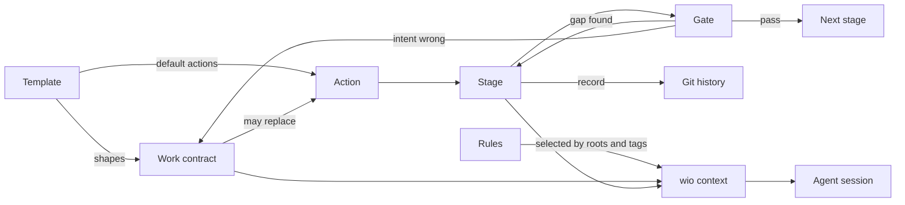

# wio core concepts

This document explains the engine of wio: the few concepts everything else is
built from. It does not describe a particular process. The contract-to-
implementation flow (typed architecture, wired skeleton, implementation) is one
preset that can run on this engine, and it appears only as an example at the
end. Terms are defined in the [glossary](../GLOSSARY.md). Open points are
listed in section 14.

## 1. What the engine is for

A coding agent produces better work when three things are true:

1. It knows what outcome is wanted, and the human has confirmed that
   understanding before expensive work starts.
2. At each step it sees only the guidance that applies to that step, not every
   rule the project has.
3. A human or a fresh reviewer can stop the work at a chosen point and look at a
   small artifact, not at a finished 800-line diff.

wio's engine provides exactly these three things, through a handful of
concepts:

| Need | Concept |
| --- | --- |
| Know the intended outcome | **Work contract**, written from a **template** |
| Break big outcomes into small ones | **Nesting** (parent and leaf Works) |
| Name the kinds of work done on an outcome | **Action**, declared by the project |
| Do an action in separate steps | **Stage** |
| Stop and decide between steps | **Gate** |
| Give each step only its own guidance | **Rules**, selected by roots and tags and compiled into context |

In one sentence: wio runs **actions** on an **outcome**. An action is a
**preset**, an ordered list of stages, some of them gates. A **template** gives
a contract its shape and its default actions, rules are selected for every
stage, and every finished stage leaves a **record** in the git history.
Everything else (skills, presets, rulesets, the event log) plugs into these.

The engine prepares and describes the work; it does not move it forward. That is
the job of a **driver**: whoever advances a Work through its stages. Today the
driver is a human, later it can be an orchestrator. The driver names the action
and the stage, honors the gates and decides what happens after a back-edge. The
engine never decides these things itself. It can propose the next step, and it
warns about inconsistencies, but it never blocks a choice.



## 2. Work contract

### What it is

A Work contract is a markdown file that states one outcome and the behaviors
that show it has been achieved. It records **intent**: what should become true,
and why.

It is deliberately not a plan, a task list or a progress report. The reason is
mechanical. Intent changes rarely and by deliberate decision. Progress changes
constantly. If both live in one file, every stage edits the same lines and the
file turns into a conflict magnet. So the contract holds intent, and progress
lives elsewhere (see section 11).

### Anatomy

A contract has a small block of metadata for scripts and markdown sections for
people and agents.

The metadata is TOML. It sits inside an HTML comment at the top of the file, so
it is hidden when the contract is rendered and readable in the source:

```markdown
<!-- wio
id = "k3m9xq"
template = "feature.leaf"
roots = ["api"]
depends_on = ["a7b2c4"]

[actions]
deliver = ["implementation"]
-->

# Short outcome title
```

- `id`: a short random id.
- `template`: the name of the template this contract follows. The template
  carries the type, the sections and the default actions.
- `roots`: the names of the roots the Work touches (see section 4). It may be
  empty, for example while a Work is still being defined.
- `depends_on`: an optional array of Work ids that must be delivered first (see
  section 4).
- `[actions]`: optional. When present it replaces, in full, the actions the
  template defines (see section 5).

Contract metadata carries no comments. Explanations belong to the template.

The title is the first heading and is stored nowhere else. There is no `parent`
field, because the directory layout gives the hierarchy (see section 4).

The body is prose. A typical contract has a purpose, goals and non-goals, an
explicit list of assumptions, and acceptance criteria (the behaviors).
Assumptions and criteria carry ids (`A-1`, `AC-1`) so that a later amendment can
say precisely what changed.

Why prose and not a strict schema? Because the reader is mostly an agent, and an
agent reads prose well. Scripts only need the metadata and a few required
sections, so only those are machine-checked.

### Metadata forms

wio also reads the same TOML as front matter between `+++` lines. A template
picks the form, and contracts made from it use the same form. The templates in
this repository use the comment form because GitHub shows `+++` front matter as
plain text, while other forges, GitLab for example, render it. A setting for the
form, and a command that rewrites it, may come later.

TOML was chosen over YAML, for now, for simplicity: it needs only the standard
library for reading, and strings are always quoted, so an id such as `234567` is
never read as a number. The choice is cheap to change: add a YAML reader and
writer (using a safe load) and change the templates.

### Identity and location

- The `id` is random and short: 6 to 8 characters of lowercase Crockford base32.
  It is generated, not written by a model, because models invent or duplicate
  ids. It is not a UUID (too long, untypeable) and not a ticket key (that would
  tie wio to one tracker).
- Two contracts with the same id are an error, and `wio contract check` names
  both paths. Copying a Work's directory is the usual cause. Ids are what
  dependencies, records and the event log key on, so a duplicate would merge the
  progress of two Works.
- A **Work** is a directory whose `README.md` contains a `wio` metadata block:
  `.agents/wio/works/<slug>/README.md`. The path is the default and will be
  configurable. Humans navigate by slug and scripts key on the id.
- Anything else in a Work's directory (notes, diagrams, stage artifacts) is
  ignored. Only a subdirectory that is itself a Work makes a child.

### Changing a contract

Later stages can reveal that the contract was wrong or incomplete. That is
normal, not a failure. The rule is that a downstream stage **proposes** a change
and the human decides. The decision has three outcomes:

- **Abandon**: stop this Work by deleting its directory. Git keeps its history.
  Every Work that depends on it must be updated in the same change (see
  section 4).
- **Amend**: change the acceptance criteria or assumptions, then rework whatever
  depended on them.
- **Ratify**: update the contract to match what was built, without reworking
  anything.

Ratify is the cheap option and the one to watch. Used too often, it turns the
contract from a statement of intent into a log of what happened.

Changes to the contract file, including the step where a definition is finished
and the contract takes its final shape, are changes of intent. They are made in
the repository and reviewed like any other change.

## 3. Templates and types

### What a template is

A template is a markdown file that shapes a contract: instructional comments,
directives and a metadata block. Its metadata describes the template itself and
what the contracts made from it look like:

```markdown
<!-- wio
name = "feature.leaf"
type = "feature"
description = "A capability delivered directly as one coherent outcome."

[actions]
deliver = "typed-boundary"

[contract]
roots = []
depends_on = []
-->
```

- `name` is the template's unique name. Two templates cannot share a name, and
  the file name does not matter.
- `type` is the template's type, one of the types the config declares.
- `description` is what tools show when they list templates.
- `[actions]` holds the default actions of every contract that follows the
  template (see section 5).
- `[contract]` is the metadata of the contracts the template produces.

### From template to contract

When wio creates a contract from a template, it prepares the template as a
contract skeleton. The `[contract]` table is promoted to the top level
(`[contract.foo]` becomes `[foo]`), and the template's own keys (`name`, `type`,
`description` and `[actions]`) are dropped. wio always sets `id` and `template`
itself, even if the template specifies them, and it removes comments from the
metadata, because they belong to the template author.

A contract created from a template therefore has exactly the shape the template
describes, and the agent that fills it in sees that shape.

### Types and entry templates

The config declares the valid types, and for each type its **entry template**:
the template that new Works of that type start from.

```toml
[types]
feature = "feature.draft"
bugfix = "bugfix"
```

A type groups templates that serve one kind of outcome. A type can have any
number of templates (a draft, a leaf, a parent, or seven others), each with its
own actions. wio gives them no level or shape: which template a contract
follows is the contract's `template` field, and that decides its sections and
its actions. `wio contract new feature` creates a Work from `feature.draft`, and
a template can also be chosen by name.

How a Work moves from its entry template to another one, for example from a
draft to a leaf or a parent, is a procedure of the stages that define it. wio
does not know about it. It only checks the result.

`wio config check` fails when a type's entry template does not exist or has
another type, and when a template or a rule names a type that is not declared.

Anyone can add a template, and with it a type, and that is the main extension
point for projects. Files in the templates directory without a `wio` metadata
block are ignored.

### Directives

Directives tell `wio contract check` what is mandatory. They live in HTML
comments on the heading they govern, for example
`## Goals <!-- wio: required, items>=1 -->`. They are invisible when the
template is rendered, readable in the source, and parseable by a markdown
parser. The grammar is small: `required`, `items` and `pattern`, and `inherit`.
Sections are **optional until marked required**, so the agent can choose
sections based on the intent it gathered.

Authoring comments and directives are removed when a contract is written. The
`wio` metadata block stays.

### Checking a contract against its template

A contract is checked against the template it names, and only against it:

- Because directives are removed from contracts, wio matches a contract's
  level-2 headings (`##`) to the template's headings by their text, ignoring
  case, surrounding whitespace and a trailing directive comment. Nothing else is
  normalized, so the match stays predictable.
- A `##` heading that the template does not have is a warning. A misspelled
  `## Constraint` would otherwise lose its inheritance without any error.
  Deeper headings are free.
- An entry template should require only what a fresh Work can supply, such as a
  purpose. Works created by a split can sit in the tree for a while before they
  are defined, and they must still pass the check. Stricter templates, such as
  a leaf or a parent, carry the stricter directives. This is guidance for
  template authors; the engine rule is only "check against your template".
- Changing a template changes the checks for every contract that follows it. A
  template change is a reviewed change, and `wio contract check` lists the
  contracts it breaks, so they are fixed in the same change or moved to a new
  template.

## 4. Nesting

### Parent and leaf

A Work either is a **leaf** (it has no child Works) or a **parent** (it is
delivered by its children). A child's directory sits inside its parent's
directory, so the hierarchy is the directory tree. There is no `parent` field
and no `children` list, because both are **computed** from the layout. Stored
lists drift; computed ones cannot.

Between the Works directory and any Work, every directory must itself be a Work.
A directory without a contract between two Works is an error, so the tree means
exactly the hierarchy and nothing has to skip a level. The Works directory
itself is the only exception, and it may hold a `README.md` without a `wio`
block, for example an index for people.

### When to split

For any outcome, ask one question: does it need decomposition?

- **Yes**: it contains independently useful, independently deliverable
  outcomes. Split them into child Works.
- **No**: it is one coherent outcome. Keep it as a leaf.
- **Unknown**: you cannot tell yet. Resolve the uncertainty with the smallest
  exploration that answers it, within the authorized outcome. Exploration can
  inform a split. It never authorizes building the feature.

The Work tree describes outcomes. It does not have to mirror the module tree or
the directory tree of the code.

How a split is carried out, and whether the pieces become nested children or
flat siblings, is a procedure that a stage and its skill own. wio only reads the
result: the directory layout and the metadata.

### Roots of a Work

A **root** is a set of directories bound to one toolchain and its rulesets
(section 8). A Work names the roots it touches in `roots`, using the names the
config gives them.

- A leaf's roots are the ones it declares.
- A parent's roots are the ones it declares, if any. Otherwise they are the
  union of the roots of its descendant leaves, computed. Declared roots replace
  the union, as a contract's `[actions]` replace the template's, so a parent can
  name a root that none of its children touch, for example one for end-to-end
  tests.
- `roots` may be empty. That is not an error in `wio contract check`. It fails
  only when a stage selects rules by the Work's roots (section 6), and then
  loudly.

How many roots a leaf may have is a choice of the workflow. A preset can ask
for exactly one root per leaf, so that an outcome spanning a FastAPI backend
and a Next.js frontend becomes a parent with one leaf per root. wio does not
enforce it.

### Inheritance, computed

A child often needs constraints that its parent states. Instead of copying them
into each child, a parent's template marks sections as **inheritable** with the
`inherit` directive, for example its Glossary and its Constraints. `wio contract
show` can then print the leaf together with the inheritable sections of its
ancestors. The agent reads one resolved view and never needs to open whole
parent contracts.

A leaf's own Constraints section holds only the constraints the leaf adds. The
inherited ones are not restated, so they cannot drift.

Marking individual acceptance criteria as inheritable is possible later.

### Dependencies

A Work can depend on other Works. Its metadata has an optional `depends_on`, an
array of Work ids:

```toml
depends_on = ["a7b2c4", "k3m9xq"]
```

- Dependencies are ids, never paths, so moving or renaming a Work's directory
  breaks nothing. The tree gives the hierarchy, and `depends_on` adds an
  ordering graph on top of it. Nesting only decides what is inherited;
  `depends_on` works the same for nested and flat Works.
- `wio contract check` verifies that every id exists and that there are no
  cycles, counting the implicit edge from each child to its parent for delivery.
- A `depends_on` id that no longer exists is an error. Whoever removes a Work,
  because it was abandoned or because the project retires finished Works,
  updates its dependents in the same change: drop the edge when the work is
  done, or rethink the dependent when it was abandoned. `wio contract show`
  lists the dependents of a Work, and the error names them.
- A dependency means the other Work must be delivered first. Whether it also
  holds back the dependent's definition, and whether a parent's dependencies
  also apply to its descendants, are open points.

### Tracking criteria (planned)

This is planned for v0.2 or v0.3 and is not part of v0.1.

A parent's acceptance criteria are usually established by its descendants
together, and the parent is written before they exist. So the link runs from the
child upward: a criterion of a Work can track a criterion of another Work, such
as a parent, a grandparent or a sibling. The links live in the contract's
metadata block, in a `[tracks]` table keyed by the Work's own criterion ids:

```toml
[tracks]
AC-1 = ["31as8f AC-3"]
AC-2 = ["31as8f AC-3", "871df7 AC-4"]
```

- To track means to contribute to, not to be enough for. Several children
  together establish one parent criterion.
- `wio contract check` verifies that every referenced Work and criterion exists,
  so an amendment that removes a criterion shows up as a dangling link.
- The parent never lists its children. The criteria that track a parent
  criterion are computed from the descendants.
- A parent criterion that nothing tracks is a warning, not an error. Some
  system-level criteria are verified only at the parent's integration stage.
- Records carry no extra trailer for this. Their `Wio-Criteria` together with
  the contract's links gives the same information.
- Constraints are not covered. They are inherited, not traced.

The exact shape of the table is open. A flat table with one string per target,
as above, is the simplest. Nested tables per target Work, such as
`[tracks.31as8f]` with `AC-1 = ["AC-3"]`, keep the Work id and the criterion id
as separate pieces of data.

## 5. Actions

### What an action is

An action is a named kind of work done on a Work. wio has no built-in actions.
The config declares them, each with a description:

```toml
[actions.define]
description = "Turn an intent into a contract, and split it when needed."

[actions.deliver]
description = "Build what the contract says."
```

The description is written for agents, like a skill's description: an agent
reads it to choose the action that fits what the user asked for. `wio contract
show` lists a Work's actions with their descriptions and pipelines. The order of
the tables is the order in which `wio next` proposes actions.

`define` and `deliver` are the actions this repository uses, and they are only
examples. Nothing in the engine sets one action apart from another, so a
project can add as many as it needs, such as an `amend` action for changing a
delivered contract.

An action's **pipeline** is either a **preset** (an ordered list of stages, by
preset id) or a list of **stage names**. In both, some stages may be gates.

### Where the pipeline comes from

A contract follows a template, and the template's `[actions]` give the default
pipeline of each action. A contract may carry its own `[actions]`, and then it
**replaces all of the template's actions**, not only the ones it names:

```toml
[actions]
deliver = ["implementation"]
```

This is how a small leaf skips the stages a large parent needs. Because the
block replaces everything, an action that is left out does not apply to the
Work. A contract's `[actions]` customizes its pipelines and has no other
meaning.

A string value is a preset id and an array is a list of stage names, so a
one-stage pipeline is a one-element array. Action names, stage names and preset
ids must exist in the config. A contract that names stages is free to skip any
of them, including gates. Hygiene is the project's business, and guidance and
presets can encourage good practice.

wio does not update a contract that has its own `[actions]` when the template or
the config changes. `wio contract check` reports names that no longer exist.

### Procedures belong to stages

Splitting a Work, promoting a leaf to a parent, demoting a parent, moving a
Work from its entry template to its final one: these are procedures. Each is a
stage with a skill, and wio does not know how they work. wio has no concept of a
stub, a draft or a level, and it does not know whether a Work is "defined".
Which actions a Work has done is progress, and progress is read from history
(section 11).

What wio does is provide context to each stage, select its rules, log what
happens and check invariants afterwards.

### What `wio next` proposes

This comes in v0.2 and is not part of v0.1.

`wio next` proposes the next action and stage for a Work. It is a heuristic over
the records in the git history (section 11), and the driver may do something
else. Every proposal says so in one fixed line.

- Actions are considered in the order the config declares them. The proposal is
  the first stage, in the first action, that is not current.
- A stage is **current** when it has a record, and its latest record is newer
  than the latest record of every earlier stage in the same pipeline. When an
  earlier stage is done again after a back-edge, the stages after it stop being
  current, and `wio next` proposes them again.
- Only stages in the Work's current pipeline count. Records of a stage that the
  pipeline no longer contains are ignored, for example after a leaf is promoted
  to a parent with a different pipeline.
- Which results let a gate's next stage start is declared with the results,
  when `wio next` is built.

For a whole tree, defining runs top-down and delivering runs bottom-up. A parent
is defined before the Works its split creates, and a parent is delivered after
its children. The leaves to deliver, with `depends_on`, form a graph that can be
sorted into batches, and the Works in one batch can run in parallel, for
example `(("32sa4k", "97fqmz"), "213asx", ("8asd2w", "732sfa"))`.

Stages of different Works do not interleave. A boundary that several leaves
share is extracted as a leaf of its own and delivered first, and the other
leaves depend on it. The [split exercises](split-exercises.md) walk through
this.

### Invariants wio checks

`wio contract check` and `wio config check` verify mechanically what wio relies
on, and they do not judge how a workflow is built:

- Every contract names an existing template, and the template's type is a
  declared type. Every type's entry template exists and has that type.
- No two contracts share an id, and every directory between the Works directory
  and a Work is itself a Work.
- The actions a contract resolves to are not empty, and each pipeline has at
  least one stage. An outcome with nothing to deliver belongs in the ticketing
  system, not in the repository.
- Every action name, preset id and stage name in a template or a contract
  exists.
- Every root a contract or a stage names is a root in the config.
- Every `depends_on` id exists, and there are no cycles.
- Required sections are present, as the template's directives say. A `##`
  heading the template does not have is a warning.

## 6. Stage

### What it is

A stage is one named step of working on a Work. It answers: *what is being
produced right now, and with which guidance?*

A stage definition has these parts:

| Part | Meaning |
| --- | --- |
| `name` | Identifier used in config, rules, records and logs. |
| `goal` | A short text that says what to produce. Used when the instructions fit in a few lines. |
| `skill` | A skill name, used instead of a goal when the procedure needs references, templates or scripts. |
| `tags` | Which rules apply (section 9). |
| `roots` | Optional. Which roots the stage selects rules from (section 8). Without it, the stage uses the Work's roots. |
| session policy | Whether the stage needs a fresh session, and whether later stages may continue its session. |

```toml
[stages.define]
skill = "wio-define"
tags = ["contract"]
roots = ["contract"]

[stages.architecture-review]
goal = "Review the typed boundaries against the contract."
tags = ["architecture", "review"]
```

A stage with only a goal and tags is valid. A stage with a skill hands its
procedure to that skill. The engine does not care which; it prints the goal or
names the skill, and compiles the rules.

Stage names are global in the config, so the same stage can appear in the
pipelines of several actions. That is why every command, record and event
names the action as well as the stage.

### Why stages exist

Staging lets a cheap artifact be reviewed before an expensive one is built. A
typed signature costs a few lines to produce and a few seconds to review. The
implementation behind it costs far more. If the signature is wrong, only the
signature is redone.

The engine does not decide which stages exist. Projects define stages in the
config file. A project may have one stage or twelve. A single-stage contract is
valid, and still benefits from the intent captured in the contract.

### Stages are not a pipeline

Real work goes back and forth. Implementation may show that the architecture
needs redoing. A review may send the work back one step. The engine therefore
treats stages as a **set of named steps**, and the order is a preset (section
12) that a driver follows, not a rule the engine enforces.

### Who knows which stage is current

Nobody stores it. "Which stage is the Work at" is a decision, not a fact that
the repository can answer. A stage may have produced a valid artifact that did
not pass its review, and with back-and-forth the answer is not even monotonic.
So the **driver** names the stage: the human in v0.1, an orchestrator later.
The command that starts a session (`wio context`, given the Work, the action and
the stage) is the declaration. What the history can say is which stages left a
record, and `wio next` proposes from that (section 5).

### Sessions

A stage may require a **fresh session**. Reviews need one, because a reviewer
who shares the author's context shares the author's blind spots. A stage may
also mark itself as **not continuable**, so a later stage will not reuse it.
Otherwise a session may be continued from the previous stage, which saves tokens
because the contract and rules are already loaded. In v0.1 `wio context` only
prints this advice. The driver follows it.

## 7. Gate

### What it is

A gate is a point where work stops until a decision is made. The decision is one
of: continue to the next stage, go back to an earlier stage, or change the
contract.

In the engine a gate is not a separate object. It is a stage whose job is to
judge the previous stage's artifact, and whose record carries a **result** from
the `results` vocabulary in the config (section 11). It is a normal stage with
its own rules (tagged for review) and usually a fresh session.

Who judges is the workflow's business. A review can be done by an agent in a
fresh session with a different ruleset, or by a human. A human approval is a
review stage too, for example `architecture-approval`, whose goal says that a
person approves the artifact. The human records the result, or tells the agent
to record it, and the commit's author shows who did. A review that changes no
files records its result in an empty commit.

There is no gate type to learn and no approval flag, only stages that record a
result.

### What a good gate looks like

- It looks at the **exact revision** that was produced. A reviewer pinned to a
  commit cannot be fooled by later edits. The `review` event records that
  commit (section 11).
- It is done by someone other than the author, or by the human.
- It judges the artifact against the contract. The contract is the standard, the
  code is the subject.
- A passing automated check is evidence, not a verdict. A type check proves the
  types agree. It does not prove the design is right.

### What a gate decides

Three outcomes, all of which are normal:

- **Pass**: the next stage starts.
- **Back-edge**: the artifact exposes a gap in an earlier stage's work. Work
  returns to that stage. Repeated back-edges to the same stage are a signal that
  something unknown was treated as known, and the right response is to amend the
  contract or split the Work.
- **Contract change**: the intent was wrong. See section 2.

### What the engine enforces

In v0.1, the engine describes gates and the driver honors them. `wio context`
prints the stage's session advice, and `wio trailers` records the result. It
does not block anything. Enforcement (for example refusing to start a stage
whose gate did not pass) belongs to a later orchestrator, which keeps the state
in its own run record and not in the repository.

## 8. Roots and rulesets

A **root** is the directories that a set of rules applies to. In a
single-language repo the code is one root. In a monorepo with a backend, a
frontend and Terraform, there are three roots with three different toolchains
and three different sets of guidance.

A **ruleset** is a reusable collection of rule files, for example "python" or
"fastapi". The repo's config **binds** rulesets to roots:

```toml
[[roots]]
name     = "api"
paths    = ["services/api"]
rulesets = ["python", "fastapi"]

[[roots]]
name     = "infra"
paths    = ["infra"]
rulesets = ["terraform"]

[[roots]]
name     = "contract"
paths    = [".agents/wio/works"]
rulesets = ["contracts"]
```

A root has a `name`, which contracts and stages use, and `paths`, a list of
directories. Why bind at the repo level and not inside the ruleset? Because a
ruleset must work in any repo. It does not know where the FastAPI service lives.
The repo does.

A root is a **toolchain boundary**, not a kind of directory. Tests and sources
written in the same language under the same tools share a root. They differ by
rule tags, not by root.

### The contract root

The contracts are a directory with their own tooling too, and the rules for
writing them (how to state a criterion, what an assumption is) are a ruleset
like any other. A project binds it to a root whose paths are the Works
directory, named `contract` in the example. Define stages select that root with
`roots = ["contract"]`, so a Work that is still being defined, and has no roots
yet, gets the rules for writing contracts. An amendment of a delivered leaf gets
them as well, and not the rules of the code the leaf touches.

### Which roots a stage selects

Rules are selected by the root the stage edits:

- A stage without `roots` uses the Work's roots: the declared ones, or for a
  parent without declared roots, the union of its leaves' roots (section 4).
- A stage with `roots` uses exactly those. The entry `@work` stands for the
  Work's roots, so a contract review that checks criteria against real modules
  can use `roots = ["contract", "@work"]`. Root names cannot contain `@`.
- If the stage selects the Work's roots and the Work has none, `wio context`
  fails loudly. A Work that skipped its definition fails the moment it is
  delivered, and a Work being defined never reaches this case.

### Paths

In v0.1 `paths` are descriptive. Rules are selected by root name, never by
path, so paths are used for three things:

- the header of each group of rules in a bundle, so the agent knows which files
  the rules are for (section 10);
- the scope that `wio contract tree` shows;
- `wio rule list --path <file>`, which answers "which rules apply to this
  file?": every root whose paths contain the file, then the rules of their
  rulesets, optionally narrowed by a stage's tags. An agent can ask it about a
  file it is about to change, and a driver can ask it when auditing the rules
  of a large repo.

Paths are plain directories, without globs, relative to the repo root.
`wio config check` verifies that they are normalized and stay inside the repo,
and that a root lists no path twice. A path that does not exist yet is a
warning, not an error, because a new root's directory is often created by the
Work that needs it. Roots may overlap: `repo = ["."]` and
`api = ["services/api"]` can coexist, and a file in both gets the rules of both
from `wio rule list --path`. Files outside every specific root, such as CI
configuration, belong to a root the project defines for them.

## 9. Rules

### What a rule is

A rule is one atomic instruction with a one-line reason: do X, or don't do Y. It
is a small markdown file.

```markdown
<!-- wio
code = "ARC001"
name = "adapters-return-typed-results"
tags = ["architecture", "review"]
types = ["feature"]            # optional
-->

Adapters return typed results, not raw dicts.

Why: a dict hides the contract from the type checker, so drift appears at runtime.

Example: `fetch_user(id) -> User | NotFound`, not `fetch_user(id) -> dict`.
```

Everything after the metadata block is the rule's **body**, and the bundle
shows it exactly as written (section 10). wio does not parse it, so the author
controls its formatting. A convention keeps rules alike:

- The first paragraph is the instruction. `wio rule list` shows it as the
  rule's summary.
- A paragraph that starts with `Why:` gives the reason. An agent that knows why
  a rule exists applies it sensibly at its edges instead of literally.
- An optional paragraph that starts with `Example:`, which may be followed by a
  short code block, shows the rule applied. An example that needs steps or
  several files is a sign that the guidance is a skill.
- The body has no Markdown headings, because they would break the structure of
  the bundle it is injected into.

`wio rule check` checks the metadata, not the body.

Rules are atomic so they can be combined freely. A long guidance document cannot
be filtered, but forty small rules can be filtered down to the seven that matter
right now.

What is **not** a rule:

- A procedure with steps, references or scripts is a **skill**.
- A mechanical check that a tool can enforce (formatting, a type error, an
  import cycle) belongs in the **tool's config**. If a linter already catches
  it, it should not cost tokens in the bundle.

What a project puts in its `AGENTS.md` is its own business. A rule that applies
to every stage can still be a rule (see "Tags" below): it then reaches only wio
sessions for its roots, not everyone who opens the repository with an agent.

### Codes and families

Rules are identified the way linter rules are. A rule has a **code**, such as
`ARC001`, a **name**, such as `adapters-return-typed-results`, and a summary
(the first paragraph of its body). The letters of the code are its
**family**, which groups rules by topic.

- A ruleset declares its families and owns their prefixes. `wio rule new`
  assigns the next free number in a family, so codes cannot clash inside a
  ruleset, and `wio config check` fails when two rulesets bound in the same repo
  claim the same prefix.
- The code is the stable identifier. Review events and review comments cite it,
  and renaming a rule does not change it.
- A rule file is named `<code>-<name>.md`, so listings sort by family.
- Wherever a rule is shown to a person or an agent, the code and the name appear
  together, so the code is never opaque.

Family and tags are independent: a family groups rules by topic, and tags select
rules for a stage.

### Rulesets on disk

A ruleset is a directory of rule files with a `ruleset.toml` manifest, which
names the ruleset and declares its families. The rulesets of a repository live
in `.agents/wio/rules/`, one directory each:

```text
.agents/wio/rules/
  contracts/
    ruleset.toml
    CON001-purpose-says-why.md
    ACC004-state-the-boundaries.md
```

```toml
name = "contracts"
description = "How to write and review Work contracts."

[families]
CON = "Contract sections"
ACC = "Acceptance criteria"
```

A ruleset is data: it can be copied from another repository, and copied again
when it is updated. So nothing that a repository decides about a ruleset lives
in the ruleset's own files.

### Choosing rules from a ruleset

A repository rarely wants all of a ruleset written by someone else, and that
ruleset's tags rarely match the repository's vocabulary. The config chooses
the rules and maps their tags, in a table per ruleset:

```toml
[rulesets.mattpocock]
include = ["TSX", "ERR003", "ERR007"]   # families or codes; omitted = everything
exclude = ["TSX012"]                    # taken out of an included family

[rulesets.mattpocock.tags]              # override the ruleset author's tags
TSX = ["implementation"]                # for a whole family
ERR003 = ["implementation", "review"]   # for one rule; wins over its family
```

- A ruleset without a table is used whole, with the tags its rules declare.
- A rule's **effective tags** are its code's override if there is one, else its
  family's, else the tags in its own file. Everything that matches tags works
  on the effective tags: selection for a stage, the vocabulary check, the note
  about always-on rules and the warning about rules that reach no stage.
- A selected rule whose effective tags are not all in the vocabulary is an
  error that names the rule, so a copied rule never goes missing silently. It
  is mapped or excluded.
- Including a family includes the rules added to it later, when the ruleset is
  copied again. Rules included by code stay as they are. Codes are stable, so
  the lists survive renames.

### Tags

Tags connect rules to stages. A tag is a label from a vocabulary declared in the
config (a rule's tags here are its effective tags, see above), similar to the
categories in a linter (style, complexity, security). The vocabulary is declared
so a misspelled tag is an error, not a rule that silently never loads.

A stage lists tags, and a rule lists tags. In v0.1 the matching rule is
**all-of**: a rule applies to a stage only when **every** tag of the rule is
among the stage's tags.

An example shows why. Suppose the architecture stage has tags `[architecture,
testing]`, and the review stage has `[architecture, review]`.

| Rule tags | Architecture stage | Review stage |
| --- | --- | --- |
| `[architecture]` | applies | applies |
| `[architecture, review]` | does not apply | applies |
| `[testing]` | applies | does not apply |
| `[]` | applies | applies |

The second rule is reviewer-only: a check that the reviewer applies but the
author is not told in advance. Reviewer-only rules cost tokens only when a
reviewer runs, and a rule that keeps being violated can be promoted by adding
the author's tag.

The last rule has no tags, so it applies to every stage that selects its root.
That is valid, and it is how a project states a rule that is always on within
its roots. `wio rule list` marks such rules, and `wio rule check` reports them
as a note that does not change its exit code, so the driver can review them.

A rule whose tags no stage has, so that it can never be selected, is a warning
in `wio rule check`.

### What else filters a rule

- **Roots**: only rulesets bound to the roots the stage selects are considered
  (section 8).
- **Template type**: an optional `types` list restricts a rule to certain types
  of Work. The names must be declared types.
- **Stage**, through its tags. A stage lists the tags of the rules it should
  see, so an authoring stage and its review stage get different rules without
  any rule naming a stage. Stage names are chosen by each project and a ruleset
  has to work in any repo, so rules refer to tags and never to stage names. To
  scope a rule to exactly one stage, add a tag named after that stage to the
  vocabulary and list it in that stage's tags.

So selection is: roots, then template type, then the stage's tags. Three
dimensions are enough. More would make rules hard to write and reason about.

## 10. The context compiler

`wio context` is the piece that joins everything. It answers: *what should this
agent session read before it starts?*

Inputs: a Work id, an action and a stage. The Work always exists first: a new
intent starts with `wio contract new <type>`, which creates the Work from the
type's entry template, and its definition then runs as stages of an action like
any other. `wio context` reads the contract and its ancestors, the stage
definition, the rulesets bound to the roots the stage selects, and the rule
files.

Output, printed to the session:

1. A header: the Work, the action, the stage, the session advice, the number of
   rules, the size of the bundle in bytes and lines, a short bundle id (a hash
   of the text), and the exact command that produced the bundle.
2. The stage's goal, or the name of its skill.
3. The resolved contract: the Work plus inheritable sections from its
   ancestors.
4. The selected rules. They are grouped by the set of roots they apply to, each
   group under one line that names the roots and their paths, such as
   `Rules for root api (services/api):`, and then by the set of their tags, in
   a stable order. Each rule is a line with its code and name, followed by its
   body exactly as written, and rules are separated by two newlines, or by the
   separator the config sets. A ruleset bound to two roots of the Work gives
   each rule once, in the group for both roots.
5. One fixed closing line: if the session's context was compacted, run the
   command from the header again.

Properties that matter:

- **Deterministic**: the same inputs produce the same bytes. This makes it
  testable with golden files and lets two evaluation runs be compared by bundle
  id ("these saw identical context").
- **Pull, not push**: the agent runs `wio context` itself as the first step of
  a stage. That works with any harness that can run a command, it makes the
  command the session's own declaration of its stage, and it lets the `context`
  event be written from inside the session, with the session's id. A wrong stage
  is caught by reading the header, which shows the Work, action, stage and goal
  first.
- **Loud failures**: an unknown Work, action, stage or root is an error, and so
  is a stage that selects the Work's roots when the Work has none. An empty
  bundle looks like success, so it is never produced by mistake. Zero matching
  rules is valid, and the header says so. A stage that is not in the Work's
  actions is only a warning, because the driver decides.
- **Explainable**: `wio context` can list why each rule was included or
  excluded.
- **Sized**: harnesses truncate long command output, and a truncated bundle
  looks complete. The header states the size, an optional threshold in the
  config turns an oversized bundle into a warning, and `--output <path>` writes
  the bundle to a file that the agent reads with its file tools.
- **Once per session, and again when needed**: the bundle is injected at session
  start. If the contract is amended afterwards, or the harness compacts the
  context, the session runs the command again and gets the same bundle id. Hooks
  that do this automatically are harness integration, not part of the engine.

## 11. Intent in the repo, progress in the history

The engine keeps a strict line:

| Lives in the working tree | Lives outside the contracts |
| --- | --- |
| Contracts (intent) | Which action and stage is current (the driver's decision) |
| Templates, rules, config | Whether a Work is done (a ticket, or the human) |
| Artifacts produced by stages | Which stages were done, with their results: records in the git history |
| | Event log: which sessions ran, which rules they received, review results |

The reason is a fixed-point problem. A commit cannot record a fact that only
becomes true after the commit lands (merged, approved, done). Recording such
facts in the files needs follow-up commits, and the follow-up commits need
recording too.

So there is no status field in a contract, no per-criterion state, and no stored
current stage. The working tree can still be queried for what is
**derivable**: the Work tree, each Work's roots, and what a contract inherits.
Which Works exist is whatever is in the working tree, committed or not.

A change of intent is different from progress. A contract that takes its final
shape, or that gets its own `[actions]`, is an edit of intent that is made and
reviewed in the repository. Which stage the Work is in, and whether the outcome
is truly done, stay outside.

Progress comes from two places: records in the git history, which are shared,
and the event log, which is personal.

### Records

A **record** says that a stage of a Work was done. It is a paragraph of git
trailers in a commit message:

```text
Wio-Work: k3m9xq
Wio-Action: deliver
Wio-Stage: architecture-review
Wio-Criteria: AC-1, AC-3
Wio-Result: pass
```

| Trailer | Meaning |
| --- | --- |
| `Wio-Work` | The Work's id, or `none` for a commit that belongs to no Work. Required. |
| `Wio-Action` | The action the stage belongs to. Required unless the Work is `none`. |
| `Wio-Stage` | The stage that was done. Required unless the Work is `none`. |
| `Wio-Criteria` | The acceptance criteria the stage addresses, separated by commas. Optional. |
| `Wio-Result` | The gate's result, one of the `results` in the config. Only for stages that judge an artifact. |

- **One record is one paragraph.** A commit message can hold several records,
  each in its own paragraph. Repeating keys inside one paragraph would lose
  which criteria belong to which stage, so a record never does.
- **Every finished stage leaves a record.** A stage that changes no files, such
  as a review, records itself in an empty commit.
- **wio reads every record reachable from `HEAD`.** It does not assume a
  workflow: a squash-merged `main`, the commits of the current branch, and a
  repository without branches are read the same way. A branch that was
  abandoned is not reachable and does not count. Uncommitted work leaves no
  record. Records are a signal, not proof: a criterion addressed at the
  architecture stage is specified, not satisfied.
- **The latest record of a stage counts.** Order is the order of the history,
  and within one commit the order of the paragraphs (see `wio next` in section
  5).
- **Unknown ids are ignored.** A record of a Work that was deleted refers to
  nothing and does no harm.

`wio trailers <work> <action> <stage> [--criteria ...] [--result ...]` prints a
checked record: the Work exists, the criteria exist in its contract, the result
is in the vocabulary, and the stage is in the Work's actions (a warning, as in
`wio context`). `wio trailers check` reads a commit message or a pull request
body and checks every record in it. A project can call it from a commit-msg
hook and from CI. Writing and checking records is part of v0.1. Reading them
from the history comes with `wio next` in v0.2.

### Reading records

How a workflow moves commit messages around decides where records end up. A
squash merge on GitHub, for example, replaces the branch's commit messages
with the pull request's body, and when the branch's commits have co-authors it
appends a separate `Co-authored-by` paragraph after it. Git itself only parses
the last paragraph of a message as trailers, so records in the body are no
longer trailers to git.

The reader is therefore a setting:

```toml
[trailers]
reader = "scan"
```

- `scan` (the default) reads every paragraph in which every line is a
  `Key: value` trailer and some key starts with `Wio-`, anywhere in the message,
  outside fenced code blocks. The code blocks are skipped because a message
  often quotes example records, like this document does.
- `git` uses git's own trailer parsing (`git log --format=%(trailers)`), for
  workflows that keep records in the last paragraph: rebase merges, merge
  commits, or squash merges with an explicit message.

The two can disagree on edge cases. Git accepts a last paragraph that is only
partly trailers when it contains a trailer git generated itself, and `scan`
requires every line to be one. Reading records from git notes is a possible
third reader, later.

### The event log

An append-only JSONL file stored in the user's data directory, one file per
repo. It holds ids, hashes and codes only, no prompts, no code and no free
text. It is personal to one machine, so the history answers "what was done"
for everyone, and the log answers "what I started". Writing it never blocks a
command, a failure is only a warning, and it can be turned off. In v0.1 it
records two events:

- `context`: a session started a stage, with the Work, action, stage, bundle
  id, size, rule codes, the harness and the session id. A second event with the
  same session and bundle id is the bundle being injected again, not a new
  stage.
- `review`: a gate finished, with the Work, action, stage, the reviewed commit,
  the overall result, and a result for each cited item, a rule code or a
  criterion id (`ARC001=fail`, `AC-2=pass`). What is not cited was not judged.

Results come from a vocabulary that the config declares, as tags do, so a
misspelled result is an error:

```toml
results = ["pass", "fail", "unknown"]
```

The record in the history carries only the overall result. The log keeps the
detail, including the reviewed commit, which a squash merge would remove from
the history.

Because events carry the harness session id, they can be joined to the harness's
own transcripts. That gives token and cost totals per Work and per stage, which
is how a project learns what each stage costs and whether a rule earns its
place.

## 12. Presets: process built on the engine

A **preset** is a named ordered list of stages. The engine ships none in v0.1. A
preset becomes the pipeline of an action wherever a template or a contract names
it, so most contracts never list stages themselves.

The engine does not care what the stages are. For illustration only, one
possible preset is the typed-boundary flow, and a template binds it to the
`deliver` action:

```toml
[presets]
define-feature = ["define", "review-contract", "split"]
typed-boundary = [
  "architecture",         # typed signatures and test stubs
  "architecture-review",
  "wiring",               # composed skeleton with stubbed leaves
  "wiring-review",
  "implementation",
  "implementation-review",
]
```

```markdown
<!-- wio
name = "feature.leaf"
type = "feature"
description = "A capability delivered directly as one coherent outcome."

[actions]
deliver = "typed-boundary"

[contract]
roots = []
-->
```

Other presets are equally valid: a single `implement` stage, a flow that starts
with high-level acceptance tests in a readable DSL, or an organization-specific
procedure with extra approval stages. Presets and rulesets can live in their own
repositories and be used or forked by anyone. Joining presets, so that one is
built from others, may come later.

A preset only names stages and orders them. What a stage produces comes from its
goal or skill. How well it produces it comes from the rules its tags select.

## 13. What the engine deliberately does not do

- It does not decide when a stage is done, or which action comes next. The
  driver does. `wio next` only proposes.
- It does not store progress or status in contracts.
- It does not run agents. It prepares context for them.
- It does not prescribe a workflow. Splitting, promoting and demoting Works,
  how many roots a leaf has, and who approves a gate are choices of the
  workflow; wio checks the invariants afterwards.
- It does not manage branches, worktrees, merges, publishing or cleanup. Those
  are project conventions. It reads the records that reach `HEAD`, however they
  got there.
- It does not lint Markdown. wio checks its own parts of a file (the metadata
  block, the directives and the sections they require), and the project's own
  tools check the rest.
- It does not assume a language. The typed-boundary preset needs a checker that
  can reject a skeleton cheaply (a type checker, architecture tests), but the
  engine itself only needs files, tags and text.

## 14. Open points

- Whether the harness session id is visible to the `wio context` process, or
  only to hooks. If not, events join to transcripts by time window and working
  directory.
- The config schema: the exact field names for stage session policy, and the
  names of the config tables (`[types]`, `[actions]`, `[stages]`, `[presets]`,
  `[trailers]`).
- Whether rule files accept `+++` front matter as well. The rule example above
  uses the `<!-- wio -->` block, as contracts do.
- Mapping tag names when a ruleset's vocabulary is close to the repository's,
  such as `style = "implementation"`. Family overrides cover most cases.
- Two rulesets that claim the same family prefix cannot both be bound. Renaming
  a prefix when binding could solve it later.
- Stage-level ordering across the tree. A parent is delivered after its
  children, and a shared boundary is a leaf of its own, so interleaved stages
  are not needed. Records and the log key on the Work, the action and the
  stage, so they can be added later.
- Whether a parent's `depends_on` also applies to its descendants. The current
  lean is no.
- Whether defining a Work holds back on its dependencies, so the dependent's
  contract can cite the dependency's contract, while independent Works are
  defined in parallel. The first split exercise leans towards yes.
- Which results let a gate's next stage start, for `wio next`, for example
  `pass` continues and `fail` goes back.
- Path hints for rules inside a root, so a ruleset can say which files of the
  root it is for, for example tests colocated with sources. The preferred shape
  is paths on a binding, such as
  `rulesets = ["python", { name = "pytest", paths = ["**/*_test.py"] }]`. It
  changes only how bundles and `wio rule list --path` show rules, not which
  rules a stage selects.
- A scope check that warns when a change touches files outside the roots of the
  Work its records name. It needs the record reader, so it belongs with v0.2.
- Whether `wio contract new` also avoids ids that appear in the history, so a
  deleted Work's id is never reused with its old records.
- The form of the metadata block (comment or `+++`) as a config setting, with a
  command that rewrites contracts and templates. Templates must keep their
  comments, so the rewrite either swaps only the delimiters or reads with a
  style-preserving parser.
- Flat splits and the joining of presets, which come after v0.1. A flat split
  has no channel for shared constraints; passing inheritable sections along
  `depends_on` could close that.
- Tracing a parent's acceptance criteria to the child criteria that establish
  them (v0.2 or v0.3). The proposed design is under "Tracking criteria" in
  section 4, and the shape of its `[tracks]` table is open. Tracing a parent's
  constraints is not covered.
- Giving a Work that designs a shared boundary the contracts of its sibling
  Works as context. For now a stage goal or a skill asks the agent to read them.
- How finished contracts are retired: promote the lasting parts into
  documentation and delete the contract in the final commit, or keep them as
  decision records. wio works either way; a deleted Work's dependents are
  updated in the same change.
- Whether all-of tag matching is enough. It is the simplest rule that works, and
  it can be replaced later without changing the file formats.
- Recipes for harness hooks that inject the bundle again after compaction.
