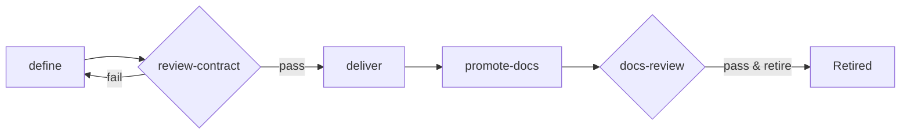

# wio's own workflow

This repository builds wio on wio. Its live configuration is in
[.agents/wio/config.toml](../.agents/wio/config.toml), its templates in
[.agents/wio/templates](../.agents/wio/templates), and its rulesets in
[.agents/wio/rules](../.agents/wio/rules). Engine concepts live in
[concepts.md](concepts.md).

## 1. Overview

Four actions cover a Work's lifecycle: `define` (turn intent into a confirmed
contract), `deliver` (build and review it, then promote lasting docs), and two
on-demand actions, `amend` (change intent and invalidate delivery) and `ratify`
(align wording/diagrams with what was built without changing guarantees).



## 2. What a contract states

A contract states *what* must become true (purpose, goals, non-goals,
assumptions, acceptance criteria, constraints) and never stores a status field;
progress lives in git commit trailers (`Wio-*`). Templates define the required
sections and item-id patterns checked by `wio contracts check`.

## 3. Defining a Work

### From draft to leaf or parent

Every Work starts from `feature.draft` via
`wio contracts new feature --title <title>`. The `define` stage interviews the
driver, then rewrites the contract into either `feature.leaf` (one deliverable)
or `feature.parent` (integrates children).

### When to split

Split into a parent and children when a Work has multiple independently
deliverable outcomes. A parent is defined before its children and delivered
after them; shared boundaries are extracted into a leaf that sibling leaves
depend on.

### The contract root

Contract-authoring stages (`define`, `amend`, `ratify` and their gates) select
the `contract` root so they receive the `contracts` and `writing` rulesets.

## 4. Delivering a Work

### Typed boundaries for a leaf

A leaf's `deliver` pipeline runs `architecture` → `architecture-review` →
`wiring` → `wiring-review` → `implementation` → `implementation-review`,
catching boundary mistakes before implementation starts. A parent runs
`integration` → `system-review`. Both finish with `promote-docs` →
`docs-review`.

### Retiring a contract

`promote-docs` carries lasting rules, reasons, and diagrams into the touched
`README.md` and `GLOSSARY.md` files without deleting contracts. Once
`docs-review` passes and the driver confirms the contracts are spent, the gate
commit deletes the retired contracts.

## 5. Changing a contract

- **`amend`** (on demand): changes criteria, assumptions, or constraints after
  driver approval and invalidates `deliver`.
- **`ratify`** (on demand): updates wording, diagrams, or links to match the
  implementation without changing any guarantee; does not invalidate `deliver`.

## 6. Gates

Every review stage is a gate (`gate = true`, `session = "fresh"`) so the
reviewer judges the artifact without the author's context. Human-judged gates
(`review-contract`, `review-amendment`, `docs-review`) require driver
confirmation before recording `Wio-Result: pass` with `Wio-Judge: human`.

## 7. Checking the config, the templates and the contracts after every edit

A config, a template or a contract with an error is refused or misread by the
commands that need it, so an agent that edits one needs to be told at once.
`wio config check`, `wio templates check` and `wio contracts check` print the
diagnostics and exit 1 on an error, and each project decides how its harness
runs them. This repository checks the config, the templates and the contracts
after every edit and before every commit that changes them:

- **When an agent edits the config, a template or a contract.** An entry in
  `.claude/settings.json` for each runs the check after `Edit`, `Write` and
  `MultiEdit`, and exits 2 with the diagnostics on standard error, which Claude
  Code gives back to the model. It reads the edited path with `jq`, which must
  be on the `PATH` as it is for the formatter hook beside it, and runs the check
  only for its own files, so wio holds no knowledge of the harness: the config
  for `.agents/wio/config.toml`, the templates for an `.md` file under
  `.agents/wio/templates/`, in any subdirectory, and the contracts for an `.md`
  file under `.agents/wio/works/`, at any depth. The contracts' check reads the
  whole tree and is given no file name, because a duplicate id, a cycle and a
  dependency span files, so an edit of one contract can break another. The hook
  reports an error only: a warning or a note is one `wio contracts check` away.
  It is fixed to `.agents/wio/works/`, so a project with another `[works] dir`
  writes its own entry. A check that exits with anything but 1, such as one that
  is refused for a config with an error, is silent and does not block the edit,
  and so is a warning, which the hook does not report. The entries sit beside
  the formatter:

  ```json
  {
    "hooks": {
      "PostToolUse": [
        {
          "matcher": "Edit|Write|MultiEdit",
          "hooks": [
            {
              "type": "command",
              "command": "jq -r '.tool_input.file_path // empty' | { read -r f; case \"$f\" in */.agents/wio/config.toml) out=$(uv run wio config check 2>/dev/null); [ $? -ne 1 ] || { printf '%s\\n' \"$out\" >&2; exit 2; };; esac; }"
            },
            {
              "type": "command",
              "command": "jq -r '.tool_input.file_path // empty' | { read -r f; case \"$f\" in */.agents/wio/templates/*.md) out=$(uv run wio templates check 2>/dev/null); [ $? -ne 1 ] || { printf '%s\\n' \"$out\" >&2; exit 2; };; esac; }"
            },
            {
              "type": "command",
              "command": "jq -r '.tool_input.file_path // empty' | { read -r f; case \"$f\" in */.agents/wio/works/*.md) out=$(uv run wio contracts check 2>/dev/null); [ $? -ne 1 ] || { printf '%s\\n' \"$out\" >&2; exit 2; };; esac; }"
            }
          ]
        }
      ]
    }
  }
  ```

  A project that has `wio` on its `PATH` writes `wio config check`,
  `wio templates check` and `wio contracts check` where this says `uv run`, and
  another harness does the same with its own hook. Claude Code runs the hooks of
  one matcher side by side, so the formatter can rewrite a template or a
  contract while its check reads it; a line in a diagnostic may then be stale
  for that one edit, and the next edit corrects it.
- **When a commit changes the config, a template or a contract.** The
  `wio-config` hook of `prek.toml` runs `uv run wio config check` when
  `.agents/wio/config.toml` is in the commit, the `wio-templates` hook of
  `prek.toml` runs `uv run wio templates check` when an `.md` file of
  `.agents/wio/templates/` is, and the `wio-contracts` hook of `prek.toml` runs
  `uv run wio contracts check` when an `.md` file of `.agents/wio/works/` is. No
  hook is passed file names, and none runs for a commit that changes none of
  them. A commit that only deletes a Work does not run the contracts hook,
  because `prek` passes only files that exist, and the abandon procedure also
  edits the dependents, which does.
