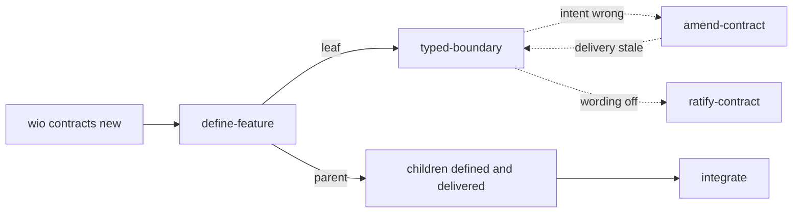

# wio's own workflow

The [core concepts](concepts.md) describe the engine and no process. This
document describes the process this repository runs on the engine: its types,
actions, presets, stages and gates, and the reasons behind them. It is one
workflow among many, and it shows how the concepts are meant to be combined.
The workflow itself is the [config](../.agents/wio/config.toml), the
[templates](../.agents/wio/templates) and the
[rulesets](../.agents/wio/rules); this document explains them. Terms are
defined in the [glossary](../GLOSSARY.md).

## 1. Overview

The repository declares one type, `feature`, with three templates: a draft that
every new Work starts from, a leaf and a parent. Four actions work on a Work:

| Action | Pipeline | What it does |
| --- | --- | --- |
| `define` | `define-feature` | Turns an intent into a contract, and splits it when needed. |
| `deliver` | `typed-boundary` for a leaf, `integrate` for a parent | Builds what the contract says, and promotes it into the docs. |
| `amend` | `amend-contract`, on demand | Changes a defined contract's intent. |
| `ratify` | `ratify-contract`, on demand | Brings a contract in line with what was built. |

Every pipeline ends in a gate, and every authoring stage is followed by one.
`deliver` comes `after` `define`, and is `invalidated_by` `define`, `amend`
and the delivery of any descendant, so redefining or amending a Work, or
delivering one of its children again, makes its delivery stale.

## 2. Defining a Work

### From draft to leaf or parent

`wio contracts new feature` creates a Work from `feature.draft`. The draft has
only a purpose and an intent section, which serve as working space while the
`define` stage interviews the driver. Once the intent is clear, the stage
decides whether the Work is a leaf or a parent, prints that template with
`wio contracts template <name> --work <id>` and rewrites the contract in its
shape. `--work` keeps the Work's id and its dependencies, so the Work keeps its
records. The stage passes no `--keep`, so the new template's roots and actions
apply: a leaf gets the typed-boundary delivery, and a parent gets
`roots = ["@descendants"]` and the integrate delivery. The intent section does
not carry over.

The draft, the leaf and the parent are written together with the define stage,
as one package. The engine knows none of this: it only checks the result
against the template the contract names.

### When to split

For any outcome, the define stage asks one question: does it need
decomposition?

- **Yes**: it contains independently useful, independently deliverable
  outcomes. Split them into child Works, created with
  `wio contracts new feature --parent <id>`.
- **No**: it is one coherent outcome. Keep it as a leaf.
- **Unknown**: you cannot tell yet. Resolve the uncertainty with the smallest
  exploration that answers it, within the authorized outcome. Exploration can
  inform a split. It never authorizes building the feature.

The children of a split start as drafts and are defined in turn. A parent is
defined before its children, and delivered after them. A boundary that several
leaves share is extracted as a leaf of its own and delivered first, and the
other leaves depend on it. The [split exercises](split-exercises.md) walk
through four splits.

### The contract gate

The gate of `define`, `review-contract`, is where the engine's first need is
met: a human confirms the understanding before expensive work starts. The
reviewer judges the contract on its own terms, by the rules, and only the
driver can say whether it states what they meant. So the gate is marked
`judge = "human"`, ends by asking the driver to confirm, and records `pass`
only once they have. The contract holds the intent in the template's shape,
not a transcript of the interview that produced it.

### The contract root

The rules for writing contracts are the `contracts` ruleset, bound to the
`contract` root, whose path is the Works directory. The define, amend and
ratify stages select that root with `roots = ["contract"]`. So a Work that is
still being defined, and has no roots yet, gets the rules for writing
contracts, and an amendment or a ratify of a delivered leaf gets them too,
rather than the rules of the code the leaf touches.

The few rules that the agent writing code needs about its contract, such as
asking for an amendment instead of working around a false assumption, are the
`contract-upkeep` ruleset. It is bound to the code roots, so the deliver stages
never select the contract root.

## 3. Delivering a Work

### Typed boundaries for a leaf

A leaf is delivered by the `typed-boundary` preset:

| Stage | Produces |
| --- | --- |
| `architecture` | The typed signatures and test stubs the contract needs. |
| `wiring` | A running skeleton that composes the boundaries, with stubbed leaves. |
| `implementation` | The code behind the stubs, until the tests and checks pass. |
| `promote-docs` | The contract's lasting guarantees, carried into the docs. |

Each is followed by its gate, in a fresh session. The order puts the cheapest
artifact first: a signature costs a few lines to review, and if it is wrong,
only the signature is redone. It relies on a checker that can reject a
skeleton cheaply, such as a type checker or architecture tests, which is why
this preset suits a typed language and is not part of the engine.

### Integration for a parent

A parent is delivered by the `integrate` preset: the `integration` stage joins
the delivered children and adds the tests for the parent's system-level
criteria, `system-review` judges the result against those criteria, and the
promote stages follow.

### Retiring a contract

A contract is spent once its guarantees live elsewhere. `promote-docs` carries
the lasting rules, reasons and diagrams into the `README.md` and `GLOSSARY.md`
files of the directories the Work touched, linking instead of copying.
`docs-review`, judged by a human, checks that no guarantee was lost. A Work
without a parent then deletes its contract and those of its descendants in the
last commit of the stage, once the driver confirms. A Work with a parent only
promotes, because the tree is kept until its top Work has promoted. Git keeps
the deleted contracts, and the records keep the progress.

## 4. Changing a contract

Later stages can reveal that the contract was wrong or incomplete. That is
normal, not a failure. A downstream stage **proposes** a change and the driver
decides. The decision has three outcomes:

- **Abandon**: stop this Work by deleting its directory. Every Work that
  depends on it is updated in the same change. Abandoning is a change of
  intent, so the deleting commit carries a record of the `define` action. A
  Work that is retired once it is done is deleted by the commit of the last
  stage it belongs to, and carries that stage's record.
- **Amend**: change the acceptance criteria, assumptions or constraints, then
  rework whatever depended on them. An amendment runs through the on-demand
  `amend` action, which `deliver` lists in `invalidated_by`, so the delivered
  stages become stale. Its gate, `review-amendment`, sees the rules for
  amendments and asks the driver to confirm the amended parts.
- **Ratify**: update the contract to match what was built, without reworking
  anything. It runs through the on-demand `ratify` action, which `deliver` does
  not list in `invalidated_by`, so nothing becomes stale. Its gate,
  `review-ratify`, checks that no criterion's guarantee changed; one that did is
  an amendment.

Ratify is the cheap option and the one to watch. Used too often, it turns the
contract from a statement of intent into a log of what happened. Giving it its
own action keeps it visible: its records show how often it happens. So a commit
that changes a contract carries a record of the action that matches the change,
an amendment or a ratify, and never a record of the delivery stage it was found
in.

## 5. Gates

### What a good gate looks like

- It looks at the **exact revision** that was produced. A reviewer pinned to a
  commit cannot be fooled by later edits. The `context` event of a gate session
  records the commit the review starts from, and the `review` event records the
  commit that was judged, so a change in between is visible (see
  [the event log](concepts.md#the-event-log)).
- It is done by someone other than the author, or by the human. Every gate here
  asks for a fresh session.
- It judges the artifact against the contract. The contract is the standard, the
  code is the subject.
- A passing automated check is evidence, not a verdict. A type check proves the
  types agree. It does not prove the design is right.

### Results and back-edges

The results are `pass`, `fail` and `unknown`. `pass` means the next stage can
start, `fail` means it cannot, and `unknown` means the gate could not judge.
After a `fail`, the driver decides whether the work goes back to an earlier
stage or the contract changes.

A back-edge means the artifact exposed a gap in an earlier stage's work.
Repeated back-edges to the same stage are a signal that something unknown was
treated as known, and the right response is to amend the contract or split the
Work.

The contract, amendment and docs gates are marked `judge = "human"`, because
they ask whether something states what the driver meant. The delivery gates are
judged by an agent.
