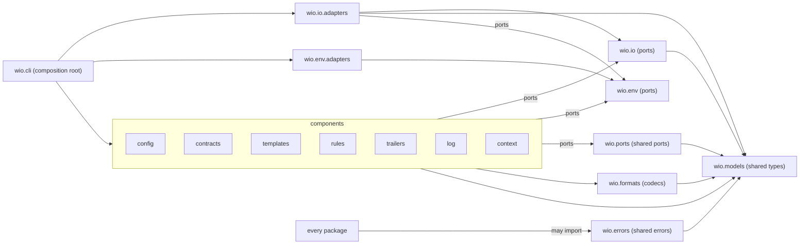

# `src/wio` overview

The terms Component, Port and Adapter are defined in the
[glossary of `src/wio`](GLOSSARY.md).

## Packages

Every package directly under `src/wio` states its role in one sentence in its
docstring.

| Package | Role |
| --- | --- |
| `wio.errors` | The errors that several packages share, and their base |
| `wio.models` | The shared types the ports name |
| `wio.env` | Ports for what the process knows about its surroundings |
| `wio.formats` | Pure codecs between text and the shared types |
| `wio.io` | Ports for the filesystem, standard streams and the repository |
| `wio.ports` | The stub of the ports two or more components share |
| `wio.io.adapters` | The adapters of the ports of `wio.io` |
| `wio.env.adapters` | The adapters of the ports of `wio.env` |
| `wio.config`, `wio.contracts`, `wio.templates`, `wio.rules`, `wio.trailers`, `wio.log`, `wio.context` | The components, one per subcommand |
| `wio.cli` | The composition root |

These are the modules of `wio` in [`tach.toml`](../../tach.toml): every package
directly under `src/wio`, the stub `wio.ports` and the two adapter modules.

## Dependency direction

A package imports only along the arrows. `wio.cli` also imports every package
below the components, and no component imports another, so each can be built
and changed alone. A dependency that exists only for a type is still a
dependency, so imports under `TYPE_CHECKING` count.

`wio.models` imports nothing from `wio`: its types are plain data, and parsing
or validation that can fail lives in `wio.formats`, which raises `WioError`, so
a model never does. `wio.errors` imports only `wio.models`, so an error can
carry a model, such as the diagnostics of a failed check, and every package may
import it. Errors that several packages share live there. A package adds an
`errors.py` that extends `WioError` only when it has an error of its own.

## Shared types

`wio.models` holds the types the ports name, as plain immutable data: `Config`
in `wio.models.config`, `Diagnostic` in `wio.models.diagnostics` and `freeze` in
`wio.models.frozen`. They are defined once, before the
[loader](config/README.md) that builds a `Config`, so every component receives
the settings and reports problems in the same types, and none needs to know how
the file was read.

- `Config` is a tree of frozen dataclasses whose fields are named as the TOML
  keys, so a key path is a chain of field names. `Config()` is the effective
  settings of an empty config file: its defaults, and the fields that have none
  (`Root.paths`, `Action.description`), are the fields of
  `wio.models.config`, and the keys are listed in the
  [config](../../docs/concepts.md#the-config). Every field carries a
  one-sentence `description` in its metadata, which a message can quote. A
  `Config` holds what it is given and judges nothing: the loader builds it.
  The results a gate can record are `gates.results`, the table `[gates]` of the
  file, which holds only them until `wio next` needs more.
- A `Config` hashes, and equal configs hash equal, because every value in it is
  a frozen dataclass, a tuple, a string, a number or a boolean, and its
  `frozendict`s are hashable when their values are. So a `Config` can be a key
  or a cache entry.
- A `frozendict` of a `Config` that is built from a mapping goes through
  `wio.models.frozen.freeze`, which holds the one pyrefly suppression that the
  [known issues](../../docs/known-issues.md) explain. The empty defaults are
  written `frozendict()`, which needs no suppression.
- A `Diagnostic` is a severity, a place and a message, shared by every `check`
  command. It has no code and cannot be suppressed, and its place is a plain
  string, not a structure. Both are
  [open points](../../docs/concepts.md#15-open-points).
- `sort_diagnostics` gives the one order: by place, compared as a plain string
  (so `x[10]` sorts before `x[2]`), then error, warning and note, then message.
  `wio.formats` renders diagnostics in that order, as one
  `error|warning|note: <where>: <message>` line each or as a JSON array of
  objects with `severity`, `where` and `message`. An empty list renders as
  empty text and as `[]`, and `json` is imported only for JSON.
- `ConfigurationError` carries the diagnostics that caused it, in the order
  given, so a caller can render them its own way. `str` of it is the message it
  was raised with, such as the rendered diagnostics. It has no diagnostics
  when none are given.

## Ports and adapters

wio uses the ports-and-adapters architecture. A port is an interface that says
what a package needs from the outside, an adapter is the code that provides it,
and the package depends only on the port. The adapters are plugged in at one
place, the composition root `wio.cli`, so a test can give a package fakes
instead and the package never learns which it got.

The ports live in `.pyi` stubs:

- `<package>/ports.pyi`: the ports that one package consumes.
- `src/wio/io/ports.pyi` and `src/wio/env/ports.pyi`: the ports for the outside
  world.
- `src/wio/ports.pyi`: the ports that two or more components share.

A package that needs no port beyond those of `wio.io`, `wio.env` and `wio.ports`
has no `ports.pyi`.

## Ports

- A port is owned by its consumer and declared in `<package>/ports.pyi`, so a
  package states what it needs without naming who provides it.
- A port is imported only under `TYPE_CHECKING`, because a `.pyi` has no
  runtime module, and it is satisfied structurally, so a provider never imports
  the stub of its consumer and no port names a neighbor.
- `wio.io` and `wio.env` own their ports, an exception to consumer ownership,
  because the filesystem, the standard streams, the repository and the
  environment are shared infrastructure that every component reaches the same
  way.
- A port that two or more components consume with the same members and
  signatures is declared once, in `src/wio/ports.pyi`, so the components do
  not drift apart on a copy.
- `src/wio/ports.pyi` imports only `wio.models` and the standard library, so the
  shared ports sit below every component.
- No package owns `wio.ports`, so a change to it is judged against every
  component that consumes the port.
- A consumer that needs a different view declares its own port under its own
  name and does not use the shared one, and a shared port that only one
  component still consumes moves back to that component's `ports.pyi`.

## Stubs

A stub of a shared type in `wio.models` is the spec until the Work that
implements the type replaces it with a `.py` that has the same annotations and
docstrings, and deletes the stub, so the spec and the code never coexist.
`wio.models` declares a type, and a field of it, only when a port signature or
a criterion of a Work needs it, so no shape is fixed before its first use. A
port stays a `.pyi` for good, because it declares a need and has no
implementation of its own.

## Adapters

- A port has one adapter, so the code a test fakes is the code that runs.
- The real adapter of a port arrives with the Work of the first component that
  consumes the port, so no adapter is written before something needs it.
- A port of `wio.env` whose behavior differs by platform, such as the one for
  the temporary directory, has one adapter for each supported platform, Linux
  and macOS.
- Any other extra adapter needs a reason that the contract of the Work that adds
  it states, so a second implementation is a decision, not an accident.
- Fakes of ports live under `tests`, never in `src`, so the package ships only
  what runs.
- Only `wio.cli` and the unit and integration tests import an adapter, so a
  component cannot bypass its ports.
- An adapter that needs another layer of the outside world is given it through
  that layer's port, imported under `TYPE_CHECKING`, and never imports the
  adapter of it. `GitRepository` is given an `Environment`, so it runs git in
  the directory the environment reports, and only `ProcessEnvironment` reads
  the process's own working directory.
- An adapter implements the members its first consumer needs and has every
  member of its port, so that it can be wired where the port is expected: the
  others raise `NotImplementedError` naming the member and the Work that first
  needs it. `ProcessEnvironment` implements only `working_directory`, and
  `GitRepository` stubs `show_index` and `is_dirty` until the trailers Work.

## The outside world

Components reach the filesystem, the standard streams and the repository only
through the ports of `wio.io`, and the environment variables, the working
directory, the clock, randomness and the well-known directories only through
those of `wio.env`, so a test can fix every input a component sees.
