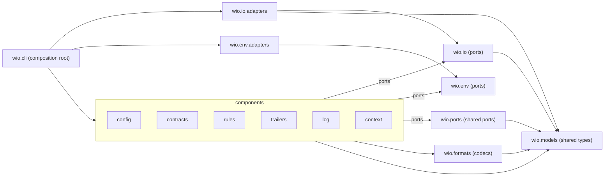

# The architecture of `src/wio`

This document owns the architecture of `src/wio`: the packages, the direction
of their imports, the rules for ports and adapters, and the check that verifies
each rule. A Work that changes the architecture edits this document in the same
change; it does not amend a delivered contract. What holds for a single package
is in the docstrings of its stubs, which are the architecture spec, and the
terms Component, Port and Adapter are defined in the
[glossary of `src/wio`](GLOSSARY.md). The [v0.1 scope](../../docs/v0.1-scope.md)
says what each component does, and the [test strategy](../../tests/README.md)
covers the packages of `tests`.

## Packages

Every package directly under `src/wio` states its role in one sentence in its
docstring.

| Package | Role | May import from `wio` |
| --- | --- | --- |
| `wio.models` | The shared types the ports name | nothing |
| `wio.env` | Ports for what the process knows about its surroundings | nothing |
| `wio.formats` | Pure codecs between text and the shared types | `wio.models` |
| `wio.io` | Ports for the filesystem, standard streams and git | `wio.models` |
| `wio.ports` | The stub of the ports two or more components share | `wio.models` |
| `wio.io.adapters` | The adapters of the ports of `wio.io` | `wio.io`, `wio.models` |
| `wio.env.adapters` | The adapters of the ports of `wio.env` | `wio.env` |
| `wio.config`, `wio.contracts`, `wio.rules`, `wio.trailers`, `wio.log`, `wio.context` | The components, one per subcommand | `wio.models`, `wio.formats`, `wio.io`, `wio.env`, `wio.ports` |
| `wio.cli` | The composition root | every package above |

[`tach.toml`](../../tach.toml) declares exactly these modules: every package
directly under `src/wio`, the stub `wio.ports`, and the two adapter modules,
which are the only other modules of `wio` there.

## The dependency direction

The imports point down the table, toward the shared types, for these reasons:

- `wio.models` and `wio.env` import nothing else from `wio`, so a type and the
  environment each have one definition that every layer can use.
- `wio.formats`, `wio.io` and `wio.ports` import only `wio.models`, so a codec
  or a port never drags a component into the layer below it.
- No component imports another component, so each can be delivered and changed
  alone, against the ports it consumes.
- `wio.cli` is the composition root: it is the only package that imports the
  commands of the components and the adapters, and it gives each component the
  adapters for the ports it consumes, so the wiring lives in one place.
- A dependency that exists only for a type is still a dependency, because a
  change of the type breaks the importer, so tach counts imports under
  `TYPE_CHECKING`.

Verified against commit `46194a8`, every edge below is a dependency that
`tach.toml` allows. `wio.cli` also imports every layer below the components
directly.

## Ports

- A port is owned by its consumer and declared in `<package>/ports.pyi`, so a
  package states what it needs without naming who provides it.
- A port is imported only under `TYPE_CHECKING`, because a `.pyi` has no
  runtime module, and it is satisfied structurally, so a provider never imports
  the stub of its consumer and no port names a neighbor.
- `wio.io` and `wio.env` own their ports, an exception to consumer ownership,
  because the filesystem, the standard streams, git and the environment are
  shared infrastructure that every component reaches the same way.
- A port that two or more components consume with the same members and
  signatures is declared once, in `src/wio/ports.pyi`, so the components do
  not drift apart on a copy.
- `src/wio/ports.pyi` imports only `wio.models` and the standard library, so the
  shared ports sit below every component.
- No package owns `wio.ports`, so a change to it is judged against every
  component that consumes the port.
- A consumer that needs a different view declares its own port under its own
  name and does not use the shared one, and a shared port that only one
  component still consumes moves back to that component's `ports.pyi`.

## Stubs

A stub of a shared type in `wio.models` is the spec until the Work that
implements the type replaces it with a `.py` that has the same annotations and
docstrings, and deletes the stub, so the spec and the code never coexist.
`wio.models` declares a type, and a field of it, only when a port signature or a
criterion of a Work needs it, so no shape is fixed before its first use. A port
stays a `.pyi` for good, because it declares a need and has no implementation of
its own.

## Adapters

- A port has one adapter, so the code a test fakes is the code that runs.
- The real adapter of a port arrives with the Work of the first component that
  consumes the port, so no adapter is written before something needs it.
- A port of `wio.env` whose behavior differs by platform, such as the one for
  the temporary directory, has one adapter for each supported platform, Linux
  and macOS, which the continuous integration matrix runs.
- Any other extra adapter needs a reason that the contract of the Work that adds
  it states, so a second implementation is a decision, not an accident.
- Fakes of ports live under `tests`, never in `src`, so the package ships only
  what runs.
- Only `wio.cli` and the unit tests import an adapter, so a component cannot
  bypass its ports.

## The outside world

Components reach the filesystem, the standard streams and git only through the
ports of `wio.io`, and the environment variables, the working directory, the
clock, randomness and the well-known directories only through those of
`wio.env`, so a test can fix every input a component sees.

## Verification

- `tach check`, a hook of `make lint` and so of `make check` and continuous
  integration, verifies the dependency direction, the counting of
  `TYPE_CHECKING` imports and lazy imports, and the visibility of the adapters
  in `.py` code.
- `exact` stays off in `tach.toml`, because it fails on declared dependencies
  that no code uses yet.
- `pyrefly check` verifies that the names in the ports resolve.
- The review of each Work verifies the rest, because tach reads no `.pyi` file
  and `ruff` applies no docstring rule to one: port ownership, the
  `TYPE_CHECKING`-only import of every stub, the imports of `wio.ports`, the
  docstrings of the stubs, the stub lifecycle, one adapter per port and the
  access to the outside world.

No committed test proves that tach rejects a forbidden import, so a change of
the locked `tach` version repeats these trials by hand before it merges, each
with a `.py` file that is not committed:

1. A component importing another component, such as `wio.rules` importing
   `wio.config`.
2. `wio.models` importing `wio.io` under `TYPE_CHECKING`.
3. A component importing `wio.io.adapters`.
4. A component importing `wio.env.adapters`.
5. A file in `scripts` importing `wio.io.adapters`.
6. A component importing `tests.sandbox`.
7. A file in `scripts` importing `tests.support`.
8. A file in `tests/scripts` importing `tests.acceptance.dsl.wio`; importing
   the directory `tests.acceptance.dsl` alone passes, because it is a namespace
   package with no module of its own.
9. `uv run prek run tach --files` on the file of trial 8, staged, which reports
   the hook as failed.

Each of trials 1 to 8 makes `uv run tach check` exit non-zero and name both
modules. Run each trial several times: the overlapping source roots of
`tach.toml` make tach 0.35.3 pass a forbidden import in some runs, a
[known issue](../../docs/known-issues.md#tach-check-sometimes-passes-a-forbidden-import)
that also means the review of each Work checks the imports of the files it
changes, instead of relying on a green `tach check`. The dependency direction of
the groups of `tests` is stated in the
[test strategy](../../tests/README.md).
