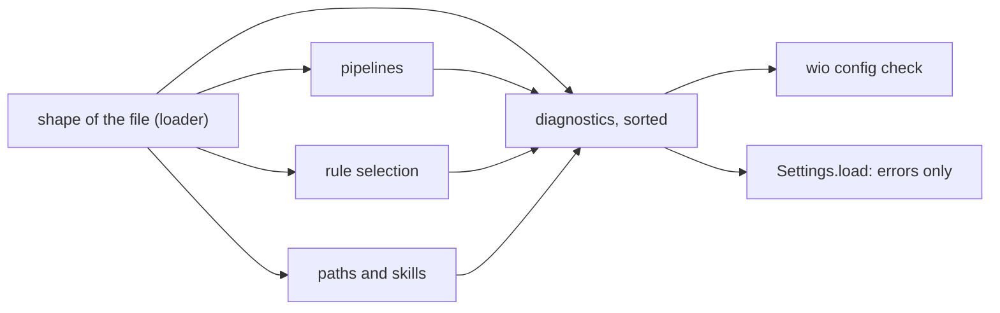

# `wio.config`

The component that reads the project's settings. The terms Source, Shape,
Setting, Key path, Check, Check run, Action cycle, Normalized path and Reference
are defined in the [glossary of this component](GLOSSARY.md), and Config,
Diagnostic and Repository in the [repository glossary](../../../GLOSSARY.md).
The keys the shape covers are listed in the
[config](../../../docs/concepts.md#the-config).

## The loader

[`loader.py`](loader.py) turns one file into a `Loaded`: its docstrings say what
it returns and what it raises. It exists so that a command receives the settings
read from one file, checked for shape and handed over complete, or is refused
with every problem at once. [`settings.py`](settings.py) adapts it to the
`Settings` port.

- **One file.** The config is `<root>/.agents/wio/config.toml`, where the root
  is the one `Repository.root` finds for the working directory, so a command run
  from a subdirectory finds the same file. There is no walk up the directories,
  no per-directory override and no variable that points at another file: one
  file keeps every command reading the same settings.
- **Absence is an error.** No repository, no file and an unreadable file are
  refused, and none of the messages mentions `wio init`, which does not exist
  before v0.2. A key the file omits keeps the default of its field, so an empty
  file is valid and a file need set only what differs from the defaults. The
  component never reads the working directory itself: the `Repository` adapter
  is given it by an `Environment`, so every component reaches the environment
  through a port, and the loader passes the adapter's message on unchanged.
- **A syntax error is one diagnostic and no `Config`,** because nothing can be
  checked in text that is not a document.
- **`Loaded.sources` says `file` for a key that the file sets to its own
  default.** A table entry such as `stages.define` has no key of its own, and
  its keys are `file` when set and `default` when not.

## The shape

`read_shape` in [`shape.py`](shape.py) walks a schema derived once from the
annotations of the `Config` dataclasses, so the value, the diagnostics and the
sources cannot drift from the fields.

- **The `Config` is best effort,** so the checks run on it also when the shape
  has errors, and a check that looks an entry up finds it instead of repeating
  the shape's problem. A stage with both or neither of `goal` and `skill` is
  kept as written.
- **Nothing is coerced.** An integer where a string belongs is an error, and a
  TOML date or time is never a setting, because no key of the schema holds one.
- **A message tells how to fix the edit,** so an agent that edits the file
  corrects every problem in one turn.
- **A run that finds no problem imports neither `difflib`, `json` nor
  `tomlkit`,** so a valid config costs nothing for its diagnostics.

## The checks

[`checks.py`](checks.py) keeps the checks in `CHECKS`, one ordered tuple that
the loader runs after the shape, so a Work that adds a check appends it there.
Its docstrings say which names are required and which are provisional.

`load_config` and `ConfigSettings` bind `CHECKS` as the default of their
`checks` argument when they are defined. A command that must see a replaced
tuple, as a test of `wio config check` does, reads `wio.config.CHECKS` when it
runs and passes it.

Every check joins one check run behind the loader, and its diagnostics come out
sorted:

- **A check is cheap and local,** because `Settings.load` runs the whole check
  run for every command. A check reads the config, paths, names, directory
  listings and whether a file exists, and parses neither a template nor a rule:
  the Works that read those check them.
- **Warnings and notes appear only in `wio config check`.** Every other command
  refuses a config on an error alone, and a warning that each command printed
  would be noise on every run.
- **An error stops every command with the lines that `check` prints,** because
  the message of the refusal is those diagnostics rendered, and the command line
  writes such a refusal as it is.

### The pipeline checks

[`pipelines.py`](pipelines.py) judges the names that stages, stage presets,
actions, roots and `gates.results` use for one another. Its docstrings say what
each check reports and where.

- **A cycle is one error for the group of actions that reach one another,** at
  the least name, so an agent breaks the loop once and is not told about each
  action on it.
- **`after` has no `@` form,** so such an entry is an undeclared action. A form
  is added with the Work that needs it, while `invalidated_by` keeps a note for
  the forms that v0.2 reserves
  ([the actions](../../../docs/concepts.md#6-actions)).
- **An unused stage, preset or action is not reported.** Whether a template's or
  a contract's pipeline resolves, and what nothing uses, belong to the Works
  that read templates and contracts.

### The path checks

[`paths.py`](paths.py) judges the paths, skills and templates that the config
names, as text first, and asks the disk only whether a path exists. Its
docstrings say what each check reports and where.

- **An empty path is an error wherever the config names a path.** It would read
  as no place at all, while `.` is the whole repository.
- **A repeat is reported instead of its fault.** Deleting the entry fixes both,
  and a path repeats an earlier one by its normalized form, so fixing the first
  does not reveal a repeat on the next run.
- **A skill path with a fault is left out of the search,** also when only its
  form is wrong, so a skill is never found through a path that the config
  refuses.
- **Only `exists` is asked.** A root path may be a file or a directory, and a
  `SKILL.md` that exists makes its parent a directory, so no criterion needs
  `is_dir`.
- **The user's home is not searched,** so a config means the same on every
  machine. Other harnesses' directories are added through `[skills] paths`
  ([the stage](../../../docs/concepts.md#7-stage)).

### The rule selection checks

[`selection.py`](selection.py) judges the references that the config makes to
rulesets and rule presets, and the ruleset directories next to the `[rulesets]`
table. Its docstrings say what each check reports and where, and
[the rules](../../../docs/concepts.md#checking-rules) list the checks that
belong to the rules Work.

- **A reference gets one error, the first problem it has:** its form, then what
  its field takes, then whether it resolves. A later problem would be noise or
  would contradict the first, such as an unknown ruleset in a reference whose
  ruleset part is not a name.
- **Whether the item after the dot exists is not checked here.** It needs the
  rule files, which the rules Work reads, so a reference to `docs.DOC999` passes
  until then.
- **A directory is a known ruleset, a name that no reference could use is not
  offered, and a table without a directory is an error.** A directory without a
  `ruleset.toml` is one error and not a cascade of unknown rulesets, while a
  directory with a name of the wrong form is left out of what the messages
  list. The alias of a table without a directory is not known, because the
  ruleset is not.
- **Only a bare `rules_include` of a config rule preset makes a cycle,** because
  an exclude only removes rules, so a preset that excludes another resolves
  whatever that one holds.
- **A cycle is one error for the group of rule presets that include one
  another,** as for actions, so an agent breaks the loop once.
- **An alias equal to its own ruleset's name is not a clash,** since it names
  the same ruleset and harms nothing.

## The command

`wio config` lets a person or an agent see the effective settings, where each
value comes from and what each setting is for, and check them. The package's
`describe()` returns the spec of the command, and `ConfigCommand` runs it. The
spec is made in the `__init__` of the package, and everything else the package
exports, `ConfigCommand` among it, is bound there with a `lazy from` import, so
describing the command loads no other module of `wio.config`. Every run of `wio`
describes every command, and a run that does not choose `config` must not pay
for it.

- **Bare `wio config` reads no config file,** so it works in a project whose
  config is broken.
- **`list` shortens and `show` does not.** `list` fits a line to 80 columns
  where it can, so a person scans every setting, and `show` and `--json` give a
  value in full. The formats are in [`listing.py`](listing.py).
- **`list` and `show` call `load_config`,** because they read `Loaded.sources`,
  which `Settings` does not return. They raise the errors themselves through
  `config_or_raise`, the one place that `ConfigSettings.load` shares.
- **`check` prints the errors of a config instead of refusing it,** because
  whoever edits the config needs the findings, while `list` and `show` need a
  valid one.
- **A clean text run says so,** so that success is told apart from a command
  that did nothing, while `--json` stays a document.
- **Hooks run the check after every change of the config.** The recipe is in
  [the workflow](../../../docs/workflow.md#7-checking-the-config-after-every-edit).
- **`resolve` judges a key path by the fields of the `Config` alone,** so a
  table without entries is told from an unknown key.

## What is not here

- The checks that parse a template or a rule file: a template's kind and
  directives, a ruleset's manifest, codes, families and presets, whether a
  qualified reference resolves to a rule, and whether a root reaches a
  root-independent ruleset. The Works that read them join the check run through
  `CHECKS`.
- Reporting a stage, root or preset that nothing uses, because templates and
  contracts name them too, which the config cannot see.
- Reading `continuable`: the field exists so that people and agents can read
  it, and no component acts on it.
