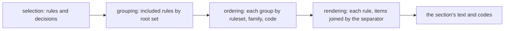

# `wio.context`

The component behind `wio context`, which prints what an agent session reads
before it starts a stage of a Work.
[The context compiler](../../../docs/concepts.md#11-the-context-compiler) says
what a [bundle](../../../GLOSSARY.md) holds and which properties it keeps.

[`wio.cli`](../cli/README.md#the-table-of-commands) wires the command
to check inputs, compose and print a bundle from the working tree. The
[repository glossary](../../../GLOSSARY.md) defines the terms used here.

## The shell of the command

The docstrings of [the package](__init__.py),
[the command](command.py), [the compiler](compiler.py) and
[the ports](ports.pyi) say what each guarantees, and the
[tests](../../../tests/unit/context) show each case.

- **The compiler and the command are apart.** The compiler judges the inputs
  and then composes, and the command writes what it returns. So the command is
  tested with a fake compiler, and a Work that adds a check or a way to deliver
  the bundle changes one of the two.
- **Every check runs before the composition,** so a refused input is never
  answered with a bundle, which would look like success.
- **The compilation warnings are reported before the bundle is written,** so a
  delivery that fails does not hide them.
- **The command leaves every error to the
  [dispatch of `wio.cli`](../cli/README.md#failures-and-exit-codes),** which
  already tells a mistake of the user from a bug.
- **The finished bundle is a [shared type](../models/bundle.py),** because the
  composition port names it, and the
  [rule for port stubs](../../../tests/tooling/test_ports.py) lets none of them
  import from its own package.

## Warning about bundle size

[The size warning](size_warning.py) compares the compiler's body size with the
optional threshold, both in UTF-8 bytes. The command reports it identically for
standard output and file delivery, after compilation warnings and before
delivery and any worktree-path warning, so a failed file write cannot hide it.
The
[acceptance scenarios](../../../tests/acceptance/context/test_size_warning.py)
cover the threshold boundaries and the failed-delivery case, and the
[delivery scenarios](../../../tests/acceptance/context/test_delivery.py) verify
destination consistency, failed-write ordering, and the full warning order.

## Writing a bundle to a file

A session can request a file when a harness might truncate printed output.
[File delivery](delivery.py) writes the complete bundle, creates its parent
directories and replaces any existing file. It prints only the path, followed by
a newline. A repeated run with the same bundle id writes the same default file
again. The [option scenarios](../../../tests/acceptance/context/test_output.py)
cover its forms, errors and warnings, and the
[directories adapter](../env/README.md#what-only-the-adapters-read) gives the
temporary directory.

A default path uses the clone's [shared key](../formats/repository_key.py) and
the bundle id, so its worktrees share one location per bundle. A named path is
printed as given, while the [filesystem port](../io/ports.pyi) resolves it to
judge whether it lies in the worktree. That warning helps prevent committing an
unintended bundle. A failed write is an error; the destination's state after a
write failure is unspecified.

## Refusing what cannot be trusted

A session needs its guidance even while the tree has faults of its own, but
never a bundle that looks complete when it may not be. So a run is refused for a
config with an error, for a Work tree that may not hold every Work, for an
unknown Work and for a fault in the rules. A fault that leaves the tree
complete, in the metadata, the graph or a template, does not stop it, except
for the lookup of a shared id and for a root the stage selects from the Work,
which must be declared, as
[Checking input names](#checking-input-names) says. Reporting the faults of the
tree and of the rules is left to `wio contracts check` and `wio rules check`.

- **The Work is judged by [a check of its own](known_work.py),** which runs
  before the others. The composition would refuse the same Work, but only after
  the names of the request had been judged and answered in its place.
- **It resolves the Work as the composition does,** through the same
  [port](ports.pyi), so which ids are refused, and in which words, is what
  [`wio contracts show`](../contracts/README.md#showing-a-work) refuses. A
  shared id therefore refuses only the lookup of that id.
- **A Work is named by its id and never by a path,** which only
  `wio contracts show` accepts, so a path is an id that no Work has.
- **A fault in the rules is left to the rule selection,** which refuses with the
  diagnostics of `wio rules`, after the names are judged. A fault that loading
  the config already reports, such as a ruleset directory with no
  `ruleset.toml`, is a config error instead and comes before every other
  refusal.

The [acceptance scenarios](../../../tests/acceptance/context/test_unreadable.py)
show each refusal and the faults that do not stop a run.

When several inputs are at fault, the first refusal wins: config, tree, Work,
action, stage, selected Work root, then rules. Once the checks pass, the
pipeline warning precedes the warning about empty Work roots; both are reported
when both apply. The
[system scenarios](../../../tests/acceptance/context/test_check_inputs.py)
exercise that ordering through the command.

## Checking input names

[The input check](inputs.py) refuses an unknown action, stage or selected Work
root before rule selection can treat the request as an empty bundle. It reads
expanded Work roots through the [roots port](ports.pyi), only when the stage
selects them; a stage that lists roots without `@work` is independent of the
Work's roots. A stage's own roots are checked by the config, so only Work roots
can introduce an unknown root here.
The [acceptance scenarios](../../../tests/acceptance/context/test_inputs.py)
show the errors at the command boundary.

## Warning about the pipeline

[The pipeline check](pipeline.py) tells the driver when the stage is not one the
Work's action lists, because a mistaken pair, such as `deliver` with `define`,
is easy to type and would otherwise go unnoticed. It warns and never refuses:
the driver names the stage, so the driver decides.

It asks for the pipeline through a [port](ports.pyi) that the
[Work lookup](../contracts/README.md#looking-up-a-work-for-a-record) satisfies,
as it does for `wio trailers`, so the two commands cannot disagree about where a
pipeline comes from. A Work with no pipeline for the action gets the same
warning as from `wio trailers`, including when it names a stage preset the
config does not declare. Reporting that preset, and judging whether a pipeline
is well formed, is left to `wio contracts check`. The
[acceptance scenarios](../../../tests/acceptance/context/test_pipeline.py) show
which pipeline decides in each case.

## Warning about missing Work roots

[The warning check](no_roots.py) tells the driver when a stage selects a Work's
empty roots, because the bundle otherwise hides that the stage selected no rules
at all. A missing `roots` key, an empty list and a leaf's `@descendants` all
resolve to no roots; the
[real-lookup scenarios](../../../tests/integration/context/test_no_roots.py)
show how those cases and the stage's selection affect the warning. The bundle is
still printed so the driver can decide what to do.

## Bundle composition

[Composition](composition.py) shares one selection across rendering, the
header's rule count, and the ordered rule hashes, so the bundle and its record
agree on which rules it contains. The hashes describe the stored file bytes
at the time they are read for hashing. A file can change between discovery and
that read. One skill lookup supplies the directory and files hash, and stage
guidance and the header use the same display escaping for the skill name and
directory. A configured skill can disappear after `wio config check` accepts
it, so composition reports a missing skill as an error the user can fix.

The [composition tests](../../../tests/unit/context/test_composition.py)
cover the bundle's text, measurements, identities, and refusals. The
[wiring test](../../../tests/integration/cli/test_context_wiring.py) shows the
command composing a bundle with project adapters. The
[system scenarios](../../../tests/acceptance/context/test_composition.py) check
the emitted identity, body size and skill pointer against the assembled text.

## Finding a skill

A bundle points to a stage's skill and counts its files, and the
[`SkillLookup` port](ports.pyi) is how this package asks for both. `wio.config`
[satisfies it](../config/README.md#finding-a-skill), because it already searches
for skills to check the config. The text of `SKILL.md` never enters a bundle.

## The bundle id

[`bundle_id`](identity.py) names a bundle by its text, and its
[tests](../../../tests/unit/context/test_identity.py) hold the known values.

- **What an id covers is decided where the text is built,** because the
  function takes the text alone. A part that is not in the text counts only
  through something written into it: the files of a skill are to count through
  a hash of them in the header.
- **The id has one length for every stage** and is kept short, as
  [the concepts](../../../docs/concepts.md#11-the-context-compiler) ask.

## Bundle assembly

[Assembly](assembly.py) joins the rendered parts. It builds the body before
asking for the header, then adds the metadata after computing the id. This
lets a reader check the size and id against the text each describes. The
[assembly tests](../../../tests/unit/context/test_assembly.py) show the layout
with every part present or omitted.

## The header

[`header`](heading.py) writes the first lines a session reads, its docstring
says what they state, and its
[tests](../../../tests/unit/context/test_heading.py) show the wording.

- **The Work, the action and the stage come first,** so a session that was
  given the wrong stage is caught by reading the top.
- **The command is the one that gives this bundle again,** so it leaves out an
  option that only changes where the bundle goes.
- **It looks nothing up.** The caller supplies the counts, the sizes and where
  a skill was found, so what the header says agrees with the rest of the
  bundle by having one source.

## Stage guidance

A stage that names a skill points to the procedure the harness can already
load. The guidance builder accepts a skill lookup result from its caller so
composition can share that result with the header. Escaping the name and path
keeps the instruction on one line while preserving the characters a session
needs to find the file. [Guidance builder](guidance.py) and
[tests](../../../tests/unit/context/test_guidance.py).

## The contract section

A session needs the same contract and inherited sections as a person running
`wio contracts show`. The [port](ports.pyi) gives composition one resolved
contract to render and pass to rule selection. The
[provider](../contracts/context_view.py) shares the contract command's lookup
and rendering behavior.

## The rules section

[`rules_section`](section.py) turns a selection into the text of the section,
its docstring says what it joins and returns, and its
[tests](../../../tests/unit/context/test_section.py) hold the whole text for one
selection. The three parts below do the work.

- **It selects, explains and labels nothing.** `wio rules` selects,
  `wio rules list --explain` says why, and the label of the section belongs to
  whatever joins the parts of the bundle, so the text carries no label and no
  reason.
- **The codes come back with the text,** in the order printed, so a record of
  what a session was given needs no second pass that could disagree with it.

## Writing the rules

[`render_rule` and `join_items`](rendering.py) write one rule and join the
items of the rules section, their docstrings say how, and their
[tests](../../../tests/unit/context/test_rendering.py) show each case.

- **A rule is named by its ruleset and code,** never by a bare code, which two
  rulesets can share.
- **How a rule was selected never shows in its text,** because the session
  needs the rule, and `wio rules list --explain` answers the other question.

## Ordering the rules

[`order_rules`](ordering.py) orders the rules of one group and introduces each
family, its docstring says how, and its
[tests](../../../tests/unit/context/test_ordering.py) show each case.

- **Only names decide the order,** so moving a rule between rule presets leaves
  it where it was.
- **The topic of a family comes through a [port](ports.pyi),** because a
  selection holds rules and their decisions and no topic.

## Grouping the rules

[`group_rules`](grouping.py) groups the rules that apply by the roots they apply
to, its docstring says how the groups are ordered and what their lines read, and
its [tests](../../../tests/unit/context/test_grouping.py) show each case.

- **A group line names its roots and the paths they have,** so a session can
  tell which files each group of rules is about.
- **A root may have no path,** because the config accepts an empty list: such a
  root is a named set of rules, and its line has only its name to give.
