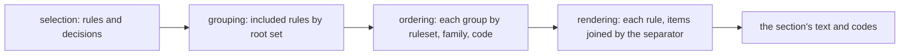

# `wio.context`

The component behind `wio context`, which prints what an agent session reads
before it starts a stage of a Work.
[The context compiler](../../../docs/concepts.md#11-the-context-compiler) says
what a [bundle](../../../GLOSSARY.md) holds and which properties it keeps.

Today the directory holds the shell of the command and parts of a bundle, each
in a section below. It has no check of its inputs and no composition of the
bundle, so a run is refused, as
[`wio.cli`](../cli/README.md#the-table-of-commands) describes. Its terms are
those of the [repository glossary](../../../GLOSSARY.md).

## The shell of the command

The docstrings of [the package](__init__.py),
[the command](command.py), [the compiler](compiler.py) and
[the ports](ports.pyi) say what each guarantees, and the
[tests](../../../tests/unit/context) show each case.

- **The compiler and the command are apart.** The compiler judges the inputs
  and then composes, and the command writes what it returns. So the command is
  tested with a fake compiler, and a Work that adds a check or a way to deliver
  the bundle changes one of the two.
- **Every check runs before the composition,** so a refused input is never
  answered with a bundle, which would look like success.
- **The warnings are reported before the bundle is written,** so a delivery
  that fails does not hide them.
- **The command leaves every error to the
  [dispatch of `wio.cli`](../cli/README.md#failures-and-exit-codes),** which
  already tells a mistake of the user from a bug.
- **The finished bundle is a [shared type](../models/bundle.py),** because the
  composition port names it, and the
  [rule for port stubs](../../../tests/tooling/test_ports.py) lets none of them
  import from its own package.

## Finding a skill

A bundle points to a stage's skill and counts its files, and the
[`SkillLookup` port](ports.pyi) is how this package asks for both. `wio.config`
[satisfies it](../config/README.md#finding-a-skill), because it already searches
for skills to check the config. The text of `SKILL.md` never enters a bundle.

## The bundle id

[`bundle_id`](identity.py) names a bundle by its text, and its
[tests](../../../tests/unit/context/test_identity.py) hold the known values.

- **What an id covers is decided where the text is built,** because the
  function takes the text alone. A part that is not in the text counts only
  through something written into it: the files of a skill are to count through
  a hash of them in the header.
- **The id has one length for every stage** and is kept short, as
  [the concepts](../../../docs/concepts.md#11-the-context-compiler) ask.

## The header

[`header`](heading.py) writes the first lines a session reads, its docstring
says what they state, and its
[tests](../../../tests/unit/context/test_heading.py) show the wording.

- **The Work, the action and the stage come first,** so a session that was
  given the wrong stage is caught by reading the top.
- **The command is the one that gives this bundle again,** so it leaves out an
  option that only changes where the bundle goes.
- **It looks nothing up.** The caller supplies the counts, the sizes and where
  a skill was found, so what the header says agrees with the rest of the
  bundle by having one source.

## The contract section

A session needs the same contract and inherited sections as a person running
`wio contracts show`. The `Contracts` port gives composition the resolved
contract for both rule selection and rendering, so the two operations see the
same contract. [Port](ports.pyi) and
[provider](../contracts/context_view.py).

## The rules section

[`rules_section`](section.py) turns a selection into the text of the section,
its docstring says what it joins and returns, and its
[tests](../../../tests/unit/context/test_section.py) hold the whole text for one
selection. The three parts below do the work.

- **It selects, explains and labels nothing.** `wio rules` selects,
  `wio rules list --explain` says why, and the label of the section belongs to
  whatever joins the parts of the bundle, so the text carries no label and no
  reason.
- **The codes come back with the text,** in the order printed, so a record of
  what a session was given needs no second pass that could disagree with it.

## Writing the rules

[`render_rule` and `join_items`](rendering.py) write one rule and join the
items of the rules section, their docstrings say how, and their
[tests](../../../tests/unit/context/test_rendering.py) show each case.

- **A rule is named by its ruleset and code,** never by a bare code, which two
  rulesets can share.
- **How a rule was selected never shows in its text,** because the session
  needs the rule, and `wio rules list --explain` answers the other question.

## Ordering the rules

[`order_rules`](ordering.py) orders the rules of one group and introduces each
family, its docstring says how, and its
[tests](../../../tests/unit/context/test_ordering.py) show each case.

- **Only names decide the order,** so moving a rule between rule presets leaves
  it where it was.
- **The topic of a family comes through a [port](ports.pyi),** because a
  selection holds rules and their decisions and no topic.

## Grouping the rules

[`group_rules`](grouping.py) groups the rules that apply by the roots they apply
to, its docstring says how the groups are ordered and what their lines read, and
its [tests](../../../tests/unit/context/test_grouping.py) show each case.

- **A group line names its roots and the paths they have,** so a session can
  tell which files each group of rules is about.
- **A root may have no path,** because the config accepts an empty list: such a
  root is a named set of rules, and its line has only its name to give.
