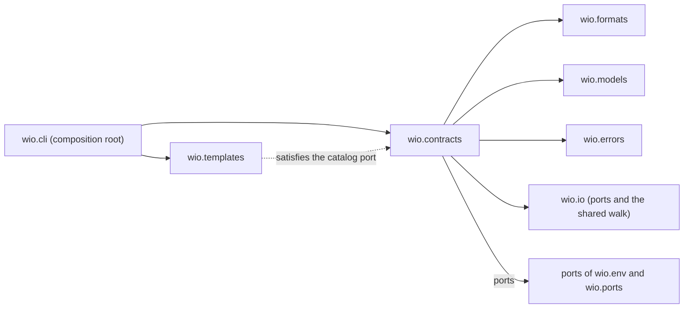

# `wio.contracts`

The component behind `wio contracts`: the group of subcommands that create,
list, check and show Work contracts and prepare the skeleton of an existing
Work. This directory holds the group and what
every subcommand shares, and each subcommand lives in a module of its own.
[`src/wio/README.md`](../README.md) is the architecture, and the
[glossary](../../../GLOSSARY.md) defines the terms.

## What the component guarantees as a whole

Every command agrees on what a Work is, what it inherits and what it depends on,
because the code that finds and reads Works is here and nowhere else. Its
functions are the ones that the ports of `wio trailers`, the later `wio rules`
and `wio context` can wrap, so none of them needs to read a contract on its own.
The sections below say how each part works, and these hold for all of them.

- **Only `new` writes, and it never overwrites.** `new` creates one file and
  refuses a path that exists, as
  [the id and the place of a new Work](#the-id-and-the-place-of-a-new-work)
  says. `skeleton`, `list`, `show` and `check` write nothing, so a Work changes
  only when a person or an agent changes it.
- **The output is the same on every run.** It is sorted or in a fixed order and
  has no timestamp, and `--json` writes one array or object that parses. The
  exit codes are the [command line's](../cli/README.md#failures-and-exit-codes).
- **Nothing is loaded before it is needed.** `list` and `check` without
  `--json` import neither `tomlkit` nor `json`, the Markdown parser loads on the
  first body that is read for a title or a heading, and only `new` and
  `skeleton` import the writer. An
  [integration test](../../../tests/integration/contracts/test_imports.py)
  pins it for `list` and `check` on a project whose Works name a template, so
  that the catalog runs.
- **One reader, one writer, one Markdown parser.** Only
  [`wio.formats`](../formats/README.md) imports `tomllib`, `tomlkit` and
  `markdown_it`, and ruff's `banned-api` reports any other import.
- **The component imports no other component.** It reaches the templates only
  through the catalog port, which `wio.cli` wires, so it can be built and
  changed alone.

`tach check` is not enough to hold the last guarantee, because it sometimes
passes a forbidden import
([known issues](../../../docs/known-issues.md#tach-check-sometimes-passes-a-forbidden-import)).
A [scan of the imports](../../../tests/tooling/test_contracts_imports.py) reads
the syntax trees of the package, `from wio import templates` and relative
imports included, and the review of a change to the package reads the imports
of the files it touches.

## The group

[`__init__.py`](__init__.py) holds `ContractsSpec` and the table of subcommands,
`SUBCOMMANDS`, and [`command.py`](command.py) holds `ContractsCommand`, which
runs the subcommand that the arguments chose. Their docstrings say what each
takes and returns, and the
[tests](../../../tests/unit/contracts/test_command.py) say how each case reads.

- **A subcommand is one entry of the table.** The group knows nothing else of a
  subcommand, so adding one does not edit another, and the group is built once
  so that two subcommands delivered together do not both create it.
- **The table is in the package module, with its `configure` and its handler.**
  Describing a command loads no module of its package besides `__init__`
  ([import-light packages](../cli/README.md#import-light-packages)), and
  `configure` runs while `wio --help` is described. So an entry's `configure` is
  defined in `__init__.py`, and its handler is a function there that imports the
  subcommand's own module when it runs. A `lazy from` in the tuple would defer
  nothing, because the names are used as the tuple is built.
- **Bare `wio contracts` reads nothing.** It writes its help without a
  repository, a config or a command of git, so it works anywhere, even when the
  config has an error.
- **What a subcommand needs comes in `Services`.** The settings, the repository,
  the file system, the catalog, the entropy and the environment are built in
  `wio.cli`, the one place where they meet the group, and a subcommand that
  needs another port adds a field.
- **A mistake the user must fix is a `ContractsError`.** It is a `WioError`, so
  the command line prints its message and exits 2, while a handler returns 0, or
  1 for a failed check, and never another code. A refusal can carry diagnostics,
  which the command line then
  [writes as they are](../cli/README.md#failures-and-exit-codes), as `list` does
  for an incomplete tree.

## The template catalog

`TemplateCatalog` in [`ports.pyi`](ports.pyi) is how `wio.contracts` asks for
the templates, so it never imports `wio.templates`, which satisfies the port
with [`TemplatesCatalog`](../templates/catalog.py) and which `wio.cli` hands to
the group. Its docstrings say what `find` and `is_rejected` return.

- **A rejected template is not a missing one.** A contract that follows a
  template `wio templates check` rejects is told so, and one that names a
  template that does not exist is told that, so the catalog gives both answers,
  and a template that discovery could not build is rejected and not found.
- **The templates are read once for each question.** The catalog discovers once
  for `find` and checks once for `is_rejected`, and loads the config once, so a
  command that asks about many contracts pays for one walk and one check.

## Finding the Works

Every command that reads Works takes them from one value, `WorkDiscovery` in
[`discovery.py`](discovery.py), which one walk of the Works directory builds, so
no command walks the directory on its own and the commands cannot disagree about
which files are Works. The docstrings there say what each field holds and what
each function takes and returns, and the
[tests](../../../tests/unit/contracts/test_discovery.py) say how each case
reads. [Which files are Works](../../../docs/concepts.md#which-files-are-works)
defines what a Work is.

- **A problem with one Work hides no other, and none is raised.** Discovery
  reports every problem as a diagnostic, and the Works directory that cannot be
  walked is one error and no Work. Only a file that cannot be identified is left
  out. A Work with a wrong optional field stays in the tree
  with that field empty, so its children and dependents are not orphaned and a
  later command still sees them. A shared id keeps every Work that has it.
- **The errors say what they leave.** `incomplete` holds the errors that leave
  the tree incomplete, and `ambiguous` the errors of a shared id, because a
  command that needs the whole tree refuses on either, while one that looks a
  Work up refuses only the lookup of a shared id, through `find_work`. A command
  tests those two fields and never reads a message to decide.
- **A reason is computed from what was read.** `explain_not_a_work` walks the
  tree again and names the files of a collision, or the error of a file that was
  left out, from the files it read and the nesting rules, and never from the
  text of a diagnostic, so a file name that holds a colon or a comma has its
  reason. A path has a reason exactly when it is not among the Works found, and
  the reasons come in the order that the docstring lists.
- **Discovery reads and never writes.** It reaches files only through the
  `FileSystem` port, and its output is in a fixed order: the Works by the
  string of their paths and the diagnostics as the shared ordering puts them.
- **`Work` is in [`wio.models.works`](../models/works.py).** Its docstring holds
  its fields and the rule that the title is the first heading, at any level.

The walk, the refusal of a Works directory and the ordering of diagnostics are
the [shared helpers](../io/walk.py) that the templates discovery also uses, so
the two read their directories the same way.

## The hierarchy of the Works

The parent, children, ancestors, descendants, resolved roots, dependencies and
dependents of a Work, and the errors of the dependency graph, come from one
value, `Hierarchy` in [`hierarchy.py`](hierarchy.py), that `build_hierarchy`
makes from the Works that discovery found. So every command gets the same
answer and none computes a relation from the files on its own. The docstrings
there say what each table holds, how it is ordered and what each error reads,
and the [tests](../../../tests/unit/contracts/test_hierarchy.py) say how each
case reads. [Parent and leaf](../../../docs/concepts.md#parent-and-leaf),
[roots of a Work](../../../docs/concepts.md#roots-of-a-work) and
[dependencies](../../../docs/concepts.md#dependencies) define the relations.

- **It is computed on each run from what it is given.** It reads no file and
  writes none, because the Works come from discovery, and nothing is kept
  between runs that could drift from the files.
- **The tables are keyed by path, not by id.** Two Works may share an id, and
  discovery keeps both, so an id would hide one of them. A dependency on a
  shared id is an edge to each Work that has it, and the duplicate itself is
  reported once, by discovery.
- **The parent comes from the layout alone.** A plain directory between two
  Works, or a directory whose Work was left out, is passed over, so a Work is
  never orphaned by a problem that discovery already reports. Under `flat` no
  Work has a relative, and `@descendants` resolves to nothing.
- **A child passes up what its own roots resolve to.** So a middle parent
  decides what reaches the top, and a parent that does not list
  `@descendants` hides the roots of its children from the Work above.
- **A parent's wait for its children is an edge of the graph and is not a
  dependency.** It counts when a cycle is searched for, so a child that lists
  its parent is found, but it adds no id to `dependencies` and makes no parent a
  dependent of its child. Where a pair has both a listed and an implicit edge,
  the edge is called listed, because that is the one a person can remove.
- **A group of Works that wait on each other is one error.** It is placed at the
  Work of the group with the smallest path and shows the shortest cycle from
  it, with ties taken by the smallest path, so one mistake gives one message
  that does not change with the order in which the Works were found.
- **The roots are not judged here.** Warnings about a root's name or about
  `@descendants` on a leaf belong to the command that checks Works, which reads
  the tables.

## Creating a Work

[`creation.py`](creation.py) composes the template catalog, skeleton, metadata
editor, location decision and write guard to create a Work. Its docstrings give
the selection, validation and report rules; the
[unit tests](../../../tests/unit/contracts/test_creation.py) and
[acceptance scenarios](../../../tests/acceptance/contracts/test_new.py) show the
cases. The [metadata editor](../formats/README.md#editing-contract-metadata) is
shared with
[the skeleton of an existing Work](#the-skeleton-of-an-existing-work), so
neither command needs its own interpretation of a block.

Creation plans before it writes, so an invalid request cannot leave a partial
Work, and reports only after the guard succeeds. Its parent lookup is shared
with the hierarchy, so a path under an existing Work and a path chosen by
`--parent` follow the same nesting rule. The command leaves filling in the body
and checking the resulting contract to the workflow.

## The id and the place of a new Work

A new Work needs an id that no Work in the tree has and a place that cannot
clash with another Work or hide the new one from every command. Both are decided
in [`location.py`](location.py), apart from writing the contract, so that the
rules are stated and tested once. The docstrings there say what each function
takes, returns and refuses, and the
[tests](../../../tests/unit/contracts/test_location.py) say how each case
reads. [Identity and location](../../../docs/concepts.md#identity-and-location)
defines the rules for ids, the default place and `--path`.

- **Deciding writes nothing, and one guard writes.** `decide_place` only asks
  the file system what exists, and `write_new` is the one function that
  creates a file and refuses one that exists, so a contract is never
  overwritten. Two creators racing for one path are not handled, because the
  check and the write are two calls.
- **The id generator is a seam.** `IdGenerator` is the interface and `RandomIds`
  the one implementation, which reads bytes only from the `Entropy` port, so a
  test fixes every id. The loop that draws again until the id is free and gives
  up after a bounded number of draws, `MAX_DRAWS`, is `new_id`, and it knows
  nothing of where candidates come from. The tree is the only record it checks:
  an id that a deleted Work had is not avoided, because that needs the history,
  which `wio trailers` reads.
- **The alphabet has no `i`, `l`, `o` or `u`.** So an id is never mistaken for a
  digit when it is read aloud or typed.
- **A slug cannot hide the Work.** A slug that is given must be lowercase
  letters and digits joined by single `-`, so it cannot start with `.`, hold `/`
  or `..`, or leave the Works directory, and one that is derived from a title
  follows the same form. An empty `--slug` counts as given, so a typo is
  reported and not silently replaced by the title.
- **A path is judged as discovery would judge it.** A new file is accepted only
  when the next walk of the Works directory would find it as a Work, so it is
  under the Works directory, below no hidden directory, through no symbolic link
  and, under `nesting`, in a directory that holds no marked file, one that
  discovery left out or excluded included, because that file would make the
  directory a collision. The rules are repeated here from
  [`explain_not_a_work`](discovery.py)'s list and not shared with it, because
  here the file does not exist yet.
- **One call gives one error, the first that applies.** The order runs from the
  options, through the slug, the parent and the path, to what already exists, so
  a mistake in the arguments is reported before the file system is asked what
  already exists.

## The skeleton of an existing Work

`wio contracts skeleton` prints a template's skeleton for a Work that exists, so
that a stage that moves the Work to another template keeps its id and its
dependencies, and with them its records and its place in the order.
[`skeleton.py`](skeleton.py) holds it, and its docstrings say the order of the
refusals, what a skeleton carries and the form of the note. The
[scenarios](../../../tests/acceptance/contracts/test_skeleton.py) show the
output and the
[concepts](../../../docs/concepts.md#from-template-to-contract) say what the
command is for.

- **It prepares and never writes.** The stage knows where the skeleton goes and
  what else to carry from the old body, and the command knows neither, so it
  prints a skeleton and leaves the decision to the stage and its skill. Two runs
  print the same bytes, so a stage can run it again after it was interrupted.
- **Only the values and the body are promised, not the layout.** The block is
  rewritten by
  [the shared editor](../formats/README.md#editing-contract-metadata), so
  comments, spacing and the place of a key in it are not carried, and a stage
  that compares skeletons compares the decoded keys.
- **Nothing is dropped silently, and the stage chooses what to keep.** The
  command does not know which keys matter to a move between two templates, so
  it carries the identity, names what it left and lets `--keep` carry any key,
  the Work's own data in a table included. The keys that the skeleton handles
  already are refused by `--keep`, because carrying them twice could only
  contradict the identity.
- **The Work is read twice, and its wrong types are not mended.** A `Work` holds
  only the fields that the other commands use, so the keys come from its file
  again, as `check` does. A `depends_on` of the wrong type is carried as the
  file has it, so the skeleton fails `wio contracts check` where the Work did,
  and the one place that reports it stays `check`.
- **The refusals follow the cost of explaining them.** A mistake that the tree
  causes would be reported again as a missing Work, so the tree is judged before
  the Work, and a usage error needs no file at all. The lookups of `show` and
  `new` are reused, so the three commands word a missing id, a shared id and a
  missing or rejected template alike, and a shared id refuses only its own
  lookup, as in `show`.
- **`--work` is checked by the command and not by the parser.** A required
  option would give the parser's own usage message, and this error must point to
  `wio templates show`, which prints a skeleton for no Work.

## Listing the Works

`wio contracts list` shows every Work with its hierarchy, and a script reads the
same facts as JSON. [`listing.py`](listing.py) renders them from a `Hierarchy`,
and its docstrings say the exact layout of a block and of an object. The format
mirrors `wio templates list`, and the scenarios of the
[acceptance tests](../../../tests/acceptance/contracts/test_list.py) show it
byte for byte on both channels.

- **Only what a Work states itself shows.** The roots, the dependencies and the
  `[actions]` are written as the Work has them, so an override is never hidden
  and what the template supplies is not repeated. The roots with `@descendants`
  resolved, the dependents and where each action comes from are for a command
  that resolves, not for `list`.
- **The text follows the hierarchy and the JSON follows the paths.** A person
  reads a parent above its children, and a script wants an order that does not
  depend on the mode, so the array is sorted by path alone and says each
  Work's parent in a field. The two differ when a child's directory sorts before
  its parent's file.
- **A tree that may not be complete is not listed.** A Work left out, a shared
  id, a collision or a Works directory that cannot be walked refuses the
  listing in both forms, because a list that silently left a Work out would hide
  it. The refusal carries the errors of discovery and ends with the line that
  points to `wio contracts check`, which shows every problem. A wrong type of an
  optional key, an undeclared root, an unknown dependency and a cycle do not
  stop it, because the listing is how a person finds the Work to fix; a
  dependency on an id that no Work has is written `(not found)` and is not an
  error of `list`.
- **Listing reads and never writes, and two runs print the same bytes.** The
  output has no timestamp and nothing is cut or wrapped, so a line is as the
  Work wrote it.

## Showing a Work

`wio contracts show` reads one Work in full: where it sits, what it waits for
and what waits for it, where each of its actions comes from, and its resolved
contract. [`showing.py`](showing.py) finds what is shown and
[`show_render.py`](show_render.py) writes it, and their docstrings say the
layout, the order of the actions and the fields. The
[scenarios](../../../tests/acceptance/contracts/test_show.py) show the output
byte for byte, and the view is the one of
[the resolved view of a Work](#the-resolved-view-of-a-work).

- **The tree is judged before the argument, and only an incomplete tree
  refuses.** The refusal is the one of the listing, in
  [`refusal.py`](refusal.py), except that a shared id refuses only the lookup of
  that id, because a Work that lists a shared id must still be shown with both
  Works. An error of the metadata or of the graph does not stop it, because
  `show` is how a person finds the Work to fix.
- **An id and a path are told apart by their form.** An id that looks like a
  path can be shown only by its path, a known limit that spares a flag. A path
  is resolved against the working directory, which `Services` carries as the
  environment, and a file that is not a Work gets the reason that discovery
  gives, so a reason is worded once.
- **The actions are not resolved a second time.** They are those that the check
  of the Works resolves, so `show` and `check` cannot disagree about where an
  action comes from. `show` adds only the order, which keeps the Work's own
  written order for the names the config does not declare, because the resolved
  order loses it for an action that the Work overrides.
- **A Work with no action is shown, and a removed action is shown as removed.**
  `check` reports a Work that resolves to no action as an error, and `show` is
  how a person finds it, so it prints `none` and not an empty block, which would
  look like output that was left out. A removed action is printed as such, so an
  override is never hidden, and a Work whose actions are all removed prints them
  and not `none`.
- **A template that cannot be used gives no inherited actions.** The Work's own
  actions remain, and so for a `template` of the wrong type, which discovery
  leaves out, so such a Work shows the config defaults while `check` skips it.
  This is a known limit.
- **A run without `--json` loads neither `json` nor `tomlkit`.** An
  [integration test](../../../tests/integration/contracts/test_show_imports.py)
  pins it in a fresh interpreter.

## Checking the Works

`wio contracts check` tells a person or an agent what is wrong with the Works,
all at once and in one run, so that no problem hides another.
[`checking.py`](checking.py) finds the problems, and its docstrings say each
message, its severity and what the check skips. The resolution of a Work's
actions is in [`actions.py`](actions.py), and the
[tests](../../../tests/unit/contracts/test_checking.py) and the
[scenarios](../../../tests/acceptance/contracts/test_check.py) show each case.
[Invariants wio checks](../../../docs/concepts.md#invariants-wio-checks) lists
what the command verifies, and this part of it is the Works' metadata and the
graph.

- **What discovery and the hierarchy report is carried through, not found
  again.** The shared id, the cycle and the wrong type of an optional key come
  as those components word them, once. A check that depends on one of them is
  skipped, so a cause is reported once and not again as its consequences: a Work
  whose template is missing, rejected or unreadable for its `[actions]` is not
  also told that it resolves to no action, and nor is a Work whose `template` or
  `[actions]` discovery reported. Only the resolved checks are skipped; the
  names in a Work's own `[actions]` are always checked.
- **Each Work's file is read again once, and each template's actions at most
  once.** A `Work` holds only some of the keys of its block, so the unknown-key
  check and the test of which fields discovery reported need the block, and the
  block is shared by every concern, so a file is read twice in all. A file that
  cannot be read the second time is the Work's one error, because nothing else
  about it can be judged.
- **The layering never puts the defaults under a template.** A Work without a
  template follows `[works.defaults.actions]`, and a Work with one follows only
  that template, so every Work has one source of default actions. The
  resolution keeps the source of each action and whether the Work removed it,
  because a reader of a Work's actions needs to tell an override from what is
  inherited, and `actions.py` holds that rule.
- **A pipeline that a template gives is judged here, a preset or a default is
  not.** No other command judges the stages that a template lists, so a repeat
  among them is reported at each Work that inherits it. `wio config check`
  judges the stage presets and the defaults, and `wio templates check` the
  template itself, which is why a rejected template is told to run it and not
  repeated.
- **The form of an id is judged here because a record needs it.** An id is
  listed in `Wio-Work` between a comma and a space, and `none` means no Work, so
  an id that holds whitespace or a comma, or is `none`, would break a record.
- **A note is for every omitted root, declared or not.** A parent whose roots
  leave out a root that any descendant uses is told so, and an undeclared root
  is also an error at the Work that names it, because the roots of a parent
  decide which rules its stages select. A parent whose own `roots` was reported
  is not noted.
- **A template's `shape` is not compared with the tree.** By the driver's
  decision it is a free description, because a `parent` shape could never be met
  under `flat`.
- **A warning or a note never fails the command.** Only an error exits 1, and
  the findings are in the order of `order_diagnostics`, so the output is the
  same for the same Works.

## Checking the body of a contract

The same `wio contracts check` run reports what is wrong with a contract's body.
[`body.py`](body.py) holds the checker, and its docstrings say each message, its
place and its severity. It uses the finder and the judge of items of
`wio.formats`, so the items are counted and their ids judged as every other
command judges them. The [tests](../../../tests/unit/contracts/test_body.py) and
the [scenarios](../../../tests/acceptance/contracts/test_check_body.py) show
each case.
[Checking a contract against its template](../../../docs/concepts.md#checking-a-contract-against-its-template)
says how sections are matched.

- **There is one source of directives.** A contract that names a template takes
  them from it and from nothing else, and a directive list in the contract is
  ignored with a warning for each, so a contract cannot loosen the template's
  checks. Only a contract that names none reads the lists on its own `##`
  headings, and it is told where a list cannot be read or is on another level.
- **The rules are written again here and not shared with `wio.templates`.** A
  component cannot import another, so the reading of a directive on a heading
  and the warning for a repeated heading are repeated, both on the parsers of
  `wio.formats`. The text of a heading is taken from its line and not from the
  parser, because the parser raises for a list that it refuses.
- **A contract whose template cannot be used gets no body check.** A template
  that is missing or rejected has been reported by the check of the Works, one
  that cannot be read is reported by `wio templates check`, and a Work whose
  `template` discovery reported has been reported too, so the body is not
  checked against a source that is not there. The caller decides the last,
  because such a Work has no template in the same way as one that names none,
  and the body checker alone could not tell them apart.
- **The template's file is read once, for its directives.** The check of the
  Works already asked the catalog what each template is, and the `Template` that
  it gives carries no directives, which are in the template's body, so the body
  checker is given that answer and reads only the file, once, however many
  contracts follow it. A template that cannot be read is remembered, so it is
  not read again for the next contract.
- **The first heading is the section.** When a `##` heading repeats, in a
  contract or in a template, the first counts, and a repeat in a contract is a
  warning and carries no items.
- **A fresh Work must pass.** What an entry template requires decides what a
  Work needs from its first commit, which the scenarios show with a template
  that requires only headings and one that requires an item.

## The resolved view of a Work

An agent reads one text for a Work: its own contract and the sections that its
ancestors pass on, so it never opens a whole parent contract.
[`resolve.py`](resolve.py) builds it in two steps, `resolve_work` gathers the
parts into a `ResolvedContract` and `render_resolved` writes the text, and the
docstrings there say each rule of the layout and of what an ancestor passes. The
[unit tests](../../../tests/unit/contracts/test_resolve.py) show each case.
[Inheritance, computed](../../../docs/concepts.md#inheritance-computed) says
what inherits and why.

- **One function writes the text.** `wio contracts show` and the context bundle
  print the same bytes because both call `render_resolved`, and the value holds
  the parts and not the text so that neither can lay it out on its own.
- **An inherited section is named by its ancestor.** It stands under a
  `## Inherited from:` heading and is demoted one level, so it can be neither
  mistaken for one of the Work's own sections nor read as one.
- **The ancestor's source decides, not the Work's.** What a Work inherits does
  not depend on whether it follows a template itself, and a section is matched
  to the source by the same rule as in the check of the body: its heading text,
  ignoring case and the whitespace around it.
- **A damaged ancestor passes nothing and stops nothing.** A missing or rejected
  template, a file that cannot be read and a list that cannot be read each leave
  that ancestor out, while the ancestors above it still pass theirs, because
  those problems are reported by the commands that check them and a command that
  only shows a Work must still show it. The Work's own file is the exception: a
  read that fails there is raised, because there is nothing to show without it.
- **A list that can be read is taken off and one that cannot stays.** A
  directive list is metadata for the checks and is of no use to the agent that
  reads the view, while one that cannot be read is shown as written, so its
  author sees why it marks nothing. A comment is kept, because an authoring note
  may matter to a reader.
- **The directive parser reads a line at column 0.** An indented heading that
  the outline counts is therefore left as written, is not demoted and never
  matches a template's heading. A closing sequence of `#` marks is not part of a
  heading's text, as in the title that discovery gives.
- **The resolver reads the template's file itself.** The catalog gives only the
  template and its path, and the directives are in its body, as for the check of
  the body.
- **The view reads and never writes, and the same Work gives the same text.**
  Line endings are LF whatever the files hold.

## Looking up a Work for a record

`WorkLookup` in [`lookup.py`](lookup.py) finds the item ids and the pipeline of
the Work that a record names, for the commands of `wio trailers`, and the roots
of a Work, for `wio.rules`. It satisfies the `Contracts` port of
[`wio.trailers`](../trailers/ports.pyi) and the `WorkRoots` port of
[`wio.rules`](../rules/ports.pyi) without importing either. `wio.cli` wires it
to `wio.trailers`, as it does the template catalog, and the wiring to
`wio.rules` comes with the commands of `wio rules` that use it. Its
docstrings say what each member takes, returns and raises, and its
[tests](../../../tests/integration/contracts/test_lookup.py) say how each case
reads.

- **A Work is found the way every other command finds one.** The lookup runs
  `discover_works` and `find_work` on a `FileSystem`, so a Work that discovery
  would not list is not found, and the lookup owns no second reading of the
  Works directory.
- **The views are tried in order, and the first that has the Work answers.** The
  lookup for the working tree reads the working tree and then `HEAD`, and the
  lookup for the index reads the
  [index view](../io/README.md#the-views-of-the-index-and-of-a-revision) and
  then `HEAD`. `HEAD` comes last so that a Work that the commit being made
  deletes is still found, and so that its record can be checked. The config and
  the templates are always the working tree's, because a commit carries neither
  as a Work does.
- **A shared id answers absent, and the next view is not asked.** When two Works
  of a view have one id, discovery refuses to guess, and an older copy in `HEAD`
  must not stand in for the Work the person meant. The contracts component
  reports the shared id, and the lookup never does.
- **Absent and empty are different answers.** An id that no view has gives
  `None` for the items and for the pipeline. A Work that has no item in its own
  sections gives an empty set, so a record that cites an item is refused for
  that item and not for the Work.
- **The items are the Work's own.** They are the ids that the `pattern`
  directives of the Work's template give the sections of its own contract, found
  with the same finder as the check of the body, so a constraint a parent
  writes is never an item of its children. A Work with no template, or with one
  that cannot be used, has none.
- **The roots are those of the hierarchy of the view that has the Work.** They
  have `@descendants` expanded through the Work's children, each name once and
  sorted, as `wio contracts show` reads them, so no second resolution exists. A
  Work with no roots and a leaf that lists `@descendants` give an empty tuple,
  and an id that no view has gives `None`. It writes nothing.
- **The pipeline is resolved as `wio contracts show` resolves it.** The Work's
  own `[actions]` replace its template's, or the config defaults for a Work with
  no template, and a stage preset is expanded from the config. An action that
  the Work removed, one that it does not have and one that names a stage preset
  the config does not declare have no pipeline.
- **The lookup finds what it can.** A file that cannot be read, a malformed
  contract and a missing template are reported by the commands that check them,
  so the lookup leaves such a Work out or gives it no items, and one bad file
  never keeps another Work from being found. It reads and writes nothing else.
- **A Work that is staged but is neither in the working tree nor in `HEAD` is
  not found,** because the index cannot be listed through the ports; the index
  view takes its candidates from the working tree and `HEAD`. A lookup also
  reads each candidate of the index one by one, so its cost grows with the
  number of Works, and a view reads its listing once, so a new lookup sees a
  later change.
