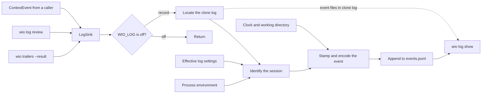
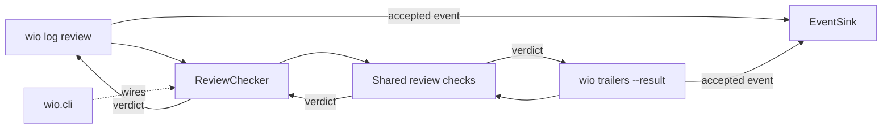

# `wio.log`

The component behind `wio log`: it records the sessions and reviews of one
clone in the [event log](../../../docs/concepts.md#the-event-log) and reads them
back. The [glossary of `src/wio`](../GLOSSARY.md) defines the envelope,
harness and harness session.

## Where the log is

[`locate.py`](locate.py) is the one place that knows where a clone's log is and
which files it holds, so the sink that writes events and the command that reads
them cannot disagree. Its docstrings say what each function takes, gives and
raises, and the [tests](../../../tests/unit/log/test_locate.py) say how each
case reads. These guarantees and their reasons are not in them:

- **One directory for each clone, under the
  [Wio home](../../../docs/concepts.md#the-wio-home).** A place keyed by the
  working directory would give each worktree its own log and hide a session's
  events from the other worktrees of the same clone, so the key is the clone's
  identity, which every worktree shares and no other clone has.
- **The digest identifies the clone and the name is only for a person.** Two
  clones that have the same directory name, in different places, still get two
  logs, because the digest is of the identity's whole path. The name lets a
  person who lists the Wio home tell which repository a log is for, and nothing
  reads it back.
- **Locating the log creates nothing.** The first write creates the directory,
  so a command that only reads a log, or fails before it writes, leaves the Wio
  home as it found it.
- **A failure to locate is the failure of the port that caused it.** Outside a
  repository, or with a `$WIO_HOME` that is relative, the caller gets the error
  of the repository or of the directories unchanged, so it can tell the person
  what it says.
- **A reader finds every lowercase `.jsonl` file of a log, in the order the
  file system port lists them.** The sink appends only to `events.jsonl`; a
  reader does not rely on that being the only file, and a missing directory is
  a log with no events and not an error.
- **The identity is taken as given.** A symlinked checkout and its target are
  one clone, because git prints the real path of its common directory, so
  `locate.py` neither resolves nor compares paths itself.

## Harness session

[Session identification](identify.py) supplies the fields that let a reader
join an event to its harness transcript. The
[session tests](../../../tests/unit/log/test_identify.py) specify how built-in
and custom mappings, preferences and diagnostics affect those fields.

A nested run can inherit session variables from several harnesses. The
preference describes which of those harnesses to use for this run. Keeping
unresolved matches and valid ids gives a reader evidence when the inherited
environment is ambiguous.

The [log settings](../config/README.md#log-settings) limit which environment
variables can supply ids. `wio config check` validates the configured names.
Project authors need to verify that the named variables hold ids, since a
secret can satisfy the same shape check. The shape check assumes that
supported harnesses emit ids in the accepted form. Identification takes a
well-shaped id as supplied, without looking up its transcript.

## Appending an event

[`LogSink`](sink.py) is the adapter of [`EventSink`](../ports.pyi) that stamps
and records both kinds of event. It uses the shared session identification and
[versioned line codec](../formats/README.md#event-log-lines) so every producer
writes the same envelope. This assumes short records on a local filesystem
where a single append keeps concurrent writers from interleaving event lines.
A torn append can also cost the following event if its line starts immediately
after the incomplete bytes. The reader recovers at the next line boundary.

Recording is best effort so a command can still give its result when storage
is unavailable. The diagnostic identifies the write destination once it is
known. The default-home hint helps users recognize that a harness restriction
can prevent writes to the default location. The `WIO_LOG` switch lets users
opt out before location, including when the home is unavailable.

The [sink tests](../../../tests/unit/log/test_sink.py) cover stamping, switch
values and diagnostics. The
[trailers acceptance scenario](../../../tests/acceptance/trailers/test_command.py)
covers the opt-out through the real command. The
[trailers integration tests](../../../tests/integration/trailers/test_write.py)
exercise the real log shared across worktrees and the command's standard
streams.

### Recording and reading events

The composition root builds the sink from the same effective log settings
that the command loaded. Session identification reads the process
environment at each write, so the envelope reflects the run that produced
the review and can be associated with that run's transcript.

The [recording scenarios](../../../tests/acceptance/log/test_record.py)
exercise the whole path through the real CLI, including configured harnesses,
preference precedence, and unresolved nested runs. The
[log workflow scenarios](../../../tests/acceptance/log/test_workflow.py)
cover recording through both commands, the log switch, and reading back
through damage. The
[adapter integration tests](../../../tests/integration/log/test_workflow.py)
exercise concurrent writers and verify that a caller can supply a complete
[`ContextEvent`](../models/events.py) and receive the same payload on decode.

## Showing recorded events

Run `wio log show [WORK] [--json]` to inspect the history of a clone's log.
The [report reader](show.py) groups events by their recorded Work ids, so
activity for a retired Work stays visible after its contract has gone.
Workflow routing uses the
[records in history](../../../docs/concepts.md#records).

The report uses event time because an earlier event can appear later in a
file. File names and line order settle ties between equal timestamps, giving
the text and JSON views the same history. The
[report renderer](render.py) uses the event codec's time formatter so the
displayed UTC timestamps agree with the recorded ones.

Each file is decoded independently. A torn last line belongs to its own file, so
the next file's first event stays readable. The skipped-line count describes the
clone's log as a whole, even when the result is filtered to a Work. Reading the
log in memory suits the expected volume of a single clone's personal activity.
The [command scenarios](../../../tests/acceptance/log/test_show.py) specify both
output forms. The [reader tests](../../../tests/unit/log/test_show.py) cover
failures to locate or read a file.

## Recording a gate review without commit records

Use `wio log review WORK ACTION STAGE --result RESULT` when the workflow
keeps its reviews in the log. [Command help](__init__.py) describes the judge,
citations, and JSON options. The accepted JSON response carries the review's
[event payload](../formats/event_lines.py) for scripts that need the judgement
and its citations. [`wio log show`](#showing-recorded-events) reads the stored
review back.

The [review checker port](ports.pyi) connects the log form to the validation
and reviewed-commit lookup used by trailers. Sharing those checks keeps the
reviewed artifact and citations consistent across the two entry points. The
[composition root](../cli/table.py) wires the checker and sink for the review
form when it is selected.

The [review scenarios](../../../tests/acceptance/log/test_review.py) specify
event parity, refusal order, output and exit codes. The sink's
[best-effort recording](#appending-an-event) keeps the accepted judgement
available even when the log is unavailable.
