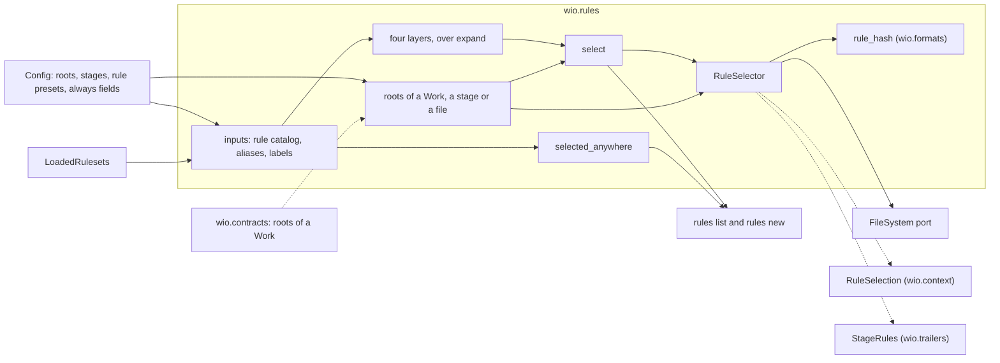
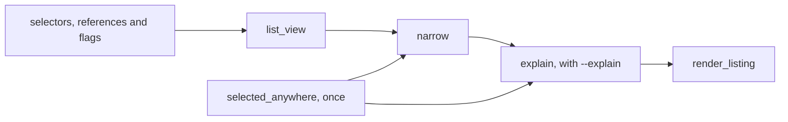

# `wio.rules`

The component behind `wio rules`. It holds the group of subcommands, the reader
of one rule file, the reader of a ruleset's manifest, the discovery of the
rulesets, the expansion of rule presets, the inputs that the selection shares,
the layers that select the rules of a stage, the decision of each rule, the
rules that any include entry delivers, the roots of a stage and of a path, the
errors of the references, the warnings of the selections and the bodies, the
report of `wio rules check`, which joins them, and the selector that gives the
rules of a stage to `wio trailers` and, once it exists, to `wio context`, and
how these parts make one selection, the listing of `wio rules list` and its
narrowing and explanation, the planning and the creation of a rule for
`wio rules new`, the finding and printing of one rule for `wio rules show`, and
what holds for the four subcommands as a whole.
[A rule file](../../../docs/concepts.md#a-rule-file) says what the file holds,
[Codes and families](../../../docs/concepts.md#codes-and-families) what its code
and name mean and [Rulesets on disk](../../../docs/concepts.md#rulesets-on-disk)
what a ruleset is. Its terms are in the
[glossary of this directory](GLOSSARY.md) and the
[repository glossary](../../../GLOSSARY.md).

## Reading a rule file

[`read_rule`](reading.py) turns the text of one rule file into a
[`Rule`](../models/rule.py), and its docstring says what it takes and returns.
Its [tests](../../../tests/unit/rules/test_reading.py) say how each case reads.

- **It reads text and does no input or output.** The caller finds the file,
  reads it and names its ruleset, so the walk of a directory and the judging of
  a rule against its ruleset, such as a family the manifest does not declare or
  a code that two rules share, are not here. A reader of one text is easy to run
  on every case, and its places are the same wherever the file came from.
- **A file reports every fault at once.** Each missing key and each key of the
  wrong form or type is its own error, so an author fixes the file in one turn,
  and an error leaves the rule out because a rule with a bad code could not be
  selected or shown safely. It never raises for a fault of the text.
- **A doubtful key is a warning and keeps the rule.** An unknown key is most
  likely a typo, so the warning suggests the known key it is close to, but a key
  that nothing reads cannot make the rule wrong.
- **A file that is not marked is not a rule and costs nothing.** A Markdown file
  next to the rules, such as a README, is left alone, while a block that claims
  to be wio's and cannot be read is an error, as for a template or a contract.
  Either metadata block form is accepted and reads to the same rule.
- **The place of a fault is the file's path.** It is followed by `:<line>` only
  when the fault has a line, which is the fault of a block that cannot be read.
  A missing key, a key of the wrong form and an unknown key have no line, so a
  person looks in the block, which is the first lines of the file.
- **The body is what the file says, trimmed.** Leading and trailing blank lines
  go, a line of whitespace counts as blank, and the final line ending goes,
  while the indentation and the line endings inside stay as written, because a
  bundle shows the body as it is. `body_line` says where the body starts, so a
  later check of the body can name its line.
- **The summary is the first paragraph on one line.** Its lines are stripped and
  joined with single spaces, so a listing shows a rule on one line whatever the
  line endings of the file are.
- **The name has a form of its own.** Hyphenated lower-case words starting with
  a letter keep a rule's file name, `<code>-<name>.md`, one readable token. The
  form is held once, here, and the code form is that of
  [`wio.formats`](../formats/README.md#the-grammar-of-a-reference-and-the-wording-of-messages).
- **A rule is a value.** It is frozen and hashable, so it can be the key of a
  selection, and two rules read from the same text, ruleset and path are equal.

## Reading a manifest

[`read_manifest`](manifest.py) turns the text of one `ruleset.toml` into a
[`Manifest`](../models/rule.py), on the same terms as `read_rule`: text in, no
input or output, every fault of the text at once, and no raising. Its
[tests](../../../tests/unit/rules/test_manifest.py) say how each case reads.

- **A fault has a key path.** A manifest has no lines to point at, except for
  TOML that does not parse, so a fault is the file followed by `#` and the key
  path, such as `#rule_presets.x.rules_include[0]`. A person finds the key in a
  file of a few lines, and the same text names the key in a message.
- **An empty manifest is a manifest.** A ruleset can be started before its first
  rule, so nothing is required of it.
- **The families and the rule presets keep the order written,** so a listing
  shows them as the author arranged them.
- **A rule preset has the shape of the config's.** One type serves both, so the
  forms of a name and of a list are not decided twice. Whether the entries of a
  preset name a family or a code that exists is not judged here, because that
  needs the rule files.
- **An unknown key is a warning that suggests the key it is close to,** as for a
  rule file, and the manifest is still returned.

## Discovering the rulesets

[`discover`](discovery.py) walks `.agents/wio/rules` through the `FileSystem`
port and returns the rulesets as [`LoadedRuleset`](../models/rule.py)s, each
with its manifest and its rules, and every fault it met. Its docstring says
where each diagnostic lies, and its
[tests](../../../tests/unit/rules/test_discovery.py) say how each case reads.

- **A fault is reported and the rest is still read.** A ruleset whose directory,
  manifest or name is at fault is left out, a ruleset whose rules are at fault
  loses those rules, and nothing is raised for a file, so `wio rules check` can
  show every fault of a repository in one run.
- **The result does not depend on the order of the listing.** The rulesets are
  sorted by name, the rules by family, then the number of the code, then the
  text of the code, and the diagnostics by `sort_diagnostics`, so the same files
  give the same bytes on any file system.
- **A ruleset is named by its directory.** A name of the wrong form, a symbolic
  link and a hidden directory are not rulesets, and a link is an error because
  the walk follows none, so a ruleset copied in by a link would otherwise be
  silently empty. A directory that cannot be listed is one error at that
  directory, the one that failed when it is below a ruleset, and a ruleset
  directory that cannot be listed is not also said to lack its `ruleset.toml`,
  because the manifest cannot be seen in it. `wio config check` reports such a
  directory with the same words.
- **The discovery repeats what `wio config check` reports, on purpose.** A
  directory without a `ruleset.toml` and a ruleset name of the wrong form are
  errors of `wio config check` already, which stops every other command before
  the discovery runs, so only a call of the discovery reaches them. `wio rules
  check` shows them again with the other faults of the rules. `wio config check`
  follows symbolic links and accepts a link to a ruleset, so the error of the
  discovery is the only report of one. The checks are not redundant, and
  removing them from the discovery loses a report.
- **A rule behind a link is never read.** The rule files are what the shared
  `walk_markdown` finds, at any depth of the ruleset's directory, and it follows
  no symbolic link, so a link to a ruleset directory is reported, as is a
  `ruleset.toml` that is one, and a link to a rule file is skipped.
- **A ruleset cannot be nested, and it holds no setting of the config.** It is
  named by its directory directly under `.agents/wio/rules`, so a reference
  cannot name a nested one, and its alias and its root independence stay in the
  config, where the selection joins them to it.
- **A stray file is reported and leaves nothing out.** A rule file outside a
  ruleset is an error, and the rulesets and rules that were read are still
  returned whole.
- **A rule is judged against its own ruleset only.** A family its manifest does
  not declare, a code or a name that two rules share, are errors that leave the
  rules out, while the same code in two rulesets is no fault, because a
  qualified code is unique. A name is unique as well as a code, as the scope of
  v0.1 says.
- **A rule file outside a ruleset and a manifest below one are errors.** They
  would be skipped, and a skipped file is a rule that nobody gets. An unmarked
  Markdown file in the rules directory, such as a README, is ignored, as in any
  other directory of rules.
- **One function refuses a discovery.** `refuse_on_errors` raises for the errors
  of a discovery and not for its warnings, so every command that must not work
  from a broken ruleset refuses alike and none decides for itself.
- **The rules directory is judged before it is walked.** It is missing without
  fault, and a symbolic link or a file there is one error and is not entered,
  as for the templates and the Works.

## Expanding rule presets

[`expand`](expansion.py) turns a list of includes and excludes into the rules it
selects, and every layer of the selection is built on it. It works on values:
the rulesets, their aliases and the config's rule presets arrive as a
[`RuleCatalog`](expansion.py), so it reads no file. Its docstring and
[tests](../../../tests/unit/rules/test_expansion.py) say what each case returns,
and [Rule presets](../../../docs/concepts.md#rule-presets) says what a rule
preset is.

- **A reference is read in the scope it is written in.** In the config a bare
  name is a rule preset of the config, and in a manifest it is a family, a code
  or a rule preset of that ruleset. So the same text can mean two things, and
  the scope is a value that the caller gives. A bare upper-case name stays
  malformed in the config, as `wio config check` judges it, because the grammar
  is the one that `wio.formats` shares with it.
- **An exclude reaches only its own level.** A rule preset resolves before
  anything uses it, so an exclude inside it cannot remove what an outer rule
  preset includes on its own. What a nested rule preset removed stays in
  `removed`, so `--explain` can say that a rule was taken out there even when an
  outer entry brought it back.
- **Every rule carries the routes by which it was reached.** A route is the
  canonical references from the outermost rule preset to the entry that named
  the rule, and a rule reached twice has both, sorted. The route is what lets
  `--explain` answer where a rule came from, and it never shows an alias, so one
  ruleset has one spelling in every output. A `Route` is in
  [`wio.models`](../models/rules.py), because a `Decision` holds routes and a
  model may not import a component.
- **What cannot be expanded is a problem and selects nothing.** An unknown name,
  a malformed reference, a qualified name inside a manifest and a cycle each
  become a `Problem` that names the entry and the rule presets it was found in,
  and the other entries are still expanded. Expanding never raises, because
  `wio rules check` has to show every fault at once, and a manifest is text that
  anyone may write.
- **A family that is declared and holds no rule is not a problem.** A ruleset
  can be started before its first rule, and a preset that includes the family
  keeps working once the rules arrive.
- **The rulesets that the includes name are returned apart from the rules.** A
  root reaches a ruleset by the rules it selects, but an exclude can leave none
  of them, and the ruleset is still the one the author meant, so the
  expansion names it. An exclude and an entry that names nothing name no
  ruleset.
- **The result does not depend on the order of the inputs.** The rules are
  sorted by ruleset, family, number and code text, the routes of a rule are
  sorted, and the problems are sorted by route, reference and kind, so the same
  files give the same bytes.
- **Nested rule presets are expanded from a list and not by recursion.** The
  depth of a chain is limited by memory and never by the recursion limit, so a
  long chain of rule presets does not raise.
- **The cost grows with the paths through nested rule presets.** A rule keeps
  every route, so a rule preset that two others include is expanded once for
  each, and a diamond of presets takes time and memory that grow exponentially
  with its depth, even when it selects nothing. A repository's own rule presets
  are shallow, so this has not been bounded; a rule preset that is expanded by
  value, once, with its routes rebased, would remove the cost.

## The inputs of the selection

[`inputs.py`](inputs.py) holds what every consumer of the selection would
otherwise build for itself: the rulesets of a discovery by canonical name
(`ruleset_map`), the [`RuleCatalog`](expansion.py) that `expand` resolves its
references in (`build_rule_catalog`), the resolution of a ruleset's name or
alias (`resolve_ruleset`), and the labels and the text of the chain that says
where a rule came from (`layer_label`, `chain_labels`, `chain_text`). A label
of a root or a stage that is given no name is refused, and not written as
`root None`. Their docstrings say what each takes and returns, and their
[tests](../../../tests/unit/rules/test_inputs.py) say how each case reads.

- **Each shape is built in one place.** The layers, the rules selected anywhere,
  the checks and the commands all need the same catalog and the same chain, and
  a second builder could differ from the first in an alias or a label, so that
  `list --explain` and `new` would print different text for one rule. The one
  place that knows what a catalog is made of is this module and `expand`, so a
  change to the catalog is made there. `expand` resolves a ruleset through
  `resolve_ruleset` and keeps no resolution of its own.
- **A name wins over an alias.** A ruleset is named by its directory, and the
  config keeps an alias from naming another ruleset, so the order only matters
  to a config that is not valid; there the directory name is the one that cannot
  change under an edit of the config.
- **An alias is kept for a ruleset whose files were not read, and names
  nothing.** The catalog holds every alias of the config, because it is the
  config's, but resolves one only when its ruleset is in the catalog, so a
  command can tell a ruleset it does not know from one it could not read, by
  looking at the config, and neither is expanded as if its rules were there.
- **The rulesets and the labels are in a fixed order and a fixed text.** The
  rulesets are keyed in the order of ruleset name whatever the order of the
  discovery, and a layer's label and a chain are the text that the text and the
  JSON of `list --explain` and `new` both print, so the two cannot disagree. A
  listing of references has no layer and so no label; its chain is the route
  alone.
- **The two modules import each other lazily.** `inputs` builds a `RuleCatalog`
  and `expansion` resolves a ruleset, so either would need the other at import
  time, and both use lazy imports to break the cycle. Importing `wio.rules`
  loads neither.

## The layers of the selection

[`apply_layers`](layers.py) applies the four layers to the rulesets, in the
order that
[How a rule is selected](../../../docs/concepts.md#how-a-rule-is-selected)
gives: the rule presets of the roots, the stage's includes and excludes, the
always includes and the always excludes. Its docstring says what it takes and
returns, and its [tests](../../../tests/unit/rules/test_layers.py) say how each
case reads.

- **Every rule is in the result, with what each layer did to it.** A listing has
  to say that a rule was excluded, vetoed or never named, and not only that it
  is out, so a rule keeps a `LayerEffect` for each layer that added it or that
  an exclude named it in, with the routes of the expansion. `selected` is the
  set after the last layer, and the effects are the reason.
- **A root named twice is applied once.** The roots add together by name, so a
  repeated name would otherwise double the effects of its rule presets.
- **A layer works on what the layers before it built.** The stage's excludes
  take out what the roots and the stage's includes added, the always includes
  add over any earlier exclude, and the always excludes are the final veto,
  which wins over the always includes. So the same rule can be added, removed
  and added back, and its effects show the three steps in order.
- **An exclude records an effect for every rule it names.** The author decided
  about the rule whether or not it was in the set, and a listing can then say
  that it was excluded or vetoed. An exclude list is expanded as includes, to
  know every rule its entries name.
- **An exclude inside a rule preset stays inside its entry.** It takes rules out
  of that entry's includes only, so it records a `removes` effect, from the
  `removed` of the expansion, and never unselects what another entry or layer
  added. What `selected` holds is decided by the includes and the layer-level
  excludes alone.
- **The roots add together, in the order of their names.** The rules of each
  given root are added, a rule that two roots add has an effect for each, and
  one root's exclude does not take out what another adds, so the order of the
  roots argument never decides whether a rule is selected.
- **A layer is applied only when its input is given.** Without roots there is no
  layer of the roots, without a stage there is none of the stage, and the always
  fields apply in every call, as the views of `wio rules list` need.
- **The rulesets that each root reaches are returned for every root of the
  config,** given or not, because applying the roots needs to know which
  rulesets a root can reach, and it does so even when its excludes leave none of
  their rules.
- **An unknown root or stage is refused and an unknown reference is a problem.**
  A name that the config does not have raises `KeyError`, which the command
  turns into a refusal, while a reference that cannot be expanded selects
  nothing and is listed once in the result, so `wio rules check` shows every
  fault at once.
- **The result does not depend on the order of the inputs** and is hashable. The
  rules are in the order of the rulesets and their codes, the effects in the
  order the layers applied, and the problems sorted, so the same files give the
  same bytes. `LayerEffect` is in
  [`wio.models`](../models/rules.py), because a `Decision` holds it and a model
  may not import a component.

## The decision of every rule

[`select`](applicability.py) applies the layers and decides every rule of every
ruleset: included, with the roots it applies to, or out, with the reason. One
function serves every view of a listing and every consumer of a selection, so
`wio rules list` and, once it exists, `wio context` cannot give a rule
different decisions. Its docstring says what it takes and returns, and its
[tests](../../../tests/unit/rules/test_applicability.py) say how each case
reads. `Decision` and `Reason` are in [`wio.models`](../models/rules.py).

- **The layers decide first and the roots cut after.** A rule that a layer
  removed is out for that layer's reason, and only a rule that the layers kept
  can be cut by the roots. Otherwise a rule that a stage excluded in a ruleset
  no root reaches would be reported as cut by the roots, and a person would look
  for the wrong cause.
- **A selected rule applies where its ruleset is reached.** It is included when
  its ruleset is root-independent or a selected root reaches it, and is cut by
  the roots otherwise. A root-independent ruleset applies to every root, so its
  rules have no roots and `root_independent` true, whether or not a root also
  reaches it; `wio rules check` reports that case, and the decision does not
  depend on it.
- **Roots not applied and roots applied with none selected are different.**
  `None` means the roots are not
  applied, as for a listing of the whole repository: nothing is cut, and a rule
  lists the roots of the config that reach its ruleset. An empty tuple means the
  roots are applied and none was selected, so only the root-independent rules
  remain and the others are cut, which is what a stage with no root selects.
- **The reason is the last layer that removed the rule.** A rule that the root
  added and the stage removed is excluded by the stage, and one that the stage
  removed and the veto removed again is vetoed, because the last removal is what
  left it out. A rule that no layer touched is not selected. The exclude of a
  rule preset inside an entry of the always includes took nothing out of the
  set, so it gives no reason, and a rule that only it removed is not selected.
- **Each decision carries the effects of the layers,** so a listing can explain
  a rule without applying the layers again, and the order of the selection is
  that of the layers: every rule once, in the order of ruleset, family, number
  and code text.
- **The same inputs give the same selection** whatever the order of the tables
  of the config, of the entries of its lists or of the roots, and `select`
  raises the `KeyError` of the layers for a root or a stage that the config does
  not have.

## The rules selected anywhere

[`selected_anywhere`](anywhere.py) answers for the whole config what the layers
answer for one stage: which rules some include entry delivers, and by which
entries. A listing of the rules that nothing selects and the report of
`wio rules new` read this one answer, so they cannot disagree. Its docstring
says what it takes and returns, and its
[tests](../../../tests/unit/rules/test_anywhere.py) say how each case reads.
`Origin` and `SelectedAnywhere` are in [`anywhere.py`](anywhere.py).

- **An entry counts whatever the roots and the stages in use.** An entry that
  names a ruleset that no root reaches, or a stage that no pipeline uses, still
  delivers its rules, because the question is whether anything selects the rule
  and not whether a session would receive it. `wio rules check` warns
  about an entry that names a ruleset that no root of the stage reaches.
- **A rule preset's exclude is a resolved set, and a view's exclude is not.**
  What the exclude of a rule preset took out of an entry is not delivered by
  it, while a stage's `rules_exclude` and the always excludes remove a rule from
  a view and leave it selected. Otherwise a rule that a stage hides would be
  reported as unselected, and an author would add it again.
- **What an exclude took out is kept in `removed`,** with the entries that did,
  also for a rule that another entry delivers, so a listing can say what removed
  a rule that nothing selects.
- **One origin for each layer and name, with all its routes.** Two rule presets
  of one root that reach a rule are one origin with two routes, so a listing
  shows the entry once and the routes that explain it.
- **What cannot be expanded delivers nothing and raises nothing,** as for the
  layers, and the rest of the entry still counts. `wio rules check`
  reports the problem.
- **It does no input or output.** A listing and `wio rules new` call it with
  the config and the rulesets they already hold, so it runs the same on a
  config with no files and on every case of a test.
- **The same inputs give the same answer** whatever the order of the tables of
  the config or of the entries of a list: origins are in the order root, stage,
  always-include and then by name, and the rules in the order of the rulesets
  and their codes.

## The roots of a stage and of a path

[`stage_roots`](roots.py) finds the roots that count for a stage of a Work, and
[`roots_of_path`](roots.py) the roots that contain a file. Both work on the
config and on what the caller names, so that one answer to which roots count
serves every consumer. The Work's own roots arrive through the
[`WorkRoots`](ports.pyi) port, which
[`WorkLookup`](../contracts/lookup.py) satisfies, so `wio.rules` reads no
contract. Their docstrings say what each takes, returns and raises, and their
[tests](../../../tests/unit/rules/test_roots.py) say how each case reads.
[Which roots a stage selects](../../../docs/concepts.md#which-roots-a-stage-selects)
says what the forms of a stage's `roots` mean.

- **A Work without roots raises where the stage needs them.** A stage that
  selects the Work's roots, without `roots` or through `@work`, raises
  `ValueError` for a Work that has none, whatever other roots it lists, because
  an empty `@work` would hide the mistake behind the other roots' rules. The
  selector turns the error into a selection with no included rule, as
  [the selector](#the-rule-selector) says.
- **A stage's own roots never look at the Work.** A stage with only its own
  roots, or `[]`, never fails for the Work and never looks it up, because the
  Work is not what the stage selects. The stage is checked first, then its own
  roots, and the Work last, so the name that a `KeyError` carries is the first
  thing that was wrong in that order.
- **A name that does not exist is refused,** not skipped: an unknown stage or
  Work, and a root of a stage or of a Work that the config lacks. a check of the
  contracts already enforces the roots of a Work, so one that is not a root is a
  mistake and not a root to ignore.
- **A path is in a root by whole components.** `src/api2/x.py` is not in a root
  `src/api`, and a root `.` holds every path. The path is relative to the
  repository root, normalized and written with `/`, and need not exist, because
  the caller is to make it so.
- **Neither function does input or output.** A fake of the port and a config
  are all a test needs, and the Work's own roots come from whichever view the
  caller's `WorkRoots` reads: for `wio trailers`, the working tree, which
  differs from the index only for a change that is not staged yet.
- **The results are sorted and each name is once,** whatever the order of the
  config's roots, of a root's paths or of a stage's `roots`.

## The selection as a whole

The parts above decide which rules apply to a stage, and they are built so that
every consumer reads one answer, so `wio trailers`, `wio rules list` and,
once it exists, `wio context` cannot disagree on what a session was given.
Its [tests](../../../tests/unit/rules/test_selection.py) are the criteria of the
selection.

- **Every view is one function over different roots.** A listing of the whole
  repository, of a root, of a path and of a Work at a stage differ only in the
  layers they apply and the roots they give: `--root`, `--path` and `--work`
  give the roots, `--stage` gives the stage, and a view without roots applies
  none. So `select` serves them all and no view computes the rules a
  second time.
- **The selection holds every rule once.** Each rule of every ruleset has one
  decision, so a listing, an explanation and the hashes are views of the same
  value, and the order of everything in it is that of the rules of the
  repository, ruleset, family and code.
- **Only the selector reads a rule file for its bytes.** `select` does no
  input or output, and the selector reads the file of a rule through the
  `FileSystem` port, so the hash of a rule is computed in one place.
- **A rule that nothing selects is never included.**
  [`selected_anywhere`](anywhere.py) says which rules some include entry of the
  config delivers, whatever the roots and the stage, and every rule that
  `select` includes in any view is among them. A rule that a stage excludes or
  the always excludes veto is still delivered by its entry, so it is selected
  and out; a rule that no entry names is out in every view, which is why a
  listing can name the rules that nothing selects.

## Listing the rules of a view

[`list_view`](listing.py) decides the rules of a view and
[`render_listing`](listing.py) writes them, and `run_list` joins them for
`wio rules list`. Their docstrings say what each takes, returns and raises, and
the [tests](../../../tests/unit/rules/test_list_view.py) say how each case
reads. The types of a listing, `Listing`, `Header`, `Row` and `Explanation`, are
in [`wio.models`](../models/listing.py), and the leaves that narrow and explain
the listing fill the fields that this one leaves empty.

`run_list` passes the listing through the steps in this order. `narrow` runs
with references or `--not-selected`, `explain` with `--explain`, and the rules
selected anywhere are computed only when one of them runs:

- **A view differs from another only in the layers and the roots it applies.**
  `--root`, `--path` and `--work` give the roots, `--stage` gives the stage, and
  `list_view` calls [`select`](applicability.py) once, so the rules of a view
  are those that `wio trailers` is given. A view without roots applies none, and
  a view with no selector applies no layer and lists every rule with no
  decision, so a listing of the whole repository is not a selection. The same
  config, rulesets and arguments give the same listing, in the order of ruleset,
  family and code, whatever the order of the tables and the entries.
- **The roots and the stage are applied as `select` takes them.** A root is that
  root, a path gives the roots that contain it, and a Work gives the roots that
  the stage selects for it, which are its own when no stage is given. A stage
  alone leaves the roots not applied, so nothing is cut and each rule lists the
  roots of the config that reach it.
- **The header says what was applied.** `layers:` names `roots`, `stage` and
  `always fields`, the last for both always fields, and `roots:` says
  `not applied` when none were applied and `none` when they were and none
  matched, so the two cases are not read as one.
- **A rule that is out is shown only when it is asked for.** `Listing` holds
  every rule considered and the renderer decides which to show: a rule that is
  included or has no decision, one with an explanation, or all of them when the
  header is marked `not selected`. An out row has `included` false in the JSON.
- **The renderer prints an explanation without knowing it.** A row's
  explanation gives its lines for the text and its fields for the JSON, so a
  later leaf adds an explanation without changing the renderer.
- **The text and the JSON hold the same rules.** The text is the header, a blank
  line and one [block](../formats/README.md#the-layout-of-blocks) for each rule,
  with a blank line between one block and the next, because a rule's description
  or summary is a long line that runs into the next rule's, and `--json` is one
  object on one line with the header keys and then the rules, for a program.
- **The discovery runs once, and anything that cannot be used is refused before
  anything is printed.** `run_list` gives `list_view` the rulesets of its own
  discovery, so it does not call `RuleSelector.selection`, which would discover
  again. A conflict of selectors, an unknown stage, root or Work, a Work with no
  roots, a path outside the repository, a reference that names nothing and a
  fault in the rules each exit 2 with the message on standard error and nothing
  on standard output, and a fault in the rules is refused as it is for the
  selector.
- **The rules selected anywhere are computed once.** `run_list` gives the one
  [`SelectedAnywhere`](anywhere.py) to [`narrow`](narrowing.py) and to
  [`explain`](explaining.py), which the
  [tests](../../../tests/unit/rules/test_list_run.py) check.
- **References narrow every view, `--not-selected` limits it to the rules that
  nothing selects and `--explain` says where each rule came from.** The three
  are in the sections below, and the
  [scenarios](../../../tests/acceptance/rules/test_list_command.py) run them
  together through the command, as text and as JSON.

## Narrowing a listing

[`narrow`](narrowing.py) takes a `Listing` and keeps the rows that references
name, or that nothing selects. Its docstring says what it takes, returns and
raises, and its [tests](../../../tests/unit/rules/test_narrow.py) say how each
case reads. It does no input or output: the caller gives it the rules that any
include entry delivers, so the repository is asked once and not once for each
use.

- **A reference delivers what `expand` returns for it.** It is read in the
  config's scope, so a rule preset delivers its includes minus its own excludes,
  and a family, a code and `all` deliver the rules they name. A listing narrowed
  by a rule preset, a family or a code is a listing like any other, in the
  layers and the roots of its view.
- **Several references keep the rules that any of them delivers,** each once and
  in the order of the listing, because the person asked about each. Each kept
  row holds in `via` the routes by which the references delivered it, merged and
  sorted.
- **`--not-selected` keeps the rules that no include entry delivers.** With
  roots applied, the candidates are the rules of the rulesets that those roots
  reach and the root-independent ones, and without roots every rule is a
  candidate. With references it keeps, of the rules they deliver, those that
  nothing selects, which says whether a rule preset or a family is in use.
- **The reach is asked of the layers once more, for no roots and no stage.** It
  does not depend on either, and the selection's rule against computing a
  decision twice is about decisions, which this does not repeat.
- **Rows that are out are kept, and the header says so.** The renderer hides an
  out row unless the header is marked `not selected`, so that mark, which the
  JSON writes as `not_selected`, is what shows the rules that nothing selects.
  The header's references and mark are set from the arguments and replace what
  the listing held.
- **A reference that cannot be used is refused, at any depth.** A name that
  names nothing, a malformed one, a cycle and a bad entry inside a rule preset
  that the reference reaches are each a `WioError` that names the reference. The
  person asked about it, and a partial listing would hide that part of it was
  not read. The wording is that of
  [`wio rules check`](#the-report-of-wio-rules-check), so a name that names
  nothing in a ruleset says so, and a bare name that is no rule preset of the
  config says that.

## Explaining a listing

[`explain`](explaining.py) gives each row of a `Listing` a
[`RuleExplanation`](explaining.py), which says where the rule came from and why
it is out. The renderer prints it through the `Explanation` protocol of
[`wio.models`](../models/listing.py) without knowing how it was made. The
docstrings say what each takes and returns, and the
[tests](../../../tests/unit/rules/test_explain.py) say how each case reads. It
does no input or output.

- **A chain says where a rule came from, and the rule came from what is on its
  right.** It starts with the rule's qualified code, then the layer, then the
  route from the outermost rule preset to the entry that named the rule, joined
  by `←`, as [the concepts](../../../docs/concepts.md) write the source of a
  rule. The labels and the chains are written by the functions of
  [the inputs](#the-inputs-of-the-selection), so every consumer writes them
  alike: `root <name>`, `stage <name>`, `rules_always_include` and
  `rules_always_exclude`.
- **A `from:` line is an origin and a `by:` line is a removal, and a row shows
  its `from:` lines whether it is included or out.** There is one for each route
  of each effect of the layers. The stage's name comes from the header of the
  listing, because a layer effect holds only the name of a root. An included row
  can have a `by:` line, when a layer removed the rule and a later one added it
  back, because the effects show every step in order.
- **The `out:` line gives the reason that the decision gave.** `not selected`,
  `excluded by the root's rule preset`, `excluded by the stage`,
  `vetoed by rules_always_exclude` and `cut by the roots` are the five reasons,
  so the line and the JSON `reason` say the same thing.
- **Layers explain a layered listing, and references explain one with no
  layers.** In a layered listing the routes of any references are ignored. With
  no layers the routes that the references delivered a rule by are its origins,
  a row that `--not-selected` shows has the reason `not selected`, and what an
  exclude of a rule preset removed from an include entry, which the rules
  selected anywhere record, is its removal. A row with no decision and no routes
  has nothing to explain and gets no line.
- **Every row gets an explanation, so every row is shown.** The renderer shows a
  row that has one, so a listing that was explained shows its out rows with
  their reasons, and one that was not shows nothing added.
- **The text and the JSON state the same.** The JSON gives `origins`, `reason`
  and `removed_by` after the fields of the rule, the chains as arrays of labels
  without the code and the reason as a kind and a layer.

## Creating a rule

[`plan_rule`](planning.py) decides the code, the place and the file of the next
rule of a family, and [`run_new`](creating.py) writes it and says whether
anything selects it, for `wio rules new`. Their docstrings say what each takes,
returns and raises, and the [tests](../../../tests/unit/rules/test_plan.py) and
[scenarios](../../../tests/acceptance/rules/test_new.py) say how each case
reads. `plan_rule` does no input or output, so a request is judged before
anything is written.

- **The code is the next number of its family and never fills a gap.** A number
  that is free below the highest is not reused. The number has at least
  three digits and at least as many as the highest code of the family, so
  `ARC999` is followed by `ARC1000` and `ARC0007` by `ARC0008`.
- **The file is named `<code>-<name>.md` and goes next to the family's last
  rule.** It is in the directory of the rule with the highest code of the
  family, or in the ruleset's directory when the family has none. The name of
  the file is a convention that no command reads.
- **The file is a comment block with an empty body, whatever form the other
  rules have.** The block holds the code, the name and the description when one
  is given, written by `encode_comment_toml`, which escapes a quote, a backslash
  and the `-->` that would close the comment early. The body is empty because a
  placeholder would reach a bundle if it were never edited. `plan_rule` reads
  the text back with `read_rule`, so the plan is a valid rule, and `run_new`
  reads the written file back with the discovery.
- **A request that cannot be met is refused before anything is written.** An
  unknown ruleset, a family that the manifest does not declare, a name or a
  description of the wrong form and a name that the ruleset already has are a
  `WioError` that lists what would do. A file in the way, a rule or not and a
  symbolic link included, is refused too, because `write_text` overwrites or
  writes through a link.
- **An error of the discovery anywhere refuses the command, and a warning does
  not.** The ruleset asked for need not be the one with the error.
- **An alias is resolved to the canonical name before the plan.** `plan_rule`
  knows canonical names only, and the result names the ruleset by it.
- **The result says whether any entry of the config delivers the new rule.** It
  asks the rules selected anywhere, which is whatever the roots, so a rule can
  be selected and still be received by no session, when its ruleset is not
  reached. Each origin is written as a chain, as `wio rules list --explain`
  writes it, in the text and in the JSON, which has `code`, `name`, `path`,
  `selected` and `origins` in that order.
- **The same repository and request give the same file.** Exactly one file is
  created.

## Showing a rule

[`show_rule`](showing.py) finds the one rule that a reference names,
[`render_rule`](showing.py) writes it and [`run_show`](showing.py) runs the
command, for `wio rules show`. A listing shows a rule in one line and a bundle
shows it only to a session, so this is how a person reads one rule whole.
Their docstrings say what each takes, returns and raises, and the
[tests](../../../tests/unit/rules/test_show.py) and
[scenarios](../../../tests/acceptance/rules/test_show.py) say how each case
reads. `show_rule` and `render_rule` do no input or output.

- **The reference is one rule's qualified code.** It is `<ruleset>.<code>`, and
  a rule is named by its ruleset and code, never by a bare code, and the ruleset
  may be its alias. `show_rule` judges its form with `parse_reference` and
  `item_kind`, and tells a bare code from other malformed text with
  `parse_own_item`.
- **A reference that is not one rule's code is refused with its cause.** A
  family, a rule preset, `all`, a bare code, malformed text, an unknown
  ruleset, an unknown rule and an item in the form of a rule preset name and
  not of a code are each a `WioError` that says which it is, so the command
  exits 2 and prints nothing on standard output. The form is judged before the
  ruleset is looked up.
- **An alias is resolved by the command, and `show_rule` knows canonical names
  only.** `run_show` resolves the ruleset part with `resolve_ruleset` and
  leaves any other text as it is, so `show_rule` words every refusal. The
  output names the rule by its canonical ruleset.
- **An error of the discovery anywhere refuses the command before the
  reference is looked at, and exits 2, and a warning does not.**
- **The text is the header, a blank line and the body.** The header is the
  qualified code and the name with the description, when the rule has one, and
  `file: <path>` indented to the name, as the listings write them, and the path
  is relative to the repository root and written with `/`. A rule without a body
  prints only its header.
- **The body is printed as `read_rule` returns it.** It has no leading or
  trailing blank lines, keeps its leading spaces and its line endings, and is
  followed by one line feed. Standard output does not translate line ends, so a
  CRLF reaches the reader of the output as it is stored.
- **`--json` writes one line.** It has `code`, which is qualified, `name`,
  `description`, which is `null` when there is none, `summary`, `body` and
  `path` in that order, with no final line feed in the body.
- **The same repository and reference give the same bytes.** Nothing is
  written.

## The command as a whole

`wio rules` has four subcommands, `check`, `list`, `new` and `show`, that share
the selection, the discovery of the rule files and the forms of their output.
The [tests](../../../tests/acceptance/rules/test_tree.py) run them together,
and the
[citation of a rule](../../../tests/acceptance/rules/test_tree_trailers.py) and
the [selector](../../../tests/unit/rules/test_tree.py) are tested through the
ports of `wio.trailers` and `wio.context`. These hold for all of them:

- **`wio.rules` imports no other component.** `tach check` verifies it. It
  reads files, the config and the roots of a Work only through the `wio.io`
  ports, the shared `Settings` port and the roots port, and the unit tests of
  its parts run it on fakes of them.
- **The output is deterministic.** The same files, config and arguments give the
  same bytes, in text and in JSON. Rules are ordered by ruleset name, then
  family, then the number of the code, then the text of the code, so `ARC999`
  comes before `ARC1000` and `ARC001` before `ARC01`, and diagnostics are in the
  order of `sort_diagnostics` of `wio.models.diagnostics`, which compares the
  place as text, then the severity, then the message.
- **Only `wio rules new` writes a file.** `check`, `list` and `show` read only.
  `new` writes nothing for a ruleset with a fault.
- **A rule is named by its canonical ruleset and code with its name.** It is
  written such as `py.API001 adapters-return-typed-results` wherever `wio rules`
  shows or cites it, never by a bare code or an alias.
- **Every subcommand takes `--json`.** It prints the information of the text
  form as one JSON document.
- **A diagnostic names its place the same way.** It is the path of the file
  relative to the repository root, written with `/` and followed by `:<line>`
  when the fault has a line; the path of the directory for a fault of a
  directory; the manifest's path followed by `#` and the key path for a fault in
  a key of a manifest, such as
  `.agents/wio/rules/demo/ruleset.toml#rule_presets.local.rules_include[0]`; and
  the key path of the config for a fault in the config, as `wio config check`
  writes it. A fault of two files names both, joined by `, `, as `wio.templates`
  writes it.
- **A fault reaches `check` and stops the other commands.** `wio rules check`
  reports it, and `new`, `list` and `show` refuse instead of working from a
  ruleset that has left a rule out.
- **A rule made by `new` needs no edit.** `check` accepts it, `list` shows it
  and the selection for a Work at a stage includes it.
- **A reference that names nothing is judged where it is written.** One of the
  config selects no rule and is reported by `check`, so `list` and the selection
  go on past it, while a reference given to `wio rules list` on the command line
  that names nothing is refused.
- **A rule that nothing selects is listed and not warned about.**
  `wio rules list --not-selected` shows the rules that no root, stage or always
  field includes, and `check` reports nothing about them.

## The group of subcommands

[`__init__.py`](__init__.py) holds `RulesSpec`, `Services`, `Subcommand`, the
table `SUBCOMMANDS` and `json_option`, and [`command.py`](command.py) holds
`RulesCommand`, which runs the subcommand that the arguments chose. It follows
the pattern of [`wio.contracts`](../contracts/README.md#the-group), and its
docstrings and [tests](../../../tests/unit/rules/test_command.py) say what each
takes and returns. So far `check`, `list`, `new` and `show` are the subcommands
in the table.

- **A subcommand is one entry of the table.** The group knows nothing else of
  a subcommand, so adding one edits no other and builds no second shell.
- **The table is in the package module, with its `configure` and its handler.**
  Describing a command loads no module of its package besides `__init__`
  ([import-light packages](../cli/README.md#import-light-packages)), and
  `configure` runs while `wio --help` is described, so the table cannot defer
  its entries with a `lazy from`; the docstring of
  [`SUBCOMMANDS`](__init__.py) says how an entry defers its handler.
- **Bare `wio rules` reads nothing.** It writes its usage without a repository
  or a config, so it works anywhere, even when the config has an error.
- **What a subcommand needs comes in `Services`.** They are built in `wio.cli`,
  the one place where they meet the group, and a subcommand that needs another
  port adds a field. `wio.cli` builds them when `wio rules` is chosen and never
  while describing, and building them reads nothing, which bare `wio rules`
  depends on.
- **The group maps no failure itself.** A mistake the user must fix is a
  `WioError`, which a handler raises and which the command line prints and
  exits 2 for, with the lines of a `DiagnosticsError` written as they are, while
  a handler returns 0, or 1 for a failed check, and never another code. Any
  other exception is a bug and exits 70, and the
  [command line](../cli/README.md#failures-and-exit-codes) owns that mapping
  for every component, so that no two components can differ.
- **`--json` has one declaration,** `json_option`, so that every subcommand that
  writes JSON gives one document and nothing else on standard output for exit 0
  and 1, and nothing for exit 2.

## The errors of the references

[`check_errors`](errors.py) finds the errors that only the rule files and the
config show together: a reference that names nothing in its ruleset, a cycle of
the rule presets of a manifest, a manifest that defines `all`, and a
root-independent ruleset that a root reaches. Its docstring says what it takes,
returns and words, and its
[tests](../../../tests/unit/rules/test_errors.py) say how each case reads. It
returns the errors of the discovery as they are, so one function holds every
error that `wio rules check` reports, and the warnings are another's. It
takes the config to be valid, as `wio config check` has judged it, so every
reference in it is well-formed and the question left is whether the item after
the dot exists.

- **An entry is judged where it is written and by itself.** Each is expanded
  alone, so a fault in a rule preset that an entry reaches is the rule preset's
  and is reported at its own key, once, however many roots, stages and rule
  presets reach it. Otherwise an author would see one fault at ten places and
  fix the wrong one.
- **A reference is judged against what the discovery returned.** A rule or a
  whole ruleset that the discovery left out for its own fault is a reference to
  nothing, and the message says so, so the author finds the cause in the
  discovery's error beside it. A family that the manifest declares and that
  holds no rule is valid, because a ruleset is started before its first rule.
- **The reason is worked out again from the entry.** A problem of the expansion
  carries only its kind, so the message lists the families, the codes of the
  family or the rule presets that exist, as `wio config check` lists what
  exists, and an author corrects the entry in one turn.
- **A cycle is one error at its first member, and an exclude is an edge.** A
  rule preset that excludes one that includes it cannot be expanded either, and
  an expansion drops the cycle it meets, so the cycles are found from the graph
  of both lists, with `find_cycles` that `wio.config` shares. The error is at
  the first member's `rules_include`, or at its `rules_exclude` when none of its
  includes names a member. [`wio config check`](../config/README.md) counts
  the same edges for the config's own rule presets, and both use
  `rule_preset_cycles` of `wio.formats`. `all` is
  the whole ruleset and never a rule preset, so it is no node of the graph, and
  a manifest that defines it is one error.
- **A root must not reach a root-independent ruleset, and a stage may include
  one.** A root-independent ruleset applies to every root, so a root that names
  it adds nothing, and the error is at the root's entry, also when the root
  reaches it through a rule preset of the config, and never at that preset's own
  key, which other roots and stages may use. It names the rule preset of the
  config that the entry names, so the author knows which line to change. A stage
  selects rules for a view and is no reach.
- **The result is in the shared order** whatever the order of the tables of the
  config and of the rulesets, and no file is read.

## The warnings of the selections and the bodies

[`check_warnings`](warns.py) finds the warnings that only the rule files and the
config show together: a selection that no root can reach, a rule that both
always fields name, and a heading in a rule's body. Its docstring says what it
takes, returns and words, and its
[tests](../../../tests/unit/rules/test_warns.py) say how each case reads. It
returns the warnings of the discovery as they are, and not its errors, so one
function holds every warning that needs the rule files and the config together,
and the errors are [another's](#the-errors-of-the-references). It takes the
config to be valid, so every reference in it is well-formed and names a
ruleset, and the question left is which rulesets an entry names and which roots
reach them.

- **A selection nothing can reach fails silently, so it is a warning with a
  fix.** The layers select its rules and the roots then always cut them, so a
  rule never reaches a session and nothing says so. The warning names the
  ruleset and the two ways out: mark it `root_independent`, or name it in a
  root's `rule_presets`. A ruleset that the config's `rulesets` table does not
  list is not root-independent.
- **Which roots count depends on where the entry is written.** A stage counts
  the roots of its own `roots`, and `@work`, a stage with no `roots` and
  `rules_always_include` count every root of the config, because the Work's
  roots are not known to a check of the repository. `roots = []` counts none,
  so a stage that selects no roots reaches only the root-independent rulesets.
  A root reaches the rulesets that the include entries of its rule presets name,
  which is the reach that the layers report.
- **An entry is judged for each ruleset it names.** A rule preset that names two
  rulesets is one warning for the one that nothing reaches, at the entry, and a
  ruleset that the discovery left out is not judged, because its fault is the
  discovery's and a second warning would only repeat it.
- **An exclude and a root's own entry are not judged.** An exclude removes rules
  from a view and selects nothing, and a root that names a root-independent
  ruleset is an error of the references, so neither is a warning here.
- **A veto that wins is a warning at the include entry.** An entry of
  `rules_always_include` whose rules an entry of `rules_always_exclude` also
  delivers adds nothing for those rules, so the warning names the exclude
  entries and the rules, with their names, and says that one of the two entries
  can go.
- **A heading in a body breaks the bundle.** A real heading in it, as
  `read_outline` finds one, breaks the structure of the bundle that holds the
  rule. A heading in
  code, a comment, a quote or a list is not one, and the warning is at the file
  and the line of the first heading.
- **Each warning is reported once, in the shared order,** whatever the order of
  the tables of the config and of the rulesets, and no file is read.

## The report of `wio rules check`

[`check_rules`](checking.py) judges the whole repository and returns every fault
in one list, and `run_check` prints it as the `check` entry of the table. Their
docstrings say what they take and return, and their
[tests](../../../tests/unit/rules/test_checking.py) and
[scenarios](../../../tests/acceptance/rules/test_check.py) say how each case
reads.

- **One discovery serves both lists.** `check_errors` and `check_warnings` each
  return the faults of the discovery that have their severity, so a fault of a
  rule file or a manifest comes through exactly one of them and is one line. The
  references are judged against what the discovery returned, so a reference to a
  rule that was left out for its own fault is reported too, as a consequence of
  that fault and not a repeat of it.
- **Every ruleset is judged, whether or not anything selects it.** A fault in a
  ruleset that no root or stage includes is reported with the others in the same
  run. The rules that nothing selects belong to `wio rules list`, so `check`
  does not warn about them.
- **The report is in the shared order, in text and in JSON,** and says
  `The rules pass.` for a repository with nothing to report, which includes one
  with no rules directory. It is exit 1 for an error, and 0 for a warning alone
  or for nothing. With `--json`, standard output holds one array and nothing
  else.
- **Each finding names its place,** as the docstring of `check_rules` says, and
  the places are those that the errors and the warnings above give.
- **It judges only what the rule files and the config show together.** The
  config itself, and the note on `rules_always_include`, are
  `wio config check`'s, a rule's body is judged only for a Markdown heading, and
  `check` fixes nothing.
- **The references it judges are those whose item after the dot needs the rule
  files.** The config is valid, so each reference is well-formed and the
  question left is whether that item exists.
- **It reads the config as valid and writes nothing.** The config is judged by
  `wio config check`, which stops every other command before this one runs, so
  a config with an error exits 2 and prints no report.

## The rule selector

[`RuleSelector`](chooser.py) gives the rules that a Work selects at a stage to
the consumers that wait for them. Its `select` is the method of the
`RuleSelection` port that [`wio.context`](../context/ports.pyi) declares, and
its `selected` is the method of the `StageRules` port that
[`wio.trailers`](../trailers/ports.pyi) declares, which `wio.cli` wires to it.
Its docstrings say what each method takes, returns and raises, and its
[tests](../../../tests/unit/rules/test_selector.py) say how each case reads.

- **One class serves both ports, over one selection.** `select` and `selected`
  both go through `selection`, which discovers the rulesets, takes the roots
  that the stage selects for the Work and calls [`select`](applicability.py), so
  the two consumers cannot give a rule different decisions.
- **A fault in the rules is a refusal and never a partial answer.** When the
  discovery reports an error, every method raises it, because a consumer that
  worked from half of the rules would hide the fault.
- **A Work without roots selects no rule, and raises nothing.** `wio trailers`
  asks for the rules of every gate record, one that cites no rule included, and
  it used to receive an empty mapping for every Work. So a stage that selects
  the Work's roots gives such a Work every rule out as `not-selected`, where the
  roots of the stage would otherwise raise `ValueError`.
- **Unknown names are refused in the form each consumer expects.** `selection`
  and `select` raise `KeyError` for an unknown stage or Work, as the port of
  `wio.context` declares, while the port of `wio.trailers` declares no
  exception, so `selected` raises a `WioError` that names the cause and
  `wio trailers` exits 2 and not 70. A rule file that cannot be read for its
  hash is such an error too.
- **The hash is of the file on disk.** The config, the rule files and the
  Work's roots are read from the working tree, so the hash of a rule is that of
  the file when `wio trailers` runs, which can differ from the staged or the
  committed file; `wio trailers` records the reviewed commit separately.
- **Only the files of the included rules are read as bytes.** `selected` hashes
  the bytes of the rules that the selection includes, as
  [`rule_hash`](../formats/README.md#the-hash-of-a-rule-file) says, and the
  other methods read only what the discovery reads. The action does not change
  which rules a stage selects, so `selected` takes it because its port does and
  does not read it.
