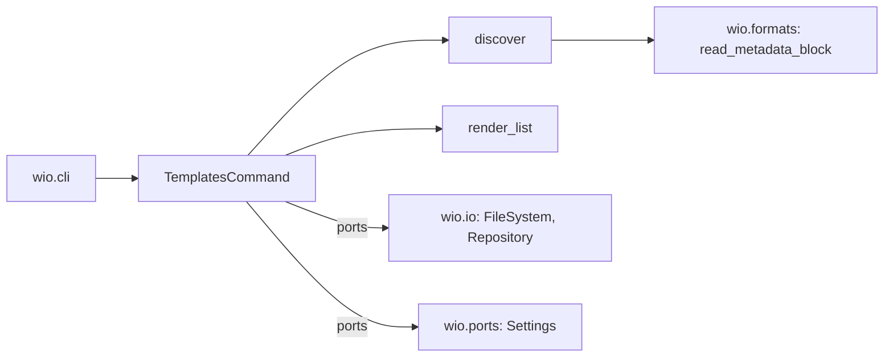

# `wio.templates`

The component behind `wio templates`: it finds the templates of a project, so
that every command that reads a template finds and builds them the same way.
Its terms are in the [glossary](../../../GLOSSARY.md), and
[Kinds and entry templates](../../../docs/concepts.md#kinds-and-entry-templates)
says what a template, a kind and an entry template are.

## Where it sits

The command reads the config through the `Settings` port, and the templates
through the `FileSystem` port, so it never knows the file or the loader. It
imports `wio.formats` for the metadata block and no other component, and
`wio.cli` wires the adapters.

## The shape of it

- **Discovery reports and does not raise.** [`discover`](discovery.py) returns
  the templates it could build and the problems it found as diagnostics, so
  `wio templates list` can refuse around them and a command that judges the
  templates can report every problem at once from the same walk.
- **`list` refuses before it filters.** A project with a template error is
  refused whatever `--kind` names, so a kind that is not declared never hides a
  broken template.
- **The walk is the Works directory's.** Finding templates follows the rules of
  [Which files are Works](../../../docs/concepts.md#which-files-are-works), so a
  file is a template by the same test as a Work is a contract.
- **A template is named by its file,** which is why a template has no `name`
  key and a name cannot differ from where the template lives.
