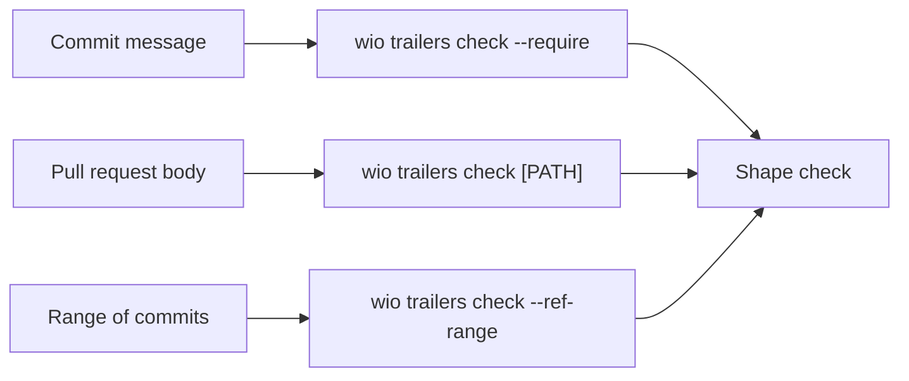

# `wio.trailers`

The component behind `wio trailers`: it prints, judges and folds the records of
commits, finds the commit a gate reviewed and records a gate's result, and runs
as one command, so that every command that handles a record reads and writes it
the same way. A [record](../../../GLOSSARY.md) is a paragraph of `Wio-*`
trailers, and [Records](../../../docs/concepts.md#records) says what each key
means. The component reads the Works through the `Contracts` port of
[`ports.pyi`](ports.pyi) and the config through the shared ports, and it never
knows git, the files or the Works directory.

## Validating the fields of a record

`validate_record` and `validate_names` in [`validation.py`](validation.py) are
the one judgment of a record's fields against the config and the Works, so the
write command and the commit-time check cannot disagree about a record. Their
docstrings say what each takes and returns, `Field` says what a field holds, and
the [tests](../../../tests/unit/trailers/test_validation.py) say how each case
reads.

- **The record's form is not judged here.** The validator takes a record that
  passed the [shape check](../formats/README.md#the-records-of-a-message), so
  its keys are known and its values are well formed. A `Wio-Work: none` record
  has no other key, and the validator has nothing to check on it.
- **A field is a key, a value and an optional line.** The write command builds a
  record from its arguments, which have no lines, and the check reads one from a
  message, so the line is optional and a diagnostic is placed by the line when
  there is one and by the key when there is none.
- **A Work that no one has is an error, and the rest is still checked.** The
  lookup of the `Contracts` port says whether a Work exists, so a record that
  names an absent Work is refused for it, and its other fields are judged on
  their own, except what depends on the Work, which is its items and its
  pipeline.
- **A name the config lacks is an error, and never also a warning.** An action
  or a stage that the config does not have is refused once. A stage that the
  config has but that the Work's pipeline for the action does not list, and an
  action that the config has and the Work lacks, are warnings, because a record
  of such a stage is odd and not wrong. An action that the Work lacks is one
  warning for the Work and not also one for the stage, because a Work without
  the action has no pipeline to list the stage in.
- **Items are each Work's own.** An item that a Work does not have is an error
  that names the item and the Work, and a list of Works is judged Work by Work.
- **A result is present exactly on a gate.** A gate without a result and a
  result on a stage that is not a gate are errors, and a result that the
  config's `gates.results` does not list is one more. The two are independent,
  because each says something different about the record, whether a result may
  be there and whether it is a result at all, and a person fixes them one at a
  time. The messages `result required` and `not a gate` are fixed wording, which
  the commands report as they are. A stage that the config lacks gets no check
  of its result, so the one error for the stage stands alone.
- **The diagnostics come in the order of the fields.** The Work, the action, the
  stage, the items and then the result, an absent field at the place it would
  have, and a warning of a field before an error of a later one, so that the
  same record gives the same lines wherever it is checked.
- **The judge is not judged here.** `Wio-Judge` is checked against its gate by
  the command that records a gate's result.
- **`validate_names` is the names alone, for the later check.** It returns only
  the errors for an action or a stage that the config lacks and for a result
  that `gates.results` does not list, whatever the stage is, and never reads a
  Work, so that the check of a range of commits can turn them into warnings and
  not fail on a record that was valid when it was written.

## Printing a record

`run_write` and `configure_write` in [`write.py`](write.py) are the write form
of `wio trailers`, `wio trailers <work> <action> <stage>`, which prints the
record that an agent adds to its commit message. [The command](#the-command)
dispatches on the first argument, `wio.cli` wires the ports and turns an error
into the exit code 2, so this module holds only what the form does and is run in
a test with fakes. Their
docstrings say what each takes, prints and raises, and the
[tests](../../../tests/unit/trailers/test_write.py) say how each case reads.

- **A record is printed only when every field holds, and then alone.** Nothing
  is written to standard output when anything is an error, so an agent that
  appends the output to a message never appends half a record. The findings go
  to standard error.
- **The record is built from the arguments and laid out by the shared
  renderer.** The `--items` ids are joined by a comma and one space in the order
  given, the judge is `agent` when a result is given and no judge is, and the
  lines come in the order of the keys whatever the order of the options. The
  form never lays out a line itself, so no second layout can disagree with the
  parser's.
- **An argument cannot add a line to the record.** An argument that is empty or
  holds a line end, and a judge without a result, are refused as the finding of
  their field before the record is rendered, one finding at most for a field and
  the empty or line-end one first, and the offending line shows a line end as an
  escape, so that what is printed to refuse an argument is one line too.
- **The checks run in order, and the first that finds something stops the
  rest.** The refusal of an argument, then the shape check with the reader of
  the config, and only when that finds nothing the
  [validator](#validating-the-fields-of-a-record), so a record of a wrong form
  never reaches the validator, and a finding is never reported twice. A Work
  that only `HEAD` has, because the commit being made deletes it, is still
  found, for the `Contracts` port looks in `HEAD` after the working tree, so the
  commit that retires or abandons a Work can carry its record.
- **A finding is a line on standard error that names its field.** A finding of
  form is `error: <key>: <message>` followed by the offending line, and a
  diagnostic of the validator is `<severity>: <where>: <message>` with the key
  of the field as `<where>`, because a record built from arguments has no lines.
  A warning does not stop the record, which is printed with the exit code 0, and
  a refused field is the exit code 1.
- **A call that no form accepts is a usage error and exits 2.** A Work that is a
  list is refused before the config is loaded. The
  [concepts](../../../docs/concepts.md#records) allow a list for a record, but
  this form writes one record for one Work, and a later form may write the rest.
  `none` never reaches this form, because
  [it has a form of its own](#printing-a-record-for-no-work).
  A missing stage, an unknown option or a config that cannot be read are refused
  by argparse and by the loader, so a mistake in how the command is called is
  never mistaken for a record that does not hold. The dispatch on the first
  argument belongs to [the command](#the-command) that joins the forms, and the
  turning of every such error into the exit code 2 to `wio.cli`, and not to this
  module.
- **A stage outside the Work's pipeline is a warning here as well.** The record
  is printed and the warning goes to standard error, as the validator reports
  it, because a record of such a stage is odd and not wrong.
- **A cited item is recorded by the gate form.** `--cite` is part of the same
  command, and [recording a gate's result](#recording-a-gates-result) checks it,
  so one set of options serves both.

## Printing a record for no Work

`run_nowork` and `configure_nowork` in [`nowork.py`](nowork.py) are the `none`
form of `wio trailers`, `wio trailers none`, which prints the record of a commit
that belongs to no Work, so that an agent need not type `Wio-Work: none` by
hand. [The command](#the-command) dispatches on the first argument and `wio.cli`
wires the ports, so this module holds only what the form does. The
[tests](../../../tests/unit/trailers/test_nowork.py) and the
[scenarios](../../../tests/acceptance/trailers/test_nowork.py) say how each case
reads.

- **It prints one line and takes nothing else.** The record is `Wio-Work: none`
  and a newline, rendered by the same renderer as every record, and the
  [commit-time check](#checking-a-commit-message) accepts it. A record of no
  Work allows no other key, so the form has no action, stage or option, and one
  that follows `none` is a usage error that exits 2, because ignoring it would
  hide a mistake that the shape check would only find later.
- **It is wired like the other forms.** The config is read when the command is
  wired, so a config that cannot be read, or a working directory outside a
  repository, exits 2 before anything is printed. The agent corrects the config
  in the working tree, which is where it is read from, and the form then works.
- **A list of Works stays refused.** `none,k3m9xq` is not `none`, so it reaches
  the write form and is refused like any list, and the message asks for one
  Work. `none` is the form's name, so a Work cannot be named `none`, as it
  cannot be named `check` or `fold`.

## Folding the records of a range

`fold_commits`, `render_block`, `fold_body` and `run_fold` in
[`fold.py`](fold.py) are the fold form of `wio trailers`: `fold block <range>`
prints the records of a range of commits folded, and `fold body <range>` reads a
pull request body and prints it with them at its end. A squash merge keeps only
the body, so the records of its commits are copied there, and the
[concepts](../../../docs/concepts.md#records) say what the fold keeps and which
[reader](../../../docs/concepts.md#reading-records) a folded body belongs to.
[The command](#the-command) dispatches, `wio.cli` wires the history and turns a
usage error into the exit code 2, and this module holds what the fold does, so
it is run in a test with fakes. It prints to standard output and edits no pull
request and calls no CI, which the command that adopts it in the hook and the
workflow does, and the revision range that it takes is a provisional way to name
the commits. Its docstrings say what each takes and returns, and the
[tests](../../../tests/unit/trailers/test_fold.py) say how each case reads. The
fold checks no record, which the check commands do, so a record that they would
refuse has no defined fold.

- **The fold is a function of the commits.** The same range gives the same
  records, so a reader may rely on the latest record of each Work, action and
  stage, its items and the order of the records, and a second run gives the same
  text. How many times a stage was recorded is lost, and a stage done again
  after another is not, because another record stands between the two.
- **Only neighbors merge, in two steps.** Consecutive records of one Work,
  action and stage become one at the later position, with the items united in
  order of appearance and the later result and judge, or the earlier one's when
  the later has none. Then consecutive records that differ only in the Work
  become one list. A record between two others is never merged across, because a
  child that is delivered again after its parent integrated makes the parent
  stale, and merging the two deliveries would move one past that record.
- **A list names no Work twice.** A Work that a list already names starts the
  next record, so the Works `a, b, a, b` fold to `a, b` and `a, b`, which keeps
  the fold's own output valid under the check.
- **A list of Works folds like a Work at a time, and `none` is dropped.** A
  record for `a, b` is the record of `a` and then the record of `b`, so the
  later steps never meet a list, and a record that belongs to no Work has
  nothing to show.
- **A revert takes its commit's records back, and is not a record.** A commit
  that a revert in the range names leaves no record, a revert of a revert
  restores it, and a revert carries no record of its own, whatever its message
  holds. This is settled before anything is folded, so the neighbors of a
  dropped commit become consecutive. A revert is found by its line
  `This reverts commit <id>.`, which `git revert` of a merge ends with a comma,
  and the id may be abbreviated, since the pull request writes the ids it was
  given.
- **A revert of work outside the range stays visible.** The records of that work
  are not in the range, so the revert line is kept as its own paragraph before
  the records, in the block and in the body, and a reader of the body sees that
  work was undone. An id that two commits of the range share, or that names a
  later commit, names no commit of the range and is kept the same way.
- **The body ends with the fold and is left alone when it already does.** The
  paragraphs a body ends with that are records or revert lines are taken off and
  the folded ones put in their place, so an older fold is replaced and a record
  that sits inside the prose stays. They are found by their shape, and not with
  the reader of the config, because a folded body holds several paragraphs,
  which the `git` reader does not read. A body that already ends with exactly
  the folded paragraphs prints nothing, so running the fold on a body twice is
  safe in CI. The prose is kept as written, apart from the whitespace after it.
- **A range that does not resolve prints nothing.** The history port refuses it
  before anything is written, and the form turns that into the usage error that
  exits 2, so a failed fold never leaves a half-written body to be pasted.

## Checking a commit message

`check_commit_message`, `has_exempt_subject`, `configure_check` and `run_check`
in [`check.py`](check.py) are the check form of `wio trailers` in its
commit-time mode, `check --require [PATH]`, which a commit-msg hook runs. It
refuses a wrong record before the commit enters the history, so a record never
has to be repaired afterwards. [The command](#the-command) dispatches, `wio.cli`
wires the ports, and this module holds what the check does, so it is run in a
test with fakes. Its
docstrings say what each takes and returns, and the
[tests](../../../tests/unit/trailers/test_check.py) say how each case reads. A
body or a range of commits is checked
[later](#checking-a-body-or-a-range-afterwards), by a mode that shares the form
and judges the same findings more leniently, because a record that was valid
when it was written must not fail after the config or the Works have changed.

- **The records are read and judged by form first, and by the config and the
  Works second.** The shape check judges each record's own form with the reader
  of the config, and every record that is not malformed is then judged by the
  [validator](#validating-the-fields-of-a-record), so a bad record and a
  malformed one in one message are both reported and a malformed one is never
  judged by fields that cannot be trusted.
- **A form that is wrong is an error, and a key the engine does not define is a
  warning.** A record the reader cannot see is an error too, because a record
  that no one reads is a record that was not written. An unknown key is only a
  warning, deliberately: a `Wio-` key that the engine no longer defines is no
  reason to refuse a commit, though a typo of a key then passes with a warning,
  and a record with only that warning is still validated, so a stray key never
  hides a bad stage.
- **A Work that the commit deletes is still found.** The Works are looked up in
  the index and then in `HEAD`, so the commit that retires or abandons a Work
  can carry its record, which the working tree no longer holds.
- **A record is required unless git wrote the subject.** The subject is the
  first line that is not a `#` comment, because a hook sees the comments that
  git removes afterwards. A subject that starts with `Merge`, `Revert`,
  `Reapply`, `fixup!` or `squash!` and a space needs no record, because the
  person did not write it, and a look-alike such as `amend! x`, `fixup!x` or
  `Merged x` does. The exemption is only from the requirement: a record that
  such a message has is judged like any other. A message with no subject, an
  empty one or one of comments only, is not exempt.
- **Each diagnostic is a line on standard error that names its line.** It is
  `<severity>: <where>: <message>` with the 1-based line in the message, or line
  1 for a record that was not found, sorted by the line as a number, so that
  line 10 follows line 9, then errors before warnings. Nothing is written to
  standard output, and an error exits 1 and a warning does not change the exit
  code.
- **A file that cannot be read is a usage error.** The message is read from the
  file or, for `-` or no path, from standard input, and a file that cannot be
  read or decoded raises the usage error that `wio.cli` turns into exit 2, so a
  mistake in how the hook is called is never mistaken for a message that does
  not hold. A call that gives `--require` with `--ref-range` is a usage error
  too, because the commit-time mode judges one message.

## Checking a body or a range afterwards

`check_afterwards`, `check_range` and `run_later` in [`later.py`](later.py) are
the check form of `wio trailers` in its later mode, `check [PATH]` for a pull
request body and `check --ref-range RANGE` for the commits of a range. The form
chooses it when `--require` is absent, and the revision range is a provisional
way to name the commits. The two modes share what they both do through
[`report.py`](report.py), which reads a message, orders and writes the
diagnostics and turns the shape findings into diagnostics, so neither imports
the other. The docstrings say what each takes and returns, and the
[tests](../../../tests/unit/trailers/test_later.py) say how each case reads.

- **A record that was valid when it was written does not fail now.** The mode
  judges each record's form and warns about the rest, so a change of the config
  or the Works after the record was written never makes an old body or commit
  fail.
- **Only a malformed record is an error.** A line the reader cannot see and a
  key the engine does not define are warnings, unlike the commit-time mode,
  where the first is an error: a commit that is being made can still be fixed,
  and one that was merged cannot.
- **A name the config lacks is a warning.** The records that are not malformed
  are judged by `validate_names`, and each error it returns is turned into a
  warning, so a stage, an action or a result that the config no longer has is
  reported at its line and the check still passes. A malformed record is not
  also warned about, because its fields cannot be trusted.
- **A Work or an item is never looked up, and no record is required.** Works are
  deleted after they are delivered and the readers ignore ids they do not know,
  and a body or commit of no Work has no record. A body with no record, a commit
  with none and an empty range pass and print nothing.
- **A range is checked commit by commit, oldest first.** The diagnostics of a
  commit are sorted by the line as a number, then errors before warnings, and
  the place of each is the full id of the commit and the line in its message as
  `<id>:<line>`. The reader that the config names reads each message, so a
  commit whose records the `git` reader cannot see is warned about at its lines.
- **Each diagnostic is a line on standard error, and nothing goes to standard
  output.** It is `<severity>: <where>: <message>`. An error exits 1, a warning
  never changes the exit code, and the config is read once.
- **An input that cannot be read is a usage error and exits 2.** A file that
  does not exist, a range that the history port refuses and a directory that is
  not in a repository raise the usage error that `wio.cli` turns into the exit
  code 2, so a mistake in the call is never mistaken for a body that does not
  hold. A path and a range are refused together because they read different
  inputs, and an empty `--ref-range` is still a range, so it is never read as no
  range and replaced by a body from standard input.

## The two modes of the check

`wio trailers check` judges a record by the time it is made, and the two modes
above are one check at two moments. The commit-msg hook calls the commit-time
mode, `check --require`, and CI calls the afterwards mode on a pull request body
or on the commits of a range, as [Records](../../../docs/concepts.md#records)
describes. They share the shape check of [`wio.formats`](../formats/README.md),
so the same record is read and judged for its form the same way, and they differ
in what they do with the rest. The
[scenarios](../../../tests/acceptance/trailers/test_check.py) run both on a real
repository.

- **A name the config lacks is an error while the commit can still be fixed, and
  a warning afterwards.** An action, a stage or a result that the config does
  not have refuses the commit at commit time. Once the commit is written, the
  config may have moved on and the commit cannot change, so the same record only
  warns.
- **A record is required unless git wrote the subject, and only at commit
  time.** A body or a commit of no Work has no record, so the afterwards mode
  asks for none.
- **A line the reader cannot see is reported in both modes.** It is an error at
  commit time and a warning afterwards, and both name the line, because a record
  that no one reads is a record that was not written.
- **A Work or an item is looked up at commit time and never afterwards.** The
  commit-time mode finds a Work in the index and then in `HEAD`, and the later
  mode never asks, because Works are deleted after they are delivered and the
  readers ignore ids they do not know.

## Finding the reviewed commit

`reviewed_commit` in [`reviewed.py`](reviewed.py) finds the commit that a gate
judged. A gate's own commits carry only the gate's record and sit on top of the
artifact it reviewed, so the reviewed commit is the first commit, from `HEAD`
down, that holds something else, and a later reader of a record knows which
artifact a review saw. It reads the history through the `History` port and
nothing else: the recording of the result belongs to the
[gate form](#recording-a-gates-result) that composes it, and the `--reviewed`
override and the comparison with the `context` event are left to a later form.
Its docstring says what it takes and returns, and the
[tests](../../../tests/unit/trailers/test_reviewed.py) say how each case reads.

- **A pure gate commit has records, and all of them are the gate's.** The
  commit has at least one record, and every record names the gate's action and
  stage, for any Work or list of Works, because the gate commit of one Work is
  as much the gate's as another's. A commit with no record, a record of
  `Wio-Work: none`, or another record beside the gate's holds something besides
  the gate, so it is the reviewed commit.
- **The reader decides what a record is.** A gate record that the configured
  reader cannot see is not a record, so under `git` a gate record that is not in
  the last paragraph does not make a gate commit, and the commit is the
  reviewed one unless another record that the reader sees makes it a gate
  commit. The finder judges the records that the reader sees and ignores the
  lines it rejects.
- **No reviewed commit is a result, not an error.** A history of only gate
  commits, and an empty one, give `None`, so the caller decides what a gate with
  nothing under it means.
- **The walk follows the first parents, newest first.** A merge commit is one
  commit of that line, as the `History` port gives it, so the finder needs no
  rule of its own for merges.

## Recording a gate's result

`run_review`, `check_cites` and `review_event` in [`gate.py`](gate.py) are the
gate form of `wio trailers`, the write form with `--result` and `--cite`. A
review leaves no other trace of the items it cited, of the commit it saw or of
who judged, so after the fields of the record hold, the form checks what was
cited, finds the reviewed commit with
[the finder](#finding-the-reviewed-commit), writes one `review` event and then
prints the record. `ReviewEvent` in
[`wio.models.events`](../models/events.py) holds the fields the form writes, and
the Work that builds `wio log` extends it. The form reads the rules a stage
selects through the provisional `StageRules` port of [`ports.pyi`](ports.pyi),
which the rules component will satisfy; until it exists no rule is selected, so
a cited rule code is refused. The docstrings say what each takes and returns,
and the [tests](../../../tests/unit/trailers/test_gate.py) say how each case
reads.

- **The refusals come in order, and the first group that finds something stops
  the rest.** The print form's field errors come first, then the cites, then a
  history with no reviewed commit, so a mistake in the record is never reported
  together with a mistake in the review that depends on it. A refusal prints
  nothing on standard output, writes no event and exits 1.
- **A cite is an item of the Work, or a qualified rule that the stage selects.**
  A key is an item when the Work has it, and otherwise it must be a
  `ruleset.CODE` that the stage selects, which is stricter than the config
  choosing the rule and tells an item from a rule without guessing at the form
  of an id. A result outside `gates.results`, a key cited twice and a cite given
  without `--result` are refused too.
- **A refusal names what to fix.** The line is `error: <name>: <message>`, with
  `--cite` as the name for a cite that is not `KEY=RESULT` with a key and a
  result and for a `--cite` without `--result`, and the cite's own key for the
  rest. The offending line is not repeated, because the name already says which
  cite it is.
- **The judge is recorded as given, and a gate that needs a human is recorded
  twice.** `agent` is the default and a human gate is not refused for it, so a
  reviewer session and the driver each record a result and each write an event
  that the judge keeps apart. `wio trailers` cannot prove who typed `human`, and
  deciding whether a human gate passed belongs to the command that reads the
  records.
- **The event is written once, after every check passed.** It is written after a
  warning, such as a stage outside the Work's pipeline, and never on a refusal,
  so the log holds only reviews whose record was printed. It names the Work, the
  action, the stage, the reviewed commit as a full sha, the judge, the result
  and each cited key with its result, and for a rule the hash of its file that
  the `context` event records, because what is not cited was not judged.
- **A sink that fails never fails the command.** The `EventSink` port reports
  its own warning and does not raise, so the record is printed and the exit code
  is 0, because a log that cannot be written must not block a review.
- **A history with no reviewed commit is an error.** The event has nothing to
  name, so the form prints `error: Wio-Work: no reviewed commit was found` and
  records nothing.

## The write form as a whole

The print form,
[the finder of the reviewed commit](#finding-the-reviewed-commit) and
[the gate form](#recording-a-gates-result) are one write form, and what holds of
it holds of the three together. A person or an agent gets a record that the
engine checked, and a gate's review leaves a trace of the commit it judged. The
[scenarios](../../../tests/acceptance/trailers/test_write.py) run it on a real
repository, and the
[tests with a recording sink](../../../tests/integration/trailers/test_write.py)
read the events that no scenario can, because `wio.cli` wires a sink that drops
them until `wio log` exists.

- **A refusal leaves nothing behind.** A result outside `gates.results`, and a
  history with no reviewed commit, print no record, send no event and exit 1,
  so a record in a commit message and an event in the log always agree.
- **Each judge of a gate that needs a human is recorded once.** The same call
  with `--judge human` after the agent's prints the human's record and sends a
  second event of the same reviewed commit, and `wio trailers` does not decide
  whether the gate passed.
- **The command does not edit a message.** The agent adds the printed paragraph
  to its commit message, and the commit that carries a gate's record is a pure
  gate commit, so the next review still finds the work under it.

## The command

`TrailersCommand` in [`command.py`](command.py) and `TrailersSpec` in
[`__init__.py`](__init__.py) are `wio trailers`, the one command that runs the
write form, `check`, `fold` and `none`. A person or an agent reaches the forms
only through it, so it tells them apart, reaches the repository and reports a
usage mistake the same way for every form. `wio.cli` wires its ports in
[`table.py`](../cli/table.py), and this package never imports an adapter. The
docstrings say what each takes and returns, and the
[tests](../../../tests/unit/trailers/test_command.py) and the
[scenarios](../../../tests/acceptance/trailers/test_command.py) say how each
case reads.

- **The first argument chooses the form.** `check`, `fold` and `none` select
  those forms and any other value is the Work of the write form, so a Work
  cannot be named `check`, `fold` or `none`, though `wio contracts` does not
  forbid such an id. The form is chosen by the first argument, so an option
  before it is refused by the parser of the command itself, and an option after
  it belongs to the form.
- **A usage mistake exits 2, whichever form it is in.** A call with no
  argument, an unknown option, a missing or unknown argument and a form's own
  parse error raise a `TrailersError`, which `wio.cli` turns into the exit code
  2, because it turns any other code than 0 and 1 that a command returns into
  70. Nothing is written to standard output and the message says what is wrong.
  A call with no argument is a usage mistake, unlike bare `wio` and `wio
  contracts`, because the write form needs a Work, an action and a stage.
- **A form's parser must not exit the process.** Argparse's own `SystemExit`
  would escape `wio.cli`, so the forms are parsed with a parser that raises
  instead, and the `-h` of a form writes its usage to standard output and exits
  0. The help of a form is not in the contract; without it, a form's `-h` would
  end as a bug.
- **There is no `--json`, on purpose.** The write form prints a plain record to
  append to a commit message and a check sends its findings to standard error,
  so the command deviates from the convention that every command declares
  `--json`.
- **The ports are wired in `wio.cli`.** The git adapter gives the history, the
  contracts component finds a Work in the working tree and then in `HEAD`, and,
  for a commit message, in the index and then in `HEAD`, so a commit that
  deletes a Work still carries its record. Where a component does not exist yet
  the command wires a null adapter from [`null.py`](../cli/null.py): a port that
  selects no rule, so a cited rule code is refused as not selected, and a sink
  that drops every event, so a recorded gate result leaves nothing in the Wio
  home until `wio log` exists.
- **A working directory outside a repository is a usage mistake.** The git
  adapter refuses it with a `RuntimeError`, which the wiring turns into a
  `TrailersError` so that it exits 2 and not 70. The wiring reads the config for
  the Works directory that the index view lists, so a config that cannot be read
  is reported before any form runs, the help of a form included.
